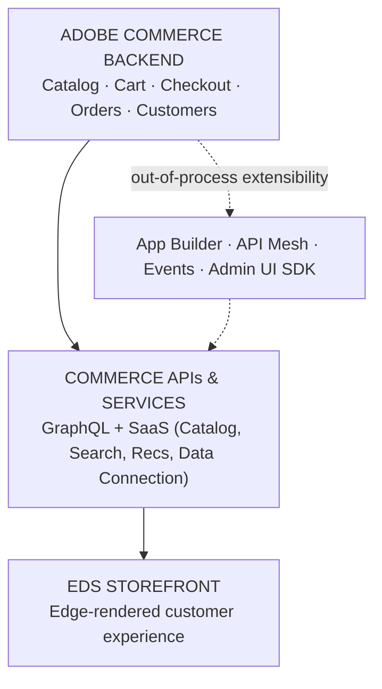

# Module 1 — Ecosystem Overview

**Source:** Part 1 of the author's LinkedIn ACCS learning series ("ACCS Architecture Overview" +
"EDS Architecture & Performance Model" diagrams), shared 2026-08-15. No product specifics below go
beyond what those diagrams and the accompanying post state.

## The mental model

For a long time, commerce platforms were built as **one tightly coupled system**: storefront,
business logic, and any custom extension all lived in the same codebase, deployed together. Change
one small thing for one channel, and you risk redeploying — and re-testing — everything.

Adobe Commerce as a Cloud Service (**ACCS**) is built on a different idea: a **composable
ecosystem**, where the storefront, the core business capabilities, and any extensibility can each
evolve **independently**. Think of it less like one monolithic building and more like a shipping
port: the warehouse (backend) doesn't need to be rebuilt every time a new crane (extension) is
added, and the trucks moving goods out (storefront) don't care how the warehouse is organized inside
— they only care about the standard containers (APIs) handed to them.

## The mechanics — the layered stack

The architecture is a **stack**, read top to bottom (customer-facing at the top, system of record at
the bottom), with one extensibility layer branching off the side rather than sitting inline:

- **Adobe Commerce Backend** — the system of record: catalog, cart, checkout, orders, customers.
  Adobe-managed infrastructure, upgraded automatically.
- **Commerce APIs & Services** — the interface layer between backend and storefront: catalog,
  search, recommendations, data connection, exposed as GraphQL + SaaS services.
- **EDS Storefront** — the edge-rendered customer experience the shopper actually sees (Module 3).
- **Out-of-process extensibility** — App Builder, API Mesh, Events, and Admin UI SDK all hang off
  the backend *without living inside it*. This is the "composable" part: extensions are separate
  deployables that call in or react to events, rather than patches to core code.

## Why this shape — the "Why ACCS" list (confirmed from source)

- **Adobe-managed infrastructure** — you don't run the servers.
- **Automatic upgrades** — because nothing custom lives inside core, Adobe can upgrade the backend
  without breaking your extensions.
- **Built-in scalability** — scaling is handled by the platform, not by capacity planning per
  merchant.
- **Composable architecture** — storefront, APIs, backend, and extensions are separate, swappable
  pieces.
- **Upgrade-safe extensibility** — because App Builder/API Mesh/Events/Admin UI SDK are
  out-of-process, an upgrade to the backend can't break them by definition (they call the backend
  through stable APIs, not through in-process code coupling).
- **Independent deployment model** — the storefront, an App Builder action, and the backend can each
  ship on their own schedule.

Four design pillars run through the whole stack: **Performance First** (optimized for speed and
efficiency), **Scalable & Resilient** (built for reliability and high availability), **Composable**
(best-of-breed, modular architecture), and **Extensible & Future Ready** (out-of-process
extensibility for continuous innovation without re-architecting).

## Where problems actually come from

Same golden-rule habit as the AEP masterclass: a symptom at one layer is often *caused* one layer
down. A slow storefront is often an API/data-layer problem, not an EDS problem. A broken custom
promo rule is an extensibility-layer problem, not a backend problem, because the backend was never
touched. Always ask *which layer* before assuming *which layer* is broken.

## Check yourself

1. Why is "automatic upgrades" possible here in a way it wasn't for a tightly coupled platform?
2. Where does App Builder sit in the stack diagram — inline in the main flow, or a branch? Why does
   that distinction matter for upgrade safety?
3. Name the three main stack layers, top to bottom, and one thing each one owns.
4. A merchant wants to change a business rule. Which layer do they touch, and which layers are
   guaranteed *not* to need a redeploy as a result?

## Running example

The confirmed running example is the **kiosk-vs-delivery promo-code scenario** — see
[scenario-walkthrough.md](scenario-walkthrough.md). This module itself is grounded in the
architecture diagrams directly; the scenario becomes most useful from Module 2 onward, once the
extensibility branch is in play.

## Still open

Module 9 (CI/CD, Observability & Ops) is not covered by the source series.
