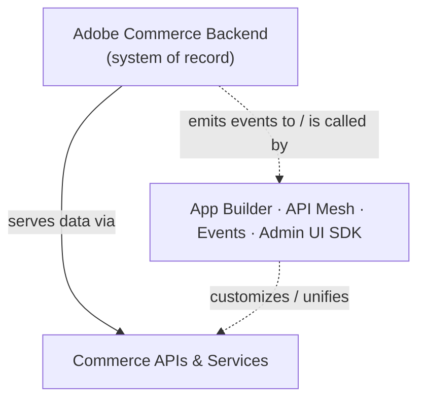

# Module 2 — ACCS Foundations

**Source:** same "ACCS Architecture Overview" diagram as Module 1 (LinkedIn series Part 1,
2026-08-15). This module goes one level deeper into the bottom two layers of the stack: the backend
itself, and why extensibility is deliberately kept out of it.

## The mental model

Think of the Adobe Commerce Backend as a **factory Adobe operates for you**. You don't own the
machines, you don't do the maintenance, and you don't get to bolt custom parts onto the assembly
line itself — but you get a fully staffed, always-upgraded factory, and a well-defined loading dock
(the API layer) where you can hook up your own trucks (extensions) without ever going inside.

The trade-off is explicit: you give up in-core customization in exchange for never being blocked by
an upgrade again.

## The mechanics

**Layer 1 — Adobe Commerce Backend.** Owns catalog, cart, checkout, orders, customers. This is the
system of record for commerce data and business logic. It's Adobe-managed: you don't patch it, you
don't run its infrastructure, and it upgrades on Adobe's cadence rather than yours.

**Layer 2 — Commerce APIs & Services.** The backend doesn't talk to the outside world directly;
everything goes through this layer — catalog, search, recommendations, and data-connection APIs
(GraphQL + SaaS services). This is also where Module 3's EDS storefront gets its data.

**The branch — Out-of-process extensibility.** Four tools, all living *outside* the backend process:

| Tool | What it's for |
|------|----------------|
| App Builder | custom serverless logic (Module 5) |
| API Mesh | unifying/customizing the API layer (Module 6) |
| Events | reacting to backend changes in real time (Module 7) |
| Admin UI SDK | extending the merchant admin UI (Module 8) |

None of these four modify backend code. They call the backend through its APIs, or they react to
events the backend emits. That's the whole trick behind "upgrade-safe extensibility" — there is
nothing inside core for an upgrade to break.

## Why this is "Commerce as a Cloud Service," specifically

The post's "Why ACCS" list, applied to this layer:

- **Adobe-managed infrastructure + automatic upgrades** — both only work *because* nothing custom
  lives inside the backend process. This is the direct payoff of the extensibility branch existing.
- **Built-in scalability** — scaling the backend is Adobe's job, not a merchant capacity-planning
  exercise.
- **Independent deployment model** — an App Builder action, an Admin UI SDK extension, and the
  backend itself can each ship on separate schedules, because none of them share a codebase.

## Grounding — the kiosk-vs-delivery promo code

See [scenario-walkthrough.md](scenario-walkthrough.md) for the full scenario. In the "old way," a
developer edits core to add a channel check, and *every* channel — web, kiosk, delivery — has to
redeploy for a one-channel rule. In the "new way," an App Builder action reacts to the condition
("channel = kiosk and code = X") entirely outside the backend: the backend is never touched, so
nothing about it needs to redeploy, and disabling the rule later means disabling one action — not
rolling back a release. This is "upgrade-safe extensibility" and "independent deployment model" made
concrete, not just bullet points.

## Common mistake

Treating "extensibility" as a downgrade from core customization. It's a *different trade*: you lose
the ability to reach into checkout/cart/catalog code directly, but you gain upgrade safety and
independent deploys. The right question when a merchant wants a customization isn't "can we edit
core," it's "which of the four out-of-process tools reacts to or calls the right part of the API
layer." (The promo-code scenario above is exactly this question, answered.)

## Check yourself

1. Why can't an App Builder action "break" on a backend upgrade the way an in-core customization
   could?
2. What's the difference in role between "Commerce APIs & Services" and "out-of-process
   extensibility" — they're drawn side by side in the diagram, but they do different jobs. What are
   those jobs?
3. A merchant asks to add custom logic to checkout. Name the two things you'd need to know before
   picking a tool: (a) does it need to change data/behavior at the API layer, or (b) does it need to
   *react* to something happening in the backend? Which tool fits which case (see table above, and
   Modules 5–7 for the full answer)?

## Still open

Modules 5–7 (App Builder, API Mesh, Events — all now written) make the extensibility branch fully
concrete. This module establishes *that* the branch exists and *why* it's shaped this way, grounded
by the promo-code scenario above; see those modules for exactly how each tool works.
