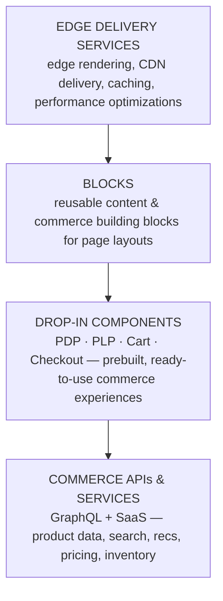

# Module 3 — EDS Storefront

**Source:** "EDS Architecture & Performance Model" diagram (LinkedIn series Part 1, 2026-08-15).

## The mental model

If Module 2's backend is the factory, EDS (Edge Delivery Services) is the **delivery network** —
optimized specifically so the customer gets the page as fast as possible, with only what they need
right now, and everything else arriving quietly afterward. The name is literal: content is delivered
from the **edge** (close to the customer), not re-computed from scratch on every request.

## Why EDS exists (confirmed from source)

- **Edge Rendering** — pages render at the edge, close to the customer.
- **Faster Page Loads** — direct consequence of edge rendering + a lightweight frontend.
- **Better Core Web Vitals** — the performance metrics Google uses to score real-world page
  experience (load speed, interactivity, visual stability) benefit directly from this model.
- **SEO Friendly** — fast, edge-rendered pages are also better for search ranking.
- **Lightweight Frontend** — minimal client-side weight by design, not an afterthought.

## The mechanics — EDS's own internal stack

EDS is itself a 4-layer stack (bottom to top):

- **Edge Delivery Services** (bottom) — the actual edge rendering/CDN/caching layer that makes the
  "why EDS" bullets above true.
- **Blocks** — reusable content *and* commerce building blocks used to compose page layouts. This is
  the customization surface (deeper dive: Module 4).
- **Drop-in Components** — prebuilt, ready-to-use experiences for the commerce-critical pages: PDP
  (Product Detail Page), PLP (Product Listing Page), Cart, Checkout. These accelerate development —
  you don't build cart/checkout UI from scratch (deeper dive: Module 4).
- **Commerce APIs & Services** (top of this diagram) — the same layer from Module 2; this is what
  Blocks and Drop-in Components call into for real data.

Alongside this stack, a set of **Storefront Services** feed the API layer: **Catalog Service**,
**Live Search**, **Product Recommendations**, **Data Connection** — the actual SaaS microservices
behind "Commerce APIs & Services."

## The mechanics — Loading Strategy

Orthogonal to the layer stack: EDS controls **when** each part of a page loads, not just how it
renders:

| Strategy | What loads | When |
|----------|-----------|------|
| **Eager Loading** | only critical, above-the-fold content | immediately, visible to the user right away |
| **Lazy Loading** | non-critical blocks and assets | after the initial render |
| **Delayed Loading** | analytics, marketing tags, chat widgets, other third-party scripts | deferred furthest — last |

This is the mechanism that actually delivers "faster page loads" and "better Core Web Vitals" — the
customer sees a usable page before the page is *fully* loaded, and the heaviest/least-critical
scripts (marketing tags, chat widgets) never get to block that first paint.

## Common mistake

Assuming a slow storefront is an EDS problem. Trace it against the stack: if Edge Delivery Services
and the loading strategy are correct but the page is still slow, the cause is very likely one layer
down — the Commerce APIs & Services layer or the Storefront Services behind it (Module 2), not EDS
itself. Same golden-rule habit as Module 1: symptom on top, cause below.

## Check yourself

1. Name EDS's four internal layers, bottom to top, and what each one owns.
2. What's the difference between a Block and a Drop-in Component? (Hint: one is a customizable
   layout primitive, the other is a prebuilt, ready-to-use page experience.)
3. A chat widget is slowing down first paint. Which loading strategy is it in, and which strategy
   should it be in instead?
4. Why does "Core Web Vitals" show up as a reason *for* EDS rather than a separate concern? What two
   mechanics (from this module) directly drive it?

## Still open

Module 4 (Drop-in Components & Custom Blocks) goes deeper on the two middle layers here — written,
see [04-dropin-components-blocks.md](04-dropin-components-blocks.md). Running example: the
kiosk-vs-delivery promo code doesn't touch EDS directly (it's backend-side logic — see Module 2's
grounding), but the storefront's role in it is simple and worth naming: it shows the discount once
applied, without ever needing a deployment itself.
