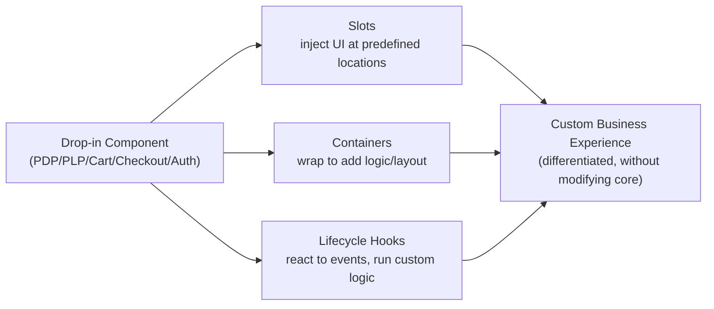
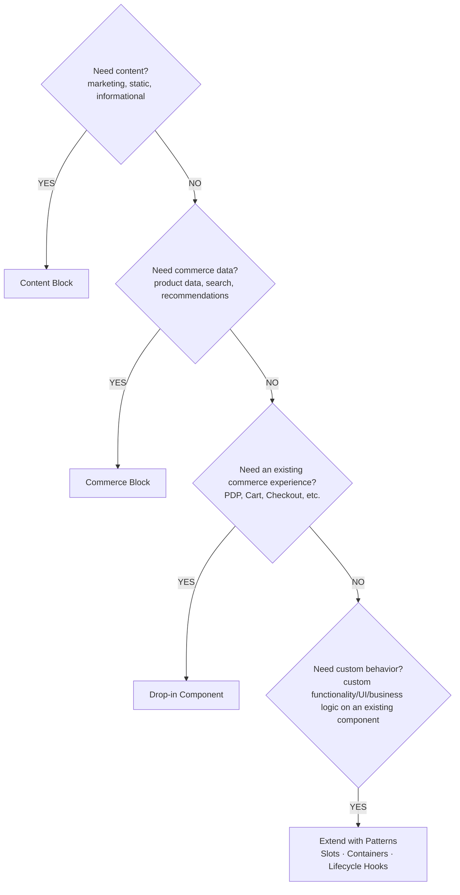

# Module 4 — Drop-in Components, Blocks & the Extensibility Decision Framework

**Source:** Part 2 of the LinkedIn ACCS learning series ("Storefront Extensibility with Drop-ins" +
"Choosing the Right Extensibility Pattern" diagrams), shared 2026-08-15.

## The mental model

The headline idea of this module isn't a feature — it's a discipline: **extensibility is not about
adding more code, it's about choosing the right extension point.** Traditional commerce
implementations default to "let's build something custom" for every new requirement. That looks
fast at first, but compounds into complexity, maintenance cost, and painful upgrades (recall Module
2: anything built *inside* core loses upgrade safety).

ACCS instead gives you a **layered extensibility model** — several mechanisms ordered from
"least code" to "most code" — and the discipline is to always reach for the *highest-level*
abstraction that solves the problem before writing anything custom. The mindset shift, in the
source's own words: stop asking *"how do we build this?"* and start asking *"what is the most
maintainable way to extend this?"*

## The mechanics — Drop-in Components

Drop-in Components are Adobe-built, ready-to-use experiences for the commerce-critical pages:

| Component | What it is |
|-----------|------------|
| **PDP** | Product Detail Page |
| **PLP** | Product Listing Page |
| **Cart** | Shopping Cart |
| **Checkout** | Checkout Experience |
| **Auth** | Authentication & Account |

**Why Drop-ins (confirmed from source):**
- **Faster Development** — go live quicker with pre-built experiences.
- **Commerce Best Practices** — built by Adobe with proven patterns.
- **Consistent UX** — unified look and feel across experiences.
- **Upgrade Friendly** — designed for compatibility with future upgrades.
- **Reduced Custom Code** — focus on business value, not rebuilding core flows.

## The mechanics — Extension Patterns ("Extend, Don't Modify")

You don't modify a Drop-in's internals — you extend it through three targeted patterns:

- **Slots** — inject custom content or UI at predefined locations.
- **Containers** — wrap a component to add logic, layout, or additional functionality around it.
- **Lifecycle Hooks** — hook into a component's events to run custom logic or integrations when
  something happens (react to events, execute custom logic).

This is what "extend, don't modify" means concretely: the Drop-in itself never changes; your
customization lives alongside it, attached at a defined point.

## The mechanics — the extensibility decision framework

This is the confirmed decision tree for *which* mechanism to reach for, in order — always try the
step above before dropping to the step below:

**Content Block vs. Commerce Block** — the two block types answer different needs:

| | Content Block | Commerce Block |
|---|---------------|-----------------|
| Nature | Content-driven experiences | Data-driven experiences |
| Used for | Marketing & informational content, landing/campaign pages | Product data, commerce insights, recommendations, search results |
| Content type | Static or semi-static | Dynamic & personalized |
| Authored in | Adobe Experience Manager (DA.live) | — |
| Data dependency | Does not depend on commerce APIs | Consumes Commerce APIs (GraphQL + SaaS Services) |
| Updates | Author-driven | Updates based on data or user context |

**Key takeaway (source's own words):** choose the highest-level abstraction that solves the problem
*before* building custom functionality.

## Where this fits the confirmed spine

Blocks and Drop-in Components both sit inside the **EDS Storefront** layer (Module 3) and both
ultimately consume the **Commerce APIs & Services** layer (Modules 2–3) when they need real data.
Extension Patterns (Slots/Containers/Hooks) are the mechanism for the *last resort* — custom code —
and even then, that code stays attached to a defined extension point rather than living inside core.

## Who uses which mechanism

Storefront development is no longer solely a developer activity — the layered model exists partly
*because* it lets different roles contribute independently:

- **Content authors** → Content Blocks, authored in Adobe Experience Manager (DA.live).
- **Merchandisers** → data/commerce-driven experiences via Commerce Blocks.
- **Frontend developers** → Drop-in Components and Extension Patterns.
- **Commerce architects** → the decision framework itself — choosing which mechanism a requirement
  should use.

Each role can act without unnecessarily impacting the others' part of the platform.

## Common mistake

Reaching for "Extend with Patterns" (custom code) first, because it's the most familiar tool. The
decision framework is ordered on purpose — Content Block, then Commerce Block, then Drop-in
Component, and only then custom extension — because each earlier option is more maintainable,
more upgrade-safe, and faster to ship than the one after it (same "upgrade-safe extensibility"
theme as Module 2, now applied at the storefront layer instead of the backend layer).

## Check yourself

1. A requirement is "show a marketing banner with today's promotion." Walk it through the decision
   framework — which mechanism do you land on, and why does it stop there instead of falling
   through to Drop-in Component or custom code?
2. What's the actual difference between a Content Block and a Commerce Block — is it about *how* it
   renders, or about *what it depends on*?
3. Name the three Extension Patterns and, for each, one sentence on what it's for.
4. Why does "extend, don't modify" matter for upgrade safety — connect it back to Module 2's
   reasoning about why the backend stays upgrade-safe.
5. A content author needs to change campaign copy on a landing page. Which mechanism do they use,
   and do they need a developer to do it?

## Still open

Note the kiosk-vs-delivery promo scenario (see [scenario-walkthrough.md](scenario-walkthrough.md))
is backend-side custom logic, not a storefront Block/Drop-in/Extension-Pattern case — it grounds
Module 5 (App Builder, written) rather than this one. Module 5 also introduces a *broader* decision
framework (storefront vs. data vs. logic vs. integration vs. admin) that this module's
Block/Drop-in/Pattern tree is a zoom-in on — see Module 5 for how the two frameworks relate.
