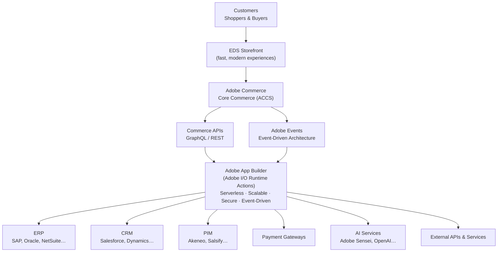
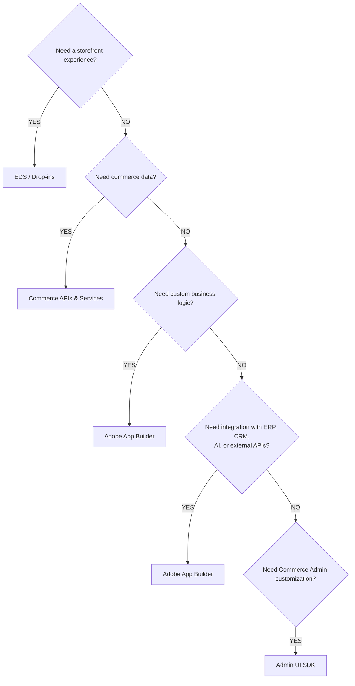

# Module 5 — App Builder

**Source:** Part 3 of the LinkedIn ACCS learning series ("Adobe App Builder — Out-of-Process
Extensibility Architecture" + "Which ACCS Extensibility Option Should You Choose?" diagrams), shared
2026-08-15.

## The mental model

The headline principle: **not every business capability belongs inside the Commerce application.**
For years, extending Commerce meant adding modules, plugins, observers, or scheduled jobs *directly
into* the application. It solved the immediate need, but it coupled your customization to the core
platform — every one of those modules/plugins/observers is something an upgrade can break.

App Builder's answer is to move custom logic and integrations **out** of Commerce entirely, into
independent serverless actions. The mindset shift, in the source's own words: stop asking *"where
should I customize Commerce?"* and start asking *"does this capability really belong inside
Commerce?"* Often the honest answer is no — keep Commerce focused on commerce, and let surrounding
capabilities (a loyalty rule, an ERP sync, a fraud check) evolve on their own.

## The mechanics — the App Builder architecture

The key wiring detail this diagram confirms: an App Builder action (an **Adobe I/O Runtime Action**)
sits downstream of *both* **Commerce APIs** (it can read/write commerce data via GraphQL/REST) *and*
**Adobe Events** (it can be triggered in real time by something happening in Commerce). From there,
it's the layer that talks *outward* — to ERP, CRM, PIM, payment gateways, AI services, or any other
external API — so integrations never have to live inside Commerce core.

**Why App Builder (confirmed from source):**
- **Serverless Architecture** — focus on business logic, not infrastructure.
- **Independent Deployment** — deploy apps independently of Commerce.
- **Independent Scaling** — scale based on business demand, not Commerce's scaling.
- **Upgrade-Safe Customizations** — no core code changes, so no upgrade impact.
- **Event-Driven Integrations** — real-time, decoupled, and resilient.
- **Reduced Core Modifications** — lower maintenance and long-term cost.

Tagline from the source: **Build once. Deploy independently. Scale independently.** *Innovation
without compromise.*

## The mechanics — the master extensibility decision framework

Part 3 gives a **broader** decision framework than Module 4's (which was scoped to *storefront*
choices). This one covers the whole ACCS stack — Module 4's Content/Commerce Block → Drop-in →
Extension Pattern tree is really a zoom-in on this framework's first branch:

Note App Builder is the answer to **two** different questions (custom business logic *and* external
integration) — both land on the same tool because both are "capabilities that don't belong inside
Commerce core."

**Extensibility Options at a Glance** (confirmed table):

| Requirement | Recommended Solution |
|---|---|
| Build a modern storefront experience | EDS / Drop-ins |
| Read or write commerce data | Commerce APIs & Services |
| Implement custom business logic | Adobe App Builder |
| Integrate with external systems/services | Adobe App Builder |
| Customize Adobe Commerce Admin | Admin UI SDK |

**Key takeaway (source's own words):** choose the platform capability that best fits the business
problem *before* introducing custom code. *Right Capability. Right Layer. Better Outcomes.*

## Grounding — the kiosk-vs-delivery promo code, resolved

This module answers the open question left in
[scenario-walkthrough.md](scenario-walkthrough.md): *how* does the App Builder action get
triggered? From the confirmed architecture above: the action can be wired to **Adobe Events** (react
in real time to something happening in the cart/checkout) and it calls **Commerce APIs** to read the
channel and apply the discount. It never touches ERP/CRM/PIM/payment/AI — this scenario only
exercises the "custom business logic" branch of the decision framework, not the "integration" branch
of App Builder. (The exact event name/trigger isn't specified by the source material — don't invent
it; this is confirmed at the architecture level, not the implementation level.)

## Where this fits the confirmed spine

App Builder is one of the four tools in the **out-of-process extensibility** branch introduced in
Module 2 (App Builder | API Mesh | Events | Admin UI SDK). This module gives App Builder's precise
wiring; Modules 6–8 will do the same for API Mesh, Events, and Admin UI SDK respectively.

## Common mistake

Assuming App Builder is *either* for custom logic *or* for integrations, and picking a different
tool for the other. The decision framework and the "options at a glance" table both confirm it's the
answer to both — the unifying idea is "this doesn't belong inside Commerce core," not "this is
specifically a logic problem" or "specifically an integration problem."

## Check yourself

1. Why does an App Builder action sit downstream of *both* Commerce APIs and Adobe Events, rather
   than just one?
2. Name three things App Builder is explicitly *not* responsible for, based on the decision
   framework (hint: look at what the other four YES-branches own).
3. In the kiosk-vs-delivery scenario, which two architecture pieces does the App Builder action
   actually touch, and which five external-system categories does it *not* need?
4. Why is "no core code changes, no upgrade impact" true for App Builder in a way it wouldn't be for
   a traditional Commerce module/plugin/observer?
5. A merchant needs to sync a new order to their ERP in real time. Walk it through the master
   decision framework — which branch do you land on, and does the answer change if "real time" is
   swapped for "nightly batch"? (The framework as given doesn't distinguish real-time vs. batch —
   flag that as a genuine open question rather than guessing.)

## Still open

- Module 6 (API Mesh) is next per the series' own preview: "how it simplifies API orchestration,
  aggregation, and secure integration across multiple backend services." Not written until Part 4
  arrives.
- The exact trigger mechanism for the kiosk-vs-delivery scenario's App Builder action (which
  specific Adobe Event, if any) remains unconfirmed.
