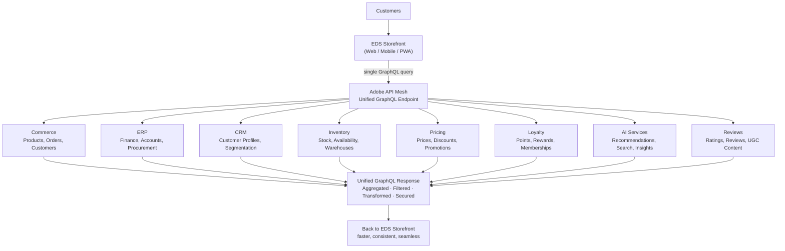

# Module 6 — API Mesh

**Source:** Part 4 of the LinkedIn ACCS learning series ("API Mesh at a Glance" — architecture +
"Before vs After API Mesh" diagrams), shared 2026-08-15. This post also included a series progress
tracker — see "Still open" below for what it changes about Modules 8–9's status.

## The mental model

Commerce is rarely the only system involved in a customer experience. Product info, inventory,
pricing, loyalty, payments, recommendations, and customer data typically live in *different*
platforms, each built for its own purpose. The hard part was never "can we integrate them" — it's
doing so in a way that stays **scalable, maintainable, and adaptable** as the ecosystem keeps
growing.

API Mesh's answer: stop tightly coupling the storefront to *every* backend service individually.
Instead, expose business capabilities through **one unified, consistent API layer**. The mindset
shift, in the source's own words: modern integration architecture isn't about exposing *more* APIs —
it's about exposing the *right* business capabilities in a simple, consumable way. Biggest takeaway
from the source: **good architecture hides complexity rather than exposing it.**

## The mechanics — the API Mesh architecture

The storefront sends **one** GraphQL query to API Mesh; API Mesh fans it out to however many backend
systems the query actually needs, then returns **one** aggregated, filtered, transformed, and
secured GraphQL response. The storefront never talks to eight different APIs directly.

**Key benefits (confirmed from source):**
- **Unified API** — a single GraphQL endpoint for all consumers.
- **Aggregation** — pull data from multiple systems into one response.
- **Federation** — combine capabilities across distributed services.
- **Security** — centralized security, policies, and access control (instead of each backend
  enforcing its own).
- **Reduced Complexity** — simpler integrations, faster delivery.

## The mechanics — before vs. after

**Without API Mesh:** the storefront calls each backend API directly (Commerce, ERP, CRM, Inventory,
Pricing, AI Services, Reviews were the ones shown). Named problems: multiple API calls, complex
integrations, tight coupling, higher latency, harder to maintain, and changes impact multiple
systems — a change to one backend can ripple into the storefront and every other consumer of it.

**With API Mesh:** the storefront calls API Mesh once; API Mesh talks to all backend systems behind
it. Named benefits: single API call, unified access layer, loose coupling, better performance,
easier to evolve, scalable & future ready.

Tagline from the source: **API Mesh powers composable commerce. One endpoint. Many systems.
Limitless possibilities.**

## Refinement to the confirmed spine

This module sharpens something Module 1's simplified spine glossed over. "Commerce APIs & Services"
in Modules 1–3 was described as ACCS's own GraphQL + SaaS layer (catalog, search, recommendations,
data connection). This diagram shows API Mesh sitting **in front of** Commerce *and* seven other
backend systems (ERP, CRM, Inventory, Pricing, Loyalty, AI Services, Reviews) — some of which
overlap with what Modules 1–3 called "Storefront Services," and some of which are entirely new
(ERP, CRM, Loyalty). So: **API Mesh is the unification mechanism**, and "Commerce APIs & Services" is
one of the several backends it unifies, not a synonym for it. Worth carrying forward rather than
silently reconciling: the master spine diagram (Module 1) is a simplification; this module and
Module 5 are where the real wiring lives.

## Where this fits the confirmed spine

API Mesh is one of the four out-of-process extensibility tools from Module 2 (App Builder | **API
Mesh** | Events | Admin UI SDK). Unlike App Builder (Module 5), which sits *behind* Commerce reacting
to events and calling APIs, API Mesh sits *in front of* the backends, between the storefront and
everything it needs data from.

## Grounding — the kiosk-vs-delivery promo code

This scenario doesn't exercise API Mesh directly — per Module 5, the App Builder action calls
Commerce APIs and reacts to Adobe Events, and neither the confirmed architecture nor the post
mentions API Mesh being involved in applying the discount. That's a genuine gap in this running
example's coverage, not an omission to paper over: API Mesh's value shows up in a *different* kind
of scenario — e.g., a PDP that needs price (Pricing), stock (Inventory), and loyalty points
(Loyalty) in one call.

## Common mistake

Treating API Mesh as "just another API gateway." The source's framing is about **hiding complexity
from consumers**, not just routing calls — the win is fewer round trips and one contract for the
storefront (or any consumer), not merely having a proxy in front of several APIs.

## Check yourself

1. In "before," name the six/seven named problems with the storefront calling backends directly.
   Which of them are really the *same* underlying problem restated?
2. Why is "Commerce APIs & Services" (Modules 1–3) not the same thing as API Mesh? What's the
   relationship between them?
3. What's the difference between Aggregation and Federation as benefits — restate each in one
   sentence.
4. Why doesn't the kiosk-vs-delivery promo scenario exercise API Mesh? What kind of requirement
   *would* need it?
5. "Good architecture hides complexity rather than exposing it" — apply that line to this module
   specifically: what complexity is being hidden, and from whom?

## Still open (historical note — resolved in Module 8)

- Module 7 (Events & Webhooks / Event-Driven Architecture) is next, confirmed by this post's own
  preview: "Adobe Events enables loosely coupled communication between Commerce and external
  systems." (Written — see `07-events-webhooks.md`.)
- **Series length, as understood at the time this module was written:** this post included a
  progress tracker showing 6 parts total with no Part 7, downgrading Module 9 (CI/CD) from "pending"
  to "uncertain." **This was fully resolved in Module 8**: Part 6 explicitly stated the series had
  concluded, confirming Module 9 is not part of it. See `08-admin-ui-sdk.md` "Still open" for the
  final word.
