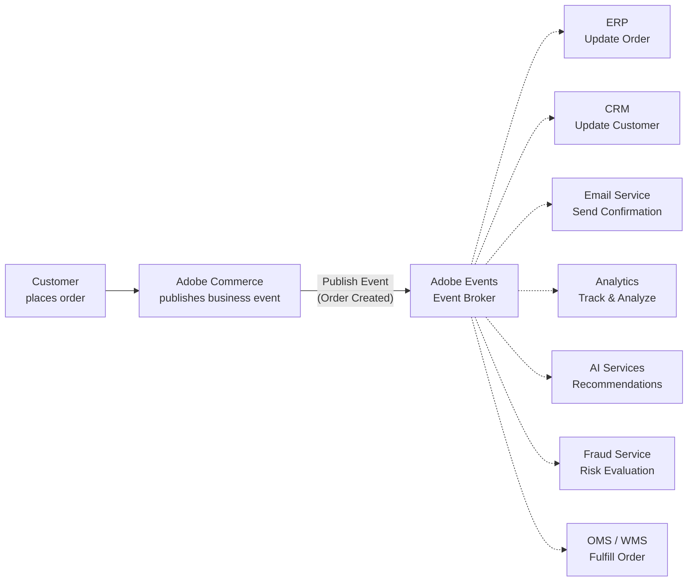

# Module 7 — Event-Driven Architecture with Adobe Events

**Source:** Part 5 of the LinkedIn ACCS learning series ("Event-Driven Architecture with Adobe
Events" + "Synchronous vs Event-Driven Communication" diagrams), shared 2026-08-15.

## The mental model

Traditionally, enterprise systems talk to each other through **direct, synchronous integrations**:
system A calls system B, waits for a response, then calls system C, and so on. It works, but it
creates tight dependencies — and the more connected applications you add, the more those
dependencies compound.

Event-driven architecture flips the communication model: instead of one system waiting for another
to finish before continuing, systems **publish business events**, and any interested application can
react **independently**. The source's framing: this isn't just a technology choice, it's a different
way of *designing* enterprise systems — one built on well-defined business events rather than direct
knowledge of every other system. Biggest takeaway, in the source's own words: **great architectures
don't rely on every system knowing about each other — they rely on well-defined business events that
allow systems to evolve independently.**

## The mechanics — the event-driven architecture flow

Adobe Commerce doesn't call ERP, CRM, email, analytics, AI services, fraud, and OMS/WMS directly —
it publishes **one** business event ("Order Created," in this example) to **Adobe Events**, the
event broker, and each interested system reacts on its own. Commerce never needs to know any of
those consumers exist.

**Key benefits (confirmed from source):**
- **Loose Coupling** — publishers and consumers don't know about each other, only about the event.
- **Asynchronous Processing** — consumers react whenever they're ready, not in lockstep with the
  publisher.
- **Scalability** — consumers scale independently of each other and of Commerce.
- **Resilience** — one consumer failing doesn't block the others or the publisher.
- **Observability** — (named as a benefit; the source doesn't detail the mechanism beyond the label
  — don't invent specifics here).
- **Event Replay & Audit** — (same: named, not detailed further in this source).

## The mechanics — synchronous vs. event-driven

**Traditional (synchronous):** Commerce → ERP → CRM → Email Service → Inventory → Loyalty, as a
**sequential chain** — each step waits on the one before it. Named problems: direct API calls,
tightly coupled, sequential processing, harder to scale, synchronous.

**Event-driven (asynchronous):** Commerce → Adobe Events (Event Broker) → fans out to ERP, CRM,
Email Service, Inventory, Loyalty **independently and in parallel**. Named benefits: publish events,
loosely coupled, independent consumers, easier to scale, asynchronous.

Tagline from the source: **React to Events. Scale Independently. Build Resilient Systems.**

## Where this fits the confirmed spine, and what's *not* fully reconciled yet

Events is one of the four out-of-process extensibility tools from Module 2 (App Builder | API Mesh
| **Events** | Admin UI SDK). Module 5 showed Adobe Events as one of two inputs feeding an **App
Builder** action. This module's diagram shows Adobe Events fanning out to business-level consumers
(ERP, CRM, Email Service, Analytics, AI Services, Fraud Service, OMS/WMS) without stating whether
each of those is *implemented as* an App Builder action or some other kind of subscriber. The two
diagrams aren't contradictory, but the source material doesn't explicitly confirm "every consumer
here is an App Builder action" — treat that as a reasonable inference, not a confirmed fact, and say
so if asked directly.

## Grounding — the kiosk-vs-delivery promo code, still not fully resolved

The "Order Created" event in this module's example is for a **different** use case (order
fulfillment fan-out to ERP/CRM/email/etc.) — it is *not* the event that would trigger the
kiosk-vs-delivery promo-code action, and shouldn't be conflated with it. The promo scenario
(`scenario-walkthrough.md`) needs an event closer to "coupon applied" or "cart updated" at
checkout time, which this source material doesn't name. That detail remains genuinely unconfirmed.

## Common mistake

Assuming "event-driven" means "no coupling at all." It's **looser** coupling, not **none** — every
consumer still has to agree on the event's shape (what "Order Created" contains). What event-driven
architecture removes is *runtime* coupling (a consumer being down doesn't block the publisher or
other consumers), not the shared contract of the event schema itself.

## Check yourself

1. In the synchronous chain, what happens to CRM, Email Service, Inventory, and Loyalty if ERP is
   slow or down? Contrast with the event-driven version.
2. Name the seven event consumers shown for "Order Created," and match each to what it does with the
   event.
3. Why is "Commerce never needs to know any of those consumers exist" the actual point, not just a
   side benefit?
4. Is every event consumer necessarily an App Builder action? What does this module's source
   material actually confirm about that, versus what would be a reasonable but unconfirmed
   inference?
5. Why doesn't the "Order Created" event in this module resolve the open question about the
   kiosk-vs-delivery promo scenario's trigger?

## Still open

- Module 8 (Admin UI SDK) is next, confirmed by this post's own preview: "extend the Adobe Commerce
  Admin experience while keeping customizations upgrade-friendly." Per Part 4's progress tracker,
  this is likely the **last** module in the series (see Module 6 "Still open" for the Module 9/CI-CD
  uncertainty — still unresolved).
- The exact event for the kiosk-vs-delivery promo scenario remains unnamed by any source so far.
- "Observability" and "Event Replay & Audit" are named benefits without mechanism detail in this
  source — don't invent how they work if asked.
