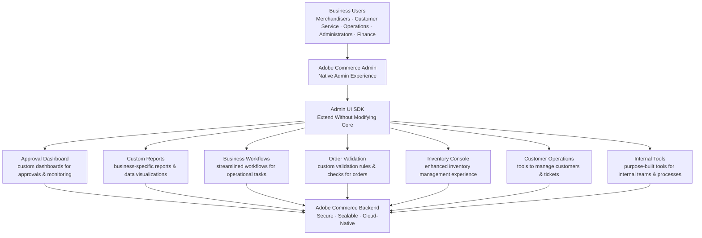

# Module 8 — Admin UI SDK

**Source:** Part 6 — the **final** part — of the LinkedIn ACCS learning series ("Extending Adobe
Commerce Admin" diagram), shared 2026-08-15. The post explicitly says "this concludes my ACCS
learning series," which confirms the series is 6 parts, no more — see "Still open" below for what
that settles about Modules 9–10.

## The mental model

Modern commerce isn't just about the customer-facing experience — it's equally about empowering the
internal teams who *run* it every day: merchandisers, customer service, operations, administrators,
finance. As a business grows, these teams need workflows and interfaces tailored to their own needs,
not just whatever the stock Commerce Admin ships with.

Admin UI SDK applies the exact same principle already seen at every other layer of this masterclass:
**extend without modifying core.** Instead of customizing core Admin pages directly, new capabilities
are built as modular extensions that plug into the existing Admin experience naturally.

## The mechanics — the Admin UI SDK architecture

Extensions built with Admin UI SDK also integrate *seamlessly* with the native Admin experience —
the source frames this explicitly as extensions appearing as a natural part of Commerce Admin, not
a bolted-on tool.

**Why Admin UI SDK (confirmed from source):**
- **Extend Without Modifying Core** — build on extension points, not core code; reduces
  customizations and upgrade risk.
- **Native Admin Experience** — extensions appear as a natural part of Adobe Commerce Admin.
- **Faster Business Workflows** — deliver tools and capabilities that make internal teams more
  efficient.
- **Upgrade-Friendly Extensions** — extensions remain compatible across platform upgrades.
- **Modular & Reusable Components** — leverage UI components and patterns for faster development.

## Where this fits the confirmed spine

Admin UI SDK is the fourth and last of the out-of-process extensibility tools from Module 2 (App
Builder | API Mesh | Events | **Admin UI SDK**). Where the other three extend Commerce toward
customers, integrations, and external systems, Admin UI SDK extends it toward the **internal** users
who operate the business — same principle (extension points, not core modification), different
audience.

## Grounding — the kiosk-vs-delivery promo code

Like Module 6 (API Mesh), this scenario doesn't exercise Admin UI SDK — it's a customer-facing
backend-logic scenario, not an internal-admin one. A natural (but unconfirmed) extension of the
scenario would be an Approval Dashboard or Custom Report letting merchandisers see which channel a
promo code is scoped to — that's a plausible fit for Admin UI SDK's stated use cases, but it isn't
part of any source material and shouldn't be taught as confirmed.

## Common mistake

Treating Admin UI SDK as "just custom Admin pages." The distinguishing feature, per the source, is
that it's built on **extension points** specifically so it survives upgrades — a raw custom Admin
page edited directly in core would reintroduce the exact upgrade risk this whole masterclass has
been building away from since Module 2.

## Check yourself

1. Name the five business-user roles shown, and one Admin UI SDK example each of them might use.
2. Why does "appears as a natural part of Adobe Commerce Admin" matter as a design goal, not just a
   nice-to-have?
3. How is Admin UI SDK's relationship to Commerce Admin analogous to App Builder's relationship to
   Commerce's business logic (Module 5)? What's the one word that describes what both avoid doing?
4. The kiosk-vs-delivery scenario doesn't touch Admin UI SDK. Why not — what's missing from the
   scenario that would make it relevant?

## Still open

This is the last module sourced directly from the LinkedIn series — the post explicitly states the
series is now concluded. That **confirms** (not just "still likely") that:
- **Module 9 (CI/CD, Observability & Ops) is not part of this series.** Downgrade its status from
  "uncertain" to "not sourced — would need separate material."
- **Module 10 (Putting It Together)** — the source material's own closing summary (see the "ACCS
  Extensibility Journey" banner in this module's diagram) effectively *is* a confirmed capstone
  already. See the new Module 10 for that content written up directly from source, rather than as a
  proposed/unconfirmed addition.
