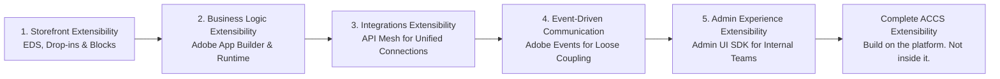

# Module 10 — Putting It Together: The ACCS Extensibility Journey

**Source:** this module is no longer a proposed/unconfirmed capstone — Part 6 (the final part) of
the LinkedIn ACCS learning series included its own closing summary diagram, "The ACCS Extensibility
Journey," which is what this module is written from directly, 2026-08-15.

## The mental model

Across six parts, one architectural principle repeats at every layer, just aimed at a different
audience each time: **build on the platform, not inside it.** The source's own closing words: *"the
best platforms are not the ones with the most customization — they're the ones designed to be
extended safely, consistently, and independently."*

## The mechanics — the confirmed extensibility journey

Mapped to this masterclass's modules:

| Journey step | What it covers | Module(s) |
|---|---|---|
| 1. Storefront Extensibility | EDS, Drop-ins & Blocks | 3–4 |
| 2. Business Logic Extensibility | Adobe App Builder & Runtime | 5 |
| 3. Integrations Extensibility | API Mesh for Unified Connections | 6 |
| 4. Event-Driven Communication | Adobe Events for Loose Coupling | 7 |
| 5. Admin Experience Extensibility | Admin UI SDK for Internal Teams | 8 |

Notice what's *not* one of the five steps: the **Adobe Commerce Backend** itself (Modules 1–2) isn't
an "extensibility" step — it's the foundation the whole journey is built *around*, never *into*.
That absence is the point: the backend stays untouched by design, and every numbered step is a way
of adding capability without ever needing to be step zero.

## Tracing the running example across the whole journey

The kiosk-vs-delivery promo-code scenario (`scenario-walkthrough.md`), placed on every step:

1. **Storefront Extensibility** — not directly exercised; the storefront's role is passive (Module
   3): it shows the discount once applied, without a deployment.
2. **Business Logic Extensibility** — the core of the scenario. An App Builder action holds the
   "if channel = kiosk and code = X, apply discount" logic (Module 5).
3. **Integrations Extensibility** — not exercised; no ERP/CRM/other external system is involved
   (Module 6's own grounding note).
4. **Event-Driven Communication** — plausible but unconfirmed: the action could react to a cart/
   checkout event, but no source names the specific event (Module 7's grounding note).
5. **Admin Experience Extensibility** — not exercised; no internal-admin tooling is part of the
   scenario as described (Module 8's grounding note).

Worth stating plainly: this scenario is a clean, worked example for **step 2** specifically. It
doesn't demonstrate the other four steps — that's a real limitation of using one small scenario as
the through-line for a five-step journey, not a gap to quietly fill with invented material.

## Common mistake

Assuming "extensibility" is a single mechanism. It's five *different* mechanisms, each solving a
different kind of change (storefront UI, business logic, integrations, real-time reactions, internal
tooling) — the unifying idea is the discipline (extend, don't modify), not a single tool.

## Check yourself

1. Why isn't the Adobe Commerce Backend one of the five journey steps?
2. Match each of the five steps to the "why [tool]" bullet list from its own module that best
   captures the *shared* theme across all five (hint: every module has an upgrade-safety bullet).
3. Walk the kiosk-vs-delivery scenario across all five steps from memory — which step is it a strong
   example of, and which steps does it not touch at all?
4. In your own words, what does "build on the platform, not inside it" mean, using one concrete
   example from two different modules?

## Still open

This module completes the confirmed portion of the masterclass (Modules 1–8, plus this capstone).
Module 9 (CI/CD, Observability & Ops) is confirmed **not** part of this source series — it would
need separate material if still wanted. No further modules are expected from the LinkedIn ACCS
series itself.
