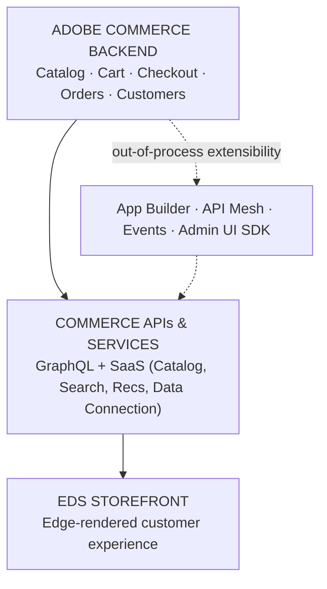
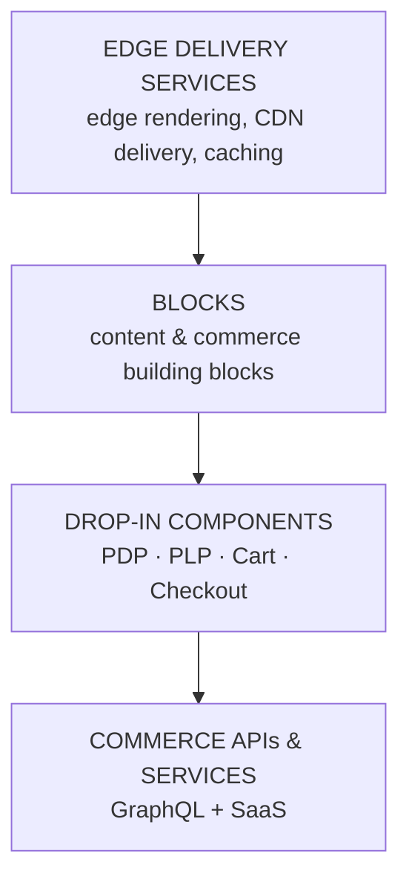

# Adobe Commerce Cloud Masterclass — Learning Skill

> **Coverage.** The spine, Modules 1–8 and the Module 10 capstone are written from the author's
> six-part ACCS learning series (2026-08-15). Module 9 (CI/CD, Observability & Ops) is **not**
> covered — if asked, say so and point to the official Adobe Commerce docs.

## Purpose

Take someone who is **completely new** to the Adobe Commerce Cloud extensibility stack and teach
them, from zero, how **App Builder**, **API Mesh**, **Events & Webhooks**, **ACCS**, and **EDS**
actually fit together into one architecture — and why that architecture exists (smaller blast
radius, independent deploys per channel, no more "redeploy everything for one channel's rule").

This is a **teaching** skill, not a reference dump, same as `adobe-experience-masterclass`: the
learner asks to learn a topic, the skill explains it the way an implementation team actually
experiences it, then checks understanding before moving on.

The content should be grounded in two things, same pattern as the AEP masterclass:

1. **A concrete running example** — the **kiosk-vs-delivery promo-code scenario** (a retailer wants
   a promo code that only works on the in-store kiosk, not the delivery app). It plays the same role
   as the AEP masterclass's Luma scenario. See [scenario-walkthrough.md](scenario-walkthrough.md).
2. **The end-to-end architecture** — confirmed spine below (from the ACCS/EDS architecture
   diagrams); every concept gets placed on it.

## When to use

- Someone says "I'm new to App Builder / ACCS / EDS, teach me" or asks how any part of the stack
  works (serverless actions, event webhooks, API Mesh, headless storefronts).
- A learner wants a structured path through the stack rather than scattered answers.
- Someone wants a term explained simply — see `glossary.md`.
- Someone wants to trace what happens to a request/change as it moves through the architecture.

## When NOT to use

- Adobe Experience Platform / AJO / CJA / RTCDP concepts — that's `adobe-experience-masterclass`.
- Magento on-prem/PaaS-specific DevOps (cloud CLI, deploys, cron) — not covered here; point to the
  Adobe Commerce on Cloud infrastructure docs.
- Production incident debugging on a real environment — this teaches concepts and mental models, not
  a substitute for official Adobe docs for a specific API/SDK version.

## How to teach (the operating rules)

1. **Meet the learner where they are.** Assume no prior App Builder/ACCS/EDS knowledge. Define every
   acronym the first time it appears.
2. **One mental model at a time.** Analogy/mental model → mechanics → grounding example, in that
   order, per module.
3. **Always connect back to the spine** (below) and say what breaks/where the blast radius
   lands if a piece is skipped or done wrong.
4. **Ground it in the running example** once one is agreed (see Purpose, item 1).
5. **Check understanding before advancing** — end with self-check questions, offer the next module.
6. **Be honest about depth** — point to official Adobe docs for at-scale/advanced/version-specific
   detail rather than inventing specifics.
7. **Teach visually with Mermaid diagrams**, same convention as the AEP masterclass.

## The architecture (confirmed spine — from the ACCS/EDS diagrams, Part 1 of the series)

Reasoning (confirmed from source diagrams, not guessed): **Adobe Commerce Backend** is the system of
record — catalog, cart, checkout, orders, customers — and it's Adobe-managed (automatic upgrades,
built-in scalability). It never gets customized in place; instead **out-of-process extensibility**
(App Builder for custom logic, API Mesh for unifying APIs, Events for reacting in real time, Admin UI
SDK for extending the admin) hangs off the backend without touching it — that's what makes upgrades
"upgrade-safe." The backend's data/logic surfaces through the **Commerce APIs & Services** layer
(GraphQL + SaaS services: catalog, search, recommendations, data connection), which the
**EDS Storefront** consumes to render the edge-delivered customer experience. This is a *layered*
architecture (top-to-bottom in the diagram), not the AEP-style left-to-right pipeline — the
extensibility layer is a branch, not a stage.

EDS itself decomposes into its own internal stack (see Module 3):

App Builder's own wiring is more precise than the coarse extensibility branch above suggests (see
Module 5): an App Builder action sits downstream of *both* Commerce APIs (GraphQL/REST) *and* Adobe
Events, and is itself upstream of external systems (ERP, CRM, PIM, payment, AI services, third-party
APIs). Each of the other three extensibility tools (API Mesh, Events, Admin UI SDK) gets the same
precision treatment in its own module (6–8) as it's written.

## The learning path

Module order follows the series' own announced roadmap (LinkedIn Part 1 post, 2026-08-15), not an
invented curriculum.

| # | Module | The one question it answers | File | Status |
|---|--------|-----------------------------|------|--------|
| 1 | Ecosystem Overview | Why is modern commerce composable, and how do the layers connect? | `01-ecosystem-overview.md` | written |
| 2 | ACCS Foundations | What does Adobe manage, and why is out-of-process extensibility "upgrade-safe"? | `02-accs-foundations.md` | written |
| 3 | EDS Storefront | How does Edge Delivery Services render a fast, composable storefront? | `03-eds-storefront.md` | written |
| 4 | Drop-in Components & Custom Blocks | How do prebuilt commerce UI and custom blocks fit together, and how do you choose the right extension point? | `04-dropin-components-blocks.md` | written |
| 5 | App Builder | How do I extend Commerce without touching core code, and which capabilities move outside Commerce entirely? | `05-app-builder.md` | written |
| 6 | API Mesh | How do multiple backend systems become one GraphQL endpoint? | `06-api-mesh.md` | written |
| 7 | Events & Webhooks (Event-Driven Architecture) | How does "reacting in real time" actually work, and what does publishing a business event buy you over a direct call? | `07-events-webhooks.md` | written |
| 8 | Admin UI SDK | How do I extend the Commerce admin for internal teams without core customization? | `08-admin-ui-sdk.md` | written |
| 9 | CI/CD, Observability & Ops | How do you deploy, monitor, and operate this stack safely? | `09-cicd-observability-ops.md` | **confirmed not part of this series** — would need separate source material |
| 10 | Putting It Together — The ACCS Extensibility Journey | How do all five extensibility mechanisms combine, and what's the one principle behind all of them? | `10-putting-it-together.md` | written — from the series' own closing summary (Part 6) |

## Commands

- `/learn accs [topic]` — start or continue the masterclass. Topics map to modules: `accs` (1–2),
  `eds storefront` (3), `drop-ins` (4), `app builder` (5), `api mesh` (6), `events` (7),
  `admin ui` (8), `putting it together` (10). For hands-on App Builder, use `/learn appbuilder`.
- `/define accs [term]` — plain-English definition of one term, backed by [glossary.md](glossary.md).
- `/simulate accs [scenario]` — trace a request/change through the architecture, backed by
  [scenario-walkthrough.md](scenario-walkthrough.md).
- `/quiz accs [topic]` — quiz + grade.

There is no week-by-week program for this product, so `/enablement` doesn't apply; use `/learn`.

## Known gaps

1. Module 9 (CI/CD, Observability & Ops) is not covered.
2. Two threads are left open by the source itself: (a) the exact trigger (Adobe Event name) for the
   kiosk-vs-delivery scenario's App Builder action, and (b) whether Module 7's named event consumers
   (ERP/CRM/etc.) are always implemented as App Builder actions. Don't invent either if asked.
3. The running example ([scenario-walkthrough.md](scenario-walkthrough.md)) only fully exercises one
   of the five extensibility mechanisms (App Builder/Module 5) — see Module 10's honest accounting of
   which steps it does and doesn't demonstrate. For the others, teach from the module itself and say
   the running example doesn't cover it.
