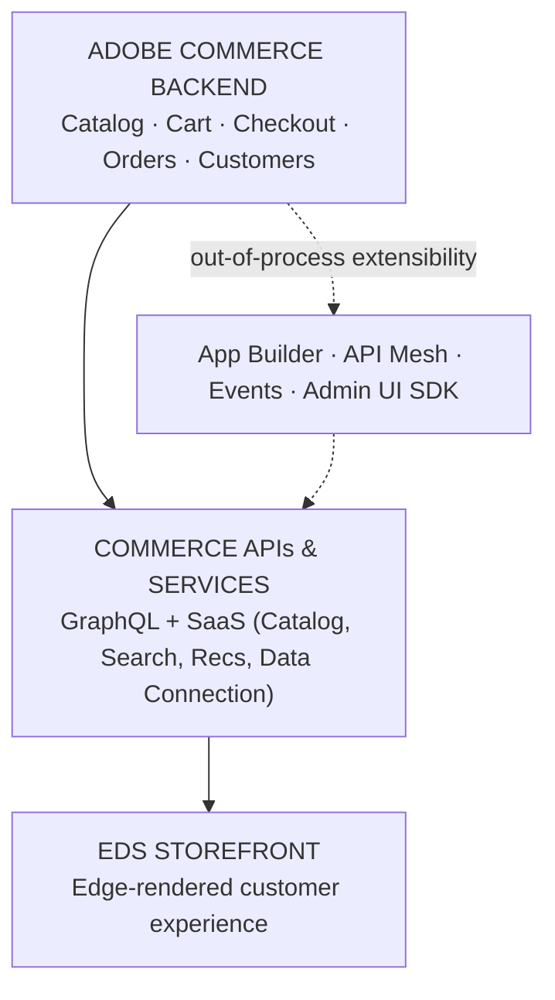

# Learning Path

## The spine

A layered stack (top = customer-facing, bottom = system of record), with extensibility branching off
the backend rather than sitting inline. See Module 1 for the full reasoning.

## Curriculum

Order follows the LinkedIn ACCS learning series' own announced roadmap — not an invented sequence.

| # | Module | Depends on | Status |
|---|--------|-----------|--------|
| 1 | Ecosystem Overview | — | written |
| 2 | ACCS Foundations | 1 | written |
| 3 | EDS Storefront | 1–2 | written |
| 4 | Drop-in Components & Custom Blocks | 3 | written |
| 5 | App Builder | 2 | written |
| 6 | API Mesh | 1–3 | written |
| 7 | Events & Webhooks | 2, 5 | written |
| 8 | Admin UI SDK | 2 | written |
| 9 | CI/CD, Observability & Ops | all of the above | **confirmed not part of this series** |
| 10 | Putting It Together — The ACCS Extensibility Journey | 3–8 | written — from the series' own closing summary (Part 6) |

## Running example

Confirmed: the kiosk-vs-delivery promo-code scenario — see
[scenario-walkthrough.md](scenario-walkthrough.md). It grounds Module 2 (extensibility branch),
Module 3 (the storefront's passive role), and Module 5 (App Builder), which resolves it down to the
architecture level (Commerce APIs + Adobe Events feed the action; no external system is touched).
It does **not** exercise Module 6 (API Mesh) or Module 8 (Admin UI SDK) — known gaps, not filled with
invented examples. Module 7 (Events) confirms the general pub/sub pattern but its own worked example
("Order Created") is for a different use case; the specific event this scenario would use remains
unnamed. Module 10 gives the full honest accounting: this scenario is a strong worked example for
exactly one of the five extensibility mechanisms (App Builder, Module 5).

## Prerequisites / time estimates

Not yet estimated.

## Open items

- Module 9 (CI/CD) is confirmed **not** part of this series (Part 6 explicitly concluded it at 6
  parts) — would need separate source material.
- The exact Adobe Event name for the promo scenario's trigger, and whether Module 7's named event
  consumers are always App Builder actions, remain genuinely unconfirmed by any source so far.
