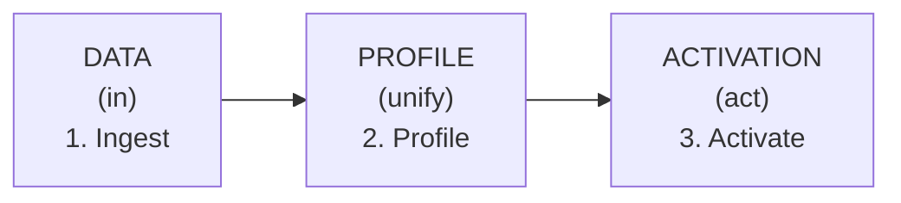
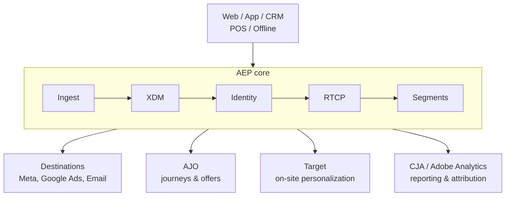

# Module 01 — Ecosystem Overview

> The one question: **Why does AEP exist, and how do the Experience Cloud apps connect?**
> Spine position: the whole spine, from 10,000 feet.

## The mental model

Start with the pain, because that's why the platform exists.

A customer buys a coffee machine. Fifteen minutes later they get an email: *"Still thinking about
buying?"* That embarrassing mistake happens every day, and it happens for one reason: **customer
data lives in disconnected systems.** The website knows one thing, the CRM another, the mobile app a
third, the email tool a fourth, the in-store POS a fifth. Different systems, different identifiers,
different versions of the same person. The average enterprise runs ~90+ marketing tools that barely
talk to each other.

Adobe Experience Platform exists to fix exactly that: **connect the entire customer story, in real
time, into one unified view** that every downstream experience can act on.

The single most important reframe for a beginner:

> **AEP is not "another marketing tool." It is the foundation layer that the other Adobe
> applications are built on. AEP is the engine; the other apps are powered by it.**

Once that clicks, the whole ecosystem stops looking like a pile of disconnected products and starts
looking like one system with a shared core.

## The mechanics — the three pillars

AEP works in three core layers. Teach these three words first; everything else hangs off them:

1. **INGEST (Data In)** — collect data from everywhere: websites, mobile apps, CRMs, POS systems,
   offline files, streaming events. → Module 02.
2. **PROFILE (Unified View)** — resolve identities and assemble everything about a person into one
   **Real-Time Customer Profile.** → Modules 05–07.
3. **ACTIVATE (Action Out)** — use that unified intelligence for personalization, audiences,
   journeys, and cross-channel experiences. → Modules 08–11.

Simple concept, complex execution underneath — and this masterclass is about the execution.

## How the apps connect

The Experience Cloud apps feel disconnected until you see that they all sit on the AEP core:

- **RTCDP** — the "audiences & activation" application packaged on AEP. Build audiences, send them
  out.
- **AJO (Adobe Journey Optimizer)** — reads the unified profile, evaluates segment rules, and
  triggers real-time journeys and offers.
- **CJA (Customer Journey Analytics)** — reports on the same AEP datasets: funnels, ROI, journey
  performance. **Adobe Analytics** is the older web-analytics product; CJA is the AEP-native
  evolution that blends online + offline on the shared identity.
- **Adobe Target** — personalizes what a visitor sees on your own site/app.
- **Adobe Campaign** — the earlier messaging product; AJO is its AEP-native successor.

Because they share one core, a decision made *once* in AEP (this person is a "ChurnRisk") is
available *everywhere* — the journey, the ad audience, and the report all see the same truth.

## Grounded in Luma

In the simulator this is the three tabs: **AEP (Identity & Profiles)** → **AJO (Journeys & Offers)**
→ **CJA (Analytics & Metrics)**. Aaron Stone's `productView` on "Lavazza Pro" is ingested once, and
then the *same* event powers his profile (Tab 1), his journey/offer eligibility (Tab 2), and the
conversion funnel count (Tab 3). One data spine, three experiences. See
[simulator-walkthrough.md](simulator-walkthrough.md).

## Grounded in Retail (a real convenience & fuel retail chain)

A confirmed real-world variant of this exact architecture, from a national convenience & fuel
retailer: Dynamics 365 CRM is the system of record for customer identity, feeding AEP by batch;
the mobile loyalty app streams events straight to AEP's Edge Network. AEP's Decisioning feeds
**AJO** for real-time push/in-app offers, while a *separate* app — **Adobe Campaign Classic** —
owns email and batch offer management, running side by side with AJO rather than being replaced
by it (they trade files nightly over SFTP and can also call each other in real time for a single
offer). **Notably, this real estate runs with no CJA at all** — reporting is out of scope for this
architecture. That's a useful reality check for a beginner: not every org runs all three apps from
the "AEP / AJO / CJA" mental model; the three-tab picture is a teaching simplification, not a law.

## Common mistakes / misconceptions

- **Thinking AEP is "just a CDP" or "another tool."** It's the foundation the other tools stand on.
  Weak foundation → every app on top inherits the weakness.
- **Thinking the apps are independent silos.** They share the profile and the identity graph. That's
  the entire point.
- **Jumping straight to journeys/campaigns.** Beginners want to build a journey on day one. But a
  journey is only as good as the profile and identity beneath it — which is why this course spends
  Modules 02–07 on the foundation before touching AJO.

## Check yourself

1. In one sentence, why does AEP exist? (What problem does it solve?)
2. Name the three pillars and what each does.
3. True or false: AJO, CJA, and Target each maintain their own separate copy of the customer.
   Explain.
4. A stakeholder says "let's just build the abandoned-cart journey first." Why might that be
   premature?

## Where next

→ **Module 02 — Data Ingestion.** Before AEP can unify a customer, it has to *receive* the data.
That's the first pillar, and the choices made there decide whether "real-time" is even possible.
