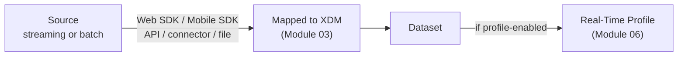

# Module 02 — Data Ingestion

> The one question: **How does data actually *get into* AEP?**
> Spine position: **Ingest** (the first pillar).

## The mental model

Before AEP can unify a customer, it has to *receive* their data. Ingestion is the front door — and
the door you walk through decides how fast you can move afterward.

The key reframe: **batch vs. streaming is not a style preference — it decides whether "real-time" is
even possible downstream.** If data arrives once a day in a batch file, no journey can react to it
in seconds, no matter how good AJO is. Latency you accept at the front door is latency you're stuck
with everywhere after it.

## The mechanics — the ways data enters

AEP accepts data through several paths. Group them into two families:

**Streaming (low latency — seconds):**
- **Web SDK (Adobe Experience Platform Web SDK / Alloy)** — the modern JS library on your website
  that sends events straight to the Adobe Edge Network. Replaces the older AppMeasurement/Launch
  approach.
- **Mobile SDK** — the equivalent for iOS/Android apps.
- **Streaming APIs / HTTP API** — send events programmatically in real time.
- **Streaming source connectors** — e.g. from a real-time event bus.

**Batch (higher latency — minutes to hours, scheduled):**
- **Batch ingestion API / file upload** — CSV, Parquet, JSON files (the simulator's
  `CustomerProfile.csv` upload is exactly this).
- **Source connectors (batch)** — pre-built connectors to CRMs, cloud storage (S3, Azure Blob,
  GCS), databases, and other Adobe apps.

Whichever path is used, the data lands in a **dataset** (a stored table conforming to a schema —
Module 03). Two things must be true for it to matter:

1. It must be **mapped to XDM** on the way in (raw fields → schema fields). → Module 03.
2. If you want it in the profile, the dataset must be **profile-enabled**. → Module 06.

## Two data shapes you're ingesting

This previews Module 03 but matters at ingestion time:
- **Record data (state)** → goes into a **Profile-class** dataset (e.g. the customer's tier, email).
  Usually batch (CRM export) or API.
- **Time-series data (events)** → goes into an **ExperienceEvent-class** dataset (a productView, a
  purchase). Usually streaming (Web/Mobile SDK).

## Grounded in Luma

Two ingestion paths, side by side in the simulator:
- **Batch:** `CustomerProfile.csv` → uploaded → becomes the `LumaCustomerProfile` schema/dataset.
  This is Aaron Stone's *state* (Silver tier, 5821 points, Keurig machine).
- **Streaming:** the "Fire ProductView / CTA Click / Conversion" buttons push ExperienceEvents into
  the **dataLayer**, which streams into AEP in real time. This is Aaron's *history* (viewed Lavazza
  Pro, clicked Add to Cart, purchased).

Notice: his stable attributes came by batch; his live behavior comes by stream. That split is
typical of a real implementation.

## Grounded in Retail

A real convenience & fuel retailer's ingestion split, confirmed end-to-end:
- **Batch:** Dynamics 365 CRM exports customer/loyalty state nightly → Azure Data Lake (SFTP
  initial load, daily delta, plus a **weekly RFM/segment extract**) → MuleSoft transforms to XDM →
  AEP's **Batch Ingestion API**, which is explicitly asynchronous and polled: `POST /batches` →
  upload the file → `POST .../?action=COMPLETE` → poll `GET /batch/{id}` until success/failure.
  This isn't fire-and-forget; a learner should notice the polling loop is itself an architecture
  decision, not an implementation detail.
- **Streaming:** the loyalty mobile app runs the Adobe Mobile SDK straight into AEP's Edge Network,
  independent of a separate tag-management SDK also running in parallel on the same app (each
  feeds its own destination directly — one doesn't relay through the other).
- **The real-time ceiling this creates:** a **Profile Update Job runs every 2–3 hours**, and the
  **Segment Qualification Job runs once daily at 3:00 AM** (a 6–7 hour run). So even though the
  mobile app streams events in seconds, any segment depending on the *batch-derived* CRM fields
  is only ever as fresh as the last nightly run — exactly the "slowest relevant input" trap this
  module warns about, playing out with real job schedules.

## Common mistakes / misconceptions

- **Choosing batch for data that needs real-time reaction.** If you want a same-session abandoned-
  cart journey, the triggering event *must* stream in. Batch-loading it kills the use case.
- **Ingesting data but never profile-enabling the dataset.** The data is "in AEP" yet never appears
  in anyone's profile — a top beginner confusion (see Module 06). Ingestion ≠ profile.
- **Skipping or fudging the XDM mapping.** Data that isn't cleanly mapped to schema fields is data
  downstream can't reliably use. Garbage in at the door is garbage in every report and journey.
- **Forgetting identity on event ingestion.** An event with no identity field can't be stitched to
  a person (Module 05) — it becomes an orphan.

## Check yourself

1. Why is "batch vs. streaming" a real-time question, not just a performance detail?
2. Which ingestion path would you use for (a) a nightly CRM export of loyalty tiers, and (b) a
   live "add to cart" click? Why?
3. Data has been ingested into a dataset but no one's profile shows it. Name two likely causes.
4. What two shapes of data are you ingesting, and which schema class does each go into?

## Where next

→ **Module 03 — XDM & Schemas.** Data is arriving; now we need to *model* it so everything
downstream understands it. This is where "just some fields" turns out to be the most important
architecture decision in the platform.
