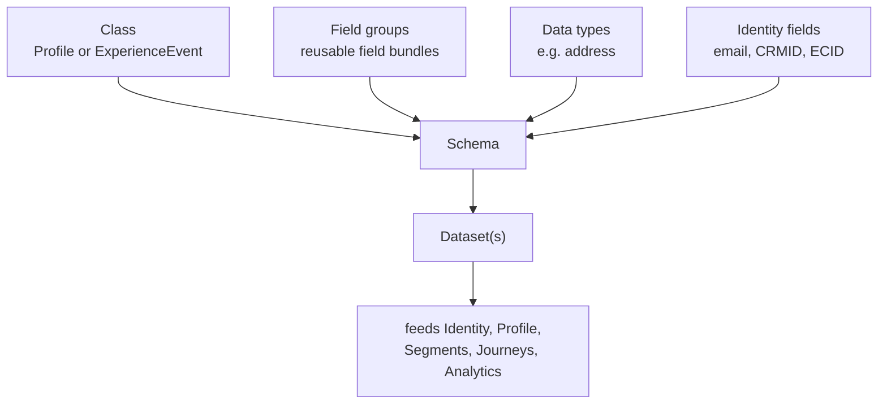
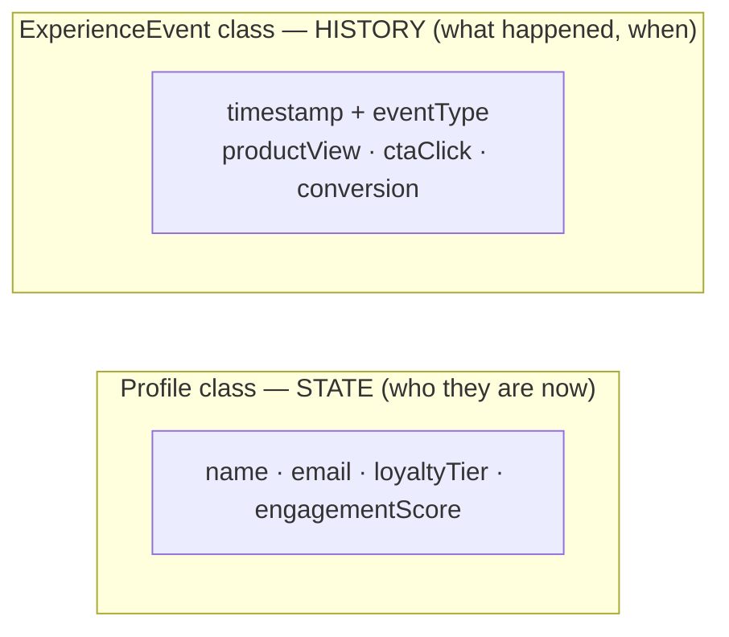

# Module 03 — XDM & Schemas

> The one question: **How is customer data *modeled* so everything downstream understands it?**
> Spine position: **Model** (right after Ingest).

## The mental model

Beginners underestimate XDM. It *looks* like "define some fields and move on." It is actually the
foundation that controls how the entire ecosystem behaves — profiles, segmentation, journeys,
personalization, and analytics all inherit whatever you decide here.

The reframe that makes it click:

> **Bad schema design doesn't stay isolated. Every downstream Adobe product inherits the problem.**

And the single most useful distinction in all of XDM:

> **Profile data represents *state*. Event data represents *history*.**
> "Who they are right now" vs. "what they did, and when."

Get those two sentences into a learner's head and schema design stops being arbitrary.

## The mechanics

**XDM (Experience Data Model)** is Adobe's open, standardized way of describing customer data as
structured JSON. Everything in AEP speaks XDM. A **schema** is one XDM definition: a set of fields
with types, built on a **class**.

The two classes you must know:

| Class | Represents | Answers | Example fields | Typical dataset |
|-------|-----------|---------|----------------|-----------------|
| **Individual Profile** | current **state** | "who is this person now?" | name, email, loyaltyTier, engagementScore | `LumaCustomerProfile` |
| **ExperienceEvent** | a single **event** in time | "what happened, and when?" | eventType, timestamp, productSKU | `LumaExperienceEventProductView` |

You compose a schema from reusable parts:
- **Class** — the top-level type (Profile or ExperienceEvent).
- **Field groups** (once called "mixins") — reusable bundles of fields (a "loyalty" group, a
  "commerce" group) you attach to a schema.
- **Data types** — reusable multi-field structures (an "address" = street + city + zip).
- **Identity fields** — fields marked as identities (email, CRMID, ECID). These are special: they're
  what Module 05 uses to stitch people together. Marking the *right* fields as identities is critical.

A schema then backs one or more **datasets** (Module 02), and the timestamp requirement is the
giveaway: ExperienceEvent schemas *require* a timestamp (history needs a "when"); Profile schemas
don't (state is "now").





## Grounded in Luma

The simulator shows both classes at once:
- `LumaCustomerProfile` (**Profile class**) holds Aaron's *state*: `customerid`, `email`,
  `loyaltypoints = 5821`, `engagementScore = 44%`, `machinetype = Keurig`. The "XDM Schema Mapping"
  panel even annotates each field's role (`customerid` = primary identity; `email` = secondary,
  used for cross-channel; `engagementScore` = used for churn prediction).
- `LumaExperienceEventProductView` / `...CTAClick` / `...Conversion` (**ExperienceEvent class**)
  hold his *history*: each row has a timestamp and an `eventType`.

The XDM payload from the simulator makes it concrete:
```json
{ "eventType": "productView", "timestamp": "2026-08-08T04:23:27.122Z",
  "customerId": "CUST-1101", "email": "user1@infinate360.in",
  "dataset": "LumaExperienceEventProductView",
  "schemaRef": "https://ns.adobe.com/xdm/context/experienceevent" }
```
`schemaRef` literally points at the ExperienceEvent class. `customerId`/`email` are the identity
fields that let this event attach to Aaron.

## Common mistakes / misconceptions

- **The "one giant schema" trap.** Cramming everything into a single mega-schema feels simple early
  and becomes unmanageable later (governance, reuse, profile bloat). Prefer well-scoped schemas with
  shared field groups.
- **Confusing state and history.** Modeling an event as a profile attribute (or vice-versa) breaks
  segmentation and analytics. Ask: "is this "who they are" or "what they did?"
- **Marking the wrong fields as identities** (e.g. `country`, `tier`). This is how identity graphs
  collapse — a whole module of pain (Module 05). Only genuinely person-unique fields are identities.
- **Treating schema work as a formality.** It's the highest-leverage decision in the platform;
  downstream teams live with it for years.

## Check yourself

1. Complete the sentence: "Profile data represents ___; Event data represents ___."
2. Which class would you use for "customer's current loyalty tier" vs. "customer redeemed an offer
   at 2:30pm"? Why?
3. Why is "one giant schema" tempting but dangerous?
4. Why is it risky to mark `customerType = Gold` as an identity field? (Preview of Module 05.)

## Where next

→ **Module 04 — Schema Registry.** You've designed schemas in the UI. But where do they actually
*live*, and what enforces the rules? The UI is only the surface.
