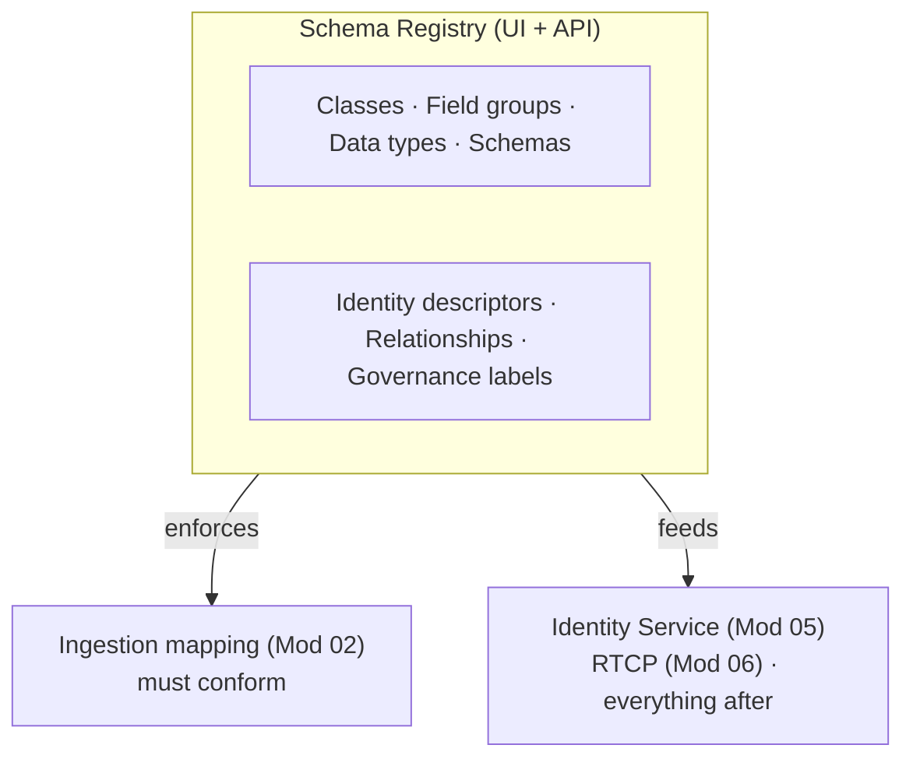

# Module 04 — Schema Registry

> The one question: **Where do schemas and their rules actually *live* and get enforced?**
> Spine position: **Model** (the enforcement layer beneath XDM).

## The mental model

When you build a schema in the AEP UI, it's easy to think the UI *is* the schema. It isn't.

> **The UI is only the surface. The real architecture lives underneath, in the Schema Registry.**

The Registry is not a passive store. It's the component that *enforces the architectural rules of
the platform*:

> **The Schema Registry is not storing schemas — it is enforcing the architectural rules that keep
> every downstream application consistent.**

This is the module where AEP stops feeling like "a marketing platform" and starts feeling like an
enterprise **data-architecture system**.

## The mechanics

The Schema Registry is the system of record for everything structural in AEP, exposed through both a
UI and a **REST API** (the Schema Registry API). It manages:

- **Classes** — the base types (Individual Profile, ExperienceEvent, plus custom classes).
- **Schemas** — full definitions built on a class.
- **Field groups & data types** — the reusable building blocks.
- **Descriptors** — metadata *about* schemas that changes platform behavior. The most important:
  - **Identity descriptors** — declare which field is an identity and in which namespace, and which
    one is the **primary** identity. This is what wires a schema into the Identity Service (Module 05).
  - **Relationship descriptors** — link two schemas (e.g. a profile to a lookup schema).
- **Governance & data usage labels** — tag fields with usage/consent constraints so activation can
  honor them later.

Two structural ideas beginners miss:
- **A schema is really a JSON architecture definition**, versioned and API-addressable — not a
  drawing in a UI. Anything the UI does, the API can do, and CI/CD-driven teams manage schemas *as
  code* through that API.
- **Schemas evolve additively.** Once a field is in use you generally *add*, not break — the
  Registry enforces backward-compatible evolution so downstream apps don't shatter.

## Grounded in Luma

In the simulator, the "XDM Schema Mapping" panel is a window into the Registry: it lists each field
of `LumaCustomerProfile`, its value, its dataset, and a **Notes** column describing its role —
`customerid` flagged as **Primary Identity**, `email` as a **secondary identity** used for
cross-channel orchestration. Those flags *are* identity descriptors living in the Registry. When
Step 4 flips "Enable Real-Time Profile," it's the Registry-level configuration that makes the schema
eligible for the profile union.

## Common mistakes / misconceptions

- **Believing the UI is the whole story.** Teams that never learn the API-and-descriptor layer make
  changes they don't understand and can't reproduce across sandboxes.
- **Sloppy identity descriptors.** Wrong primary identity, or marking a non-unique field as an
  identity, corrupts the identity graph (Module 05) — and it's configured *here*.
- **No schema governance in production.** Ad-hoc fields, duplicate field groups, and unlabeled
  sensitive data create the "reporting inconsistencies and broken journeys" that surface much later.
- **Assuming schema mistakes are downstream problems.** Broken profiles, unreliable journeys,
  inaccurate audiences, and reporting errors *usually start here*, at the schema and identity layer.

## Check yourself

1. Why is "the UI is only the surface" the key idea of this module? What's underneath?
2. What is an identity descriptor, and which later module does it directly feed?
3. Give two things the Schema Registry enforces beyond "storing fields."
4. A team reports inconsistent audience counts and journeys that misfire. Why is the schema/identity
   layer the first place to look?

## Where next

→ **Module 05 — Identity Service.** The Registry declared *which* fields are identities. Now the
Identity Service uses them to answer the platform's hardest question: how do we know all these
different IDs belong to the *same person*?
