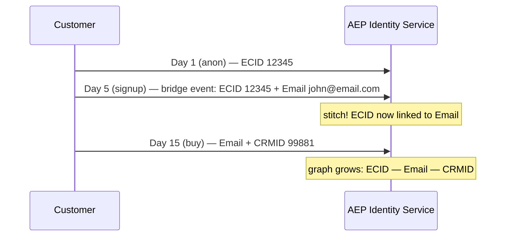
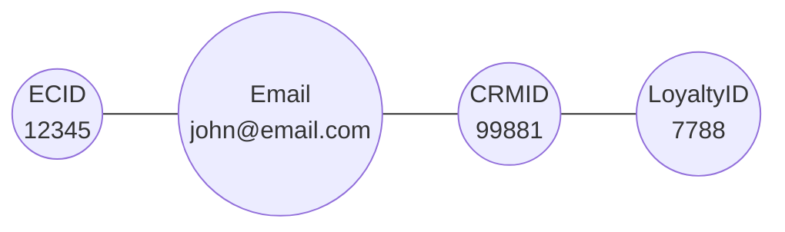
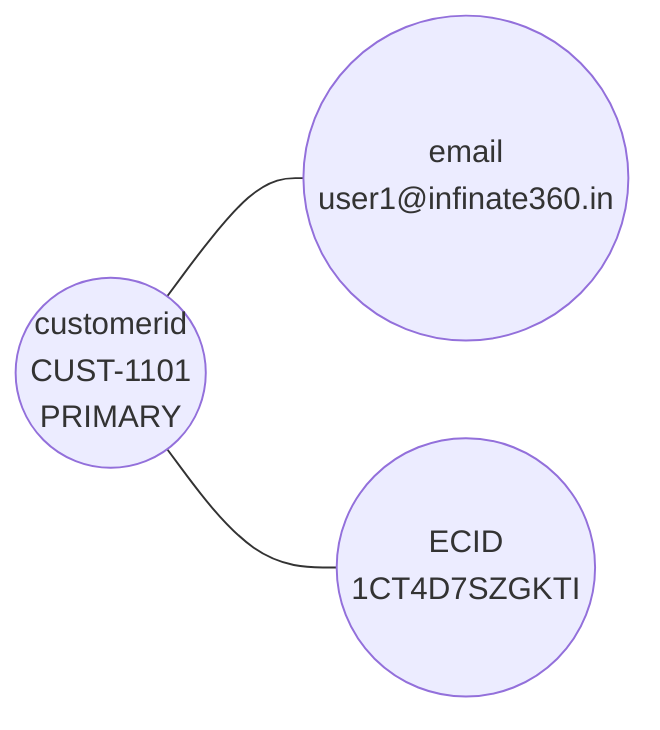
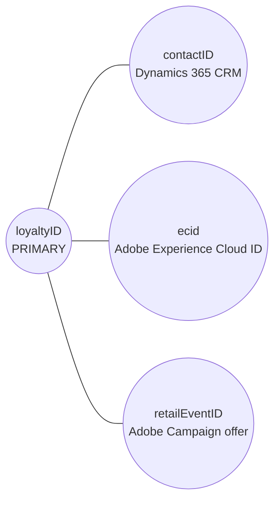
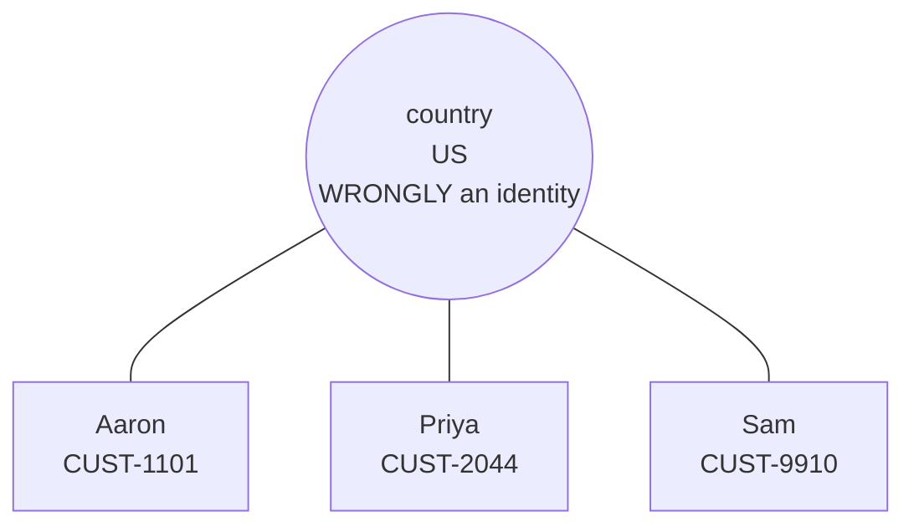

# Module 05 — Identity Service & Identity Graph

> The one question: **How does AEP know all these different IDs belong to the *same person*?**
> Spine position: **Identity** (between Model and Profile).

## The mental model

Businesses never interact with a customer through a single identifier. The same person:
- browses anonymously (website sees an **ECID**),
- logs into the app,
- buys in-store (POS sees a **loyalty number**),
- opens an email (ESP sees an **email address**),
- calls support (CRM sees a **CRM ID**).

Five systems, five identifiers, **one** human. Without resolution, AEP would create five profiles.

The reframe that unlocks the whole platform:

> **AEP does not identify *people*. It connects *identifiers*.**

AEP never asserts "this is Aaron." It asserts "ECID `1CT4D7SZGKTI` is connected to
`user1@infinate360.in`, which is connected to `CUST-1101`." Those connections form a network — the
**Identity Graph**. Profiles aren't built from data alone; they're built from the *relationships
between* data.

## The mechanics

- **Identity** = a value + a **namespace**. The namespace supplies context. `12345` alone is
  meaningless (CRM ID? loyalty ID? order ID?). `CRMID:12345` is unambiguous. **Namespaces are the
  unsung hero** — without them, stitching is unreliable.
  Common namespaces: **ECID, Email, CRMID, Phone, LoyaltyID.**
- **Identity Service** ingests every event/record, reads its identity fields (declared by the
  identity descriptors from Module 04), and updates the **Identity Graph** — the per-person web of
  connected identifiers.
- **Stitching** happens when one event carries *two* identities at once — the **bridge**. A logged-in
  purchase carries both the ECID *and* the email, so AEP can now link months of previously-anonymous
  ECID behavior to the known person.

The resulting identity graph — one person, many namespaces:

- **Known vs. anonymous.** Most journeys *start* anonymous (ECID only). The login/registration/
  purchase/form-submit is the moment anonymous behavior joins a known profile.

## Grounded in Luma

The simulator's "Identity Graph Visualization" shows exactly three nodes for Aaron Stone —
`customerid (CUST-1101)`, `email (user1@infinate360.in)`, `ECID (1CT4D7SZGKTI)` — each a different
namespace, merged into one unified profile. The caption says it outright: "Each node represents a
different identity namespace; they are merged into one unified profile." That *is* an identity graph
with `customerid` as primary and email/ECID as secondaries.

## Grounded in Retail

A real convenience & fuel retailer's identity graph resolves on **four confirmed namespaces**:
`loyaltyID`, `contactID` (the Dynamics 365 CRM record), `ecid` (Adobe Experience Cloud ID from the
app/web), and `retailEventID` (an Adobe Campaign offer identifier) — stitched into one
`Contact/Profile` node in AEP.

The bridge event here is exactly the one this module predicts: a customer browses the app
anonymously (ECID only), then **scans their loyalty card at checkout** — that single event carries
both the ECID and the loyaltyID, and months of previously-anonymous app behavior stitches onto
their known loyalty identity in that instant. One open question this real architecture hasn't
resolved either: what happens when one `loyaltyID` picks up two different `ecid`s (a phone
upgrade, a shared household device)? That's exactly the "merge policy for identity" edge case a
real implementation has to answer, not just a textbook example.

## Common mistakes / misconceptions — the expensive ones

Identity mistakes are among the costliest errors in AEP, because everything downstream sits on them.

- **Marking a non-unique field as an identity.** `country = India` or `customerType = Gold` are
  **not** identities. Configure them as such and AEP will start linking *completely unrelated*
  people who share that value.
- **Identity Graph Collapse — the nightmare.** Too many identities, wrong identities, or low-quality
  identifiers cause thousands of customers to be merged into one giant tangled graph. Once the graph
  is unreliable, *everything* built on it — profiles, audiences, journeys, reports — becomes
  unreliable too. This is the single most dangerous architecture failure in the platform.
- **Forgetting namespaces** (or reusing one namespace for different meanings) — silent, corrupting
  stitching errors.
- **Events with no identity at all** — orphaned data that can never join a profile.

**Identity Graph Collapse, drawn:** mark `country` as an identity, and three unrelated people who
all live in the US get fused into one meaningless "profile."

## Why it matters so much

Identity Service sits underneath almost everything: RTCP, segmentation, AJO, RTCDP, personalization,
even attribution all depend on it.

> **Identity Service does not create customer profiles. It creates the *relationships* that make
> customer profiles possible.**

Customer *data* is easy; customer *identity* is hard. Most organizations already have the data — the
real challenge is knowing which pieces belong together.

## Check yourself

1. Rewrite this correctly: "AEP identifies people." (What does it actually do?)
2. Why can't AEP connect the raw value `12345` to a customer without more information?
3. What is a "bridge" event, and why does one moment of login unlock months of anonymous history?
4. A team marked `loyaltyTier` as an identity and now unrelated customers share a profile. What is
   this failure called, and why is it catastrophic?

## Where next

→ **Module 06 — Real-Time Customer Profile.** The graph tells us which fragments belong to the same
person. Now: how are all those fragments *assembled* into one live, usable profile?
