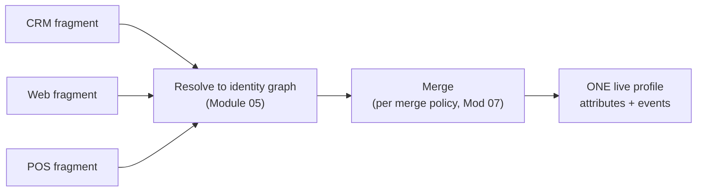

# Module 06 — Real-Time Customer Profile (RTCP)

> The one question: **How are all the fragments *assembled* into one live customer view?**
> Spine position: **Profile** (the second pillar).

## The mental model

The common beginner assumption: "Real-Time Customer Profile is a table that stores customer records."

It isn't.

> **RTCP is not a customer table. It is a real-time profile *assembly engine*.**

It doesn't sit still holding rows. It continuously assembles a customer's identity and behavior — as
data streams in and the identity graph updates, the profile it produces changes. This is the layer
where AEP starts to feel "alive": identities get stitched, profile fragments come together,
behavioral events become usable, and audiences and journeys start reacting.

## The mechanics

- A **profile fragment** is one partial contribution from one dataset (CRM contributes tier and
  email; the web contributes recent product views; the POS contributes purchases). No single system
  has the whole customer.
- RTCP takes every **profile-enabled** dataset, resolves each fragment to the **identity graph**
  (Module 05), and **merges** them into one view per person — attributes *and* the event time-series
  together.
- Two ingredients make it work:
  - **Identity Service** — decides which fragments belong to the same person.
  - **Union schema** — the auto-combined view of all profile-enabled schemas of a class, so RTCP
    knows the full set of fields that can describe a person.
- **"Real-time"** means: as a new streaming event resolves to a person, their assembled profile
  reflects it in seconds — which is what lets segmentation and journeys react immediately.

**Profile enablement is the on/off switch.** A dataset that isn't profile-enabled still stores its
data — but that data never reaches anyone's profile. This is the #1 "why can't I see my data"
confusion for beginners.

## Grounded in Luma

The simulator's "Real-Time Customer Profile" card *is* the assembled output for Aaron Stone:
identity fields (`CUST-1101`, email, ECID) + attributes (Silver, 5821 points, engagementScore 44%,
Keurig) + the event history table (productView → ctaClick → conversion). None of that lives in one
source file — it's assembled on the fly from the profile-enabled `LumaCustomerProfile` and the
`LumaExperienceEvent*` datasets, resolved to his 3-node identity graph. Step 4 in the lineage
panel ("Enable Real-Time Profile: YES") is the enablement toggle doing its job.

## Grounded in Retail

A loyalty member's assembled profile at a real convenience & fuel retailer draws from three
fragments resolved to the four-namespace identity graph (Module 05): the CRM fragment (loyalty
tier, contact details — batch, refreshed on the 2–3 hour Profile Update Job cycle), the mobile app
fragment (recent fuel purchases, app opens — streaming, seconds-fresh), and the offer/redemption
fragment from the Adobe Campaign side. None of those three systems has the whole customer — RTCP
is what makes "this loyalty member bought fuel 20 minutes ago AND is Gold tier per last night's
CRM sync" a single queryable fact, even though the two halves of that sentence arrived by
completely different paths at completely different speeds.

## Common mistakes / misconceptions

- **"It's a database table."** No — it's assembled continuously; the "row" you see is computed.
- **Forgetting profile enablement.** Data ingested but dataset not profile-enabled → invisible in
  the profile. Check this first when a field is "missing."
- **Expecting real-time from batch inputs.** If the contributing dataset arrives by daily batch, the
  profile only updates daily for those fields — "real-time" is bounded by your *slowest* relevant
  input (ties back to Module 02).
- **Assuming the profile is neutral truth.** When fragments disagree, *something* has to choose the
  winner — that's the merge policy, and it's a decision you own (Module 07).

## Why it matters

> **RTCP amplifies both good and bad architecture decisions.** Good schemas + clean identity →
> a profile that powers everything. Bad ones → the profile faithfully reproduces the mess, at scale.

Most "customer experience problems" are really data-architecture and identity problems, and RTCP is
where those earlier decisions finally become *visible*.

## Check yourself

1. Why is "assembly engine" a better description than "customer table"?
2. What two AEP capabilities does RTCP depend on to merge fragments correctly?
3. A field was ingested but doesn't appear in any profile. What's the first thing to check?
4. Can a profile be "real-time" if its loyalty tier comes from a nightly batch file? Explain.

## Where next

→ **Module 07 — Merge Policies.** RTCP merges fragments — but when two fragments *disagree* about
the same customer, which value wins? That's not automatic; you configure it.
