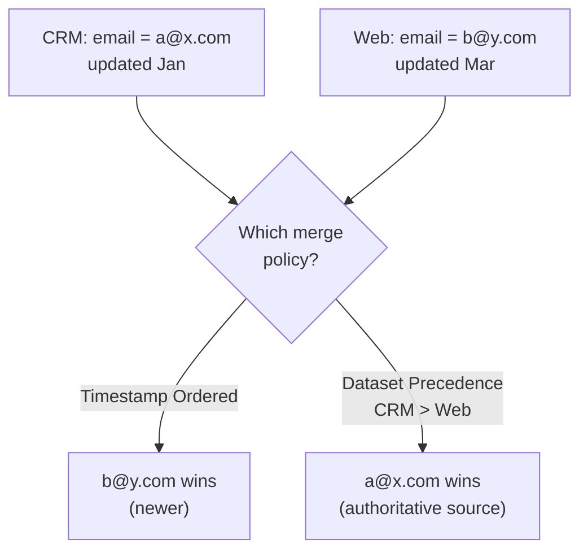

# Module 07 — Merge Policies

> The one question: **When two systems *disagree* about a customer, which data wins?**
> Spine position: **Profile** (the rulebook RTCP merges by).

## The mental model

Even after identity stitching and profile assembly, AEP still has one more decision to make. In real
enterprises, systems rarely agree:
- CRM says one email, the website captured another.
- The loyalty system says a different tier.
- Consent values changed at different times.

So the "single customer view" is messier than the architecture diagram suggests. Something must
decide which value is *the* value.

The reframe:

> **AEP does not automatically know which customer data is correct. You have to teach it what your
> business considers truth.**

And the deeper one:

> **A customer profile is not objective truth — it is *constructed* truth. The merge policy is the
> rule controlling that construction.**

## The mechanics

A **merge policy** is a set of rules RTCP applies when fragments conflict. The two core strategies:

| Strategy | How it decides the winner | Use when |
|----------|---------------------------|----------|
| **Timestamp Ordered** | most recently updated value wins | recency is the best proxy for correctness (e.g. latest known email) |
| **Dataset Precedence** | a ranked list of datasets; higher-ranked dataset wins regardless of recency | one source is authoritative (e.g. CRM outranks web-form for legal name) |

A merge policy also controls:
- **Which datasets are included** in the merge (you can scope it).
- **Identity graph selection** — which stitching ruleset to resolve with.

Crucially, **different teams can apply different merge policies to the same data** — so the "customer
view" segmentation sees can legitimately differ from the one a journey uses. That's a feature, but
it's also how "the numbers don't match" happens.

## Grounded in Luma

Aaron's profile shows one email (`user1@infinate360.in`) and one tier (Silver) — clean, because the
simulator gives a single authoritative profile source. The teaching move: ask "what if the POS
recorded a *different* email during an in-store signup?" Now RTCP must choose. Under **Timestamp
Ordered**, whichever was written last wins; under **Dataset Precedence** with CRM ranked above POS,
the CRM email wins even if the POS one is newer. His `engagementScore = 44%` driving churn logic is
only trustworthy if the merge policy is picking the *intended* source for it.

## Grounded in Retail

At a real convenience & fuel retailer, Dynamics 365 CRM is the **contractually designated system
of record** for customer PII — not a default, a deliberate decision (name/phone/email/DOB updates
flow *from* CRM *into* every downstream system, never the reverse). That single fact settles the
merge-policy question before it's even asked: **Dataset Precedence, with CRM ranked above the
mobile app**, is the only policy consistent with the business's own stated source-of-truth
decision. If a customer updates their phone number in the app and it hasn't synced to CRM yet, a
Timestamp Ordered policy would (wrongly, per this business's own rules) let the fresher app value
win. This is a case where the "right" merge policy isn't a data-quality judgment call at all — it's
just encoding a decision the business already made for unrelated (compliance/CRM-ownership)
reasons.

## Common mistakes / misconceptions

- **"Latest data is always the right data."** Not true. A stale-but-authoritative CRM value can beat
  a fresh-but-wrong web-form typo. Recency ≠ correctness.
- **Not realizing profiles are constructed.** Teams treat the profile as gospel and never ask which
  policy built it.
- **Different teams, different policies, then surprise when counts diverge.** The mismatch is often
  *correct behavior* of two different merge policies — diagnose the policy before assuming a bug.
- **Ignoring merge policy for consent/identity fields**, where picking the wrong "truth" has
  compliance consequences.

## Why it matters

Most downstream pain — broken personalization, unreliable segmentation, inconsistent journeys —
traces back to foundational profile/identity decisions, and the merge policy is the last of those
foundational decisions before data becomes an audience.

## Check yourself

1. Why isn't a customer profile "objective truth"?
2. Contrast Timestamp Ordered vs. Dataset Precedence with a one-line example where they disagree.
3. Give a case where the *older* value is the correct one to keep.
4. Two teams report different sizes for "the same" audience and both are running correctly. How can
   that be? (Hint: it may not be a bug.)

## Where next

→ **Module 08 — Segmentation.** We now have a resolved, merged profile. Time to turn profiles into
*audiences* — and to see why an audience is a living condition, not a saved list.
