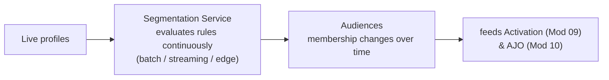

# Module 08 — Segmentation

> The one question: **How does AEP turn profiles into *audiences* that update themselves?**
> Spine position: **Segment** (the last step inside AEP core).

## The mental model

The beginner assumption: a segment is a list. Create it, save it, activate it, done.

Wrong — and it's a big "aha":

> **Segments are not lists. They are continuously evaluated *conditions*.**
> **Segmentation Service is not a list builder — it's a continuous audience-evaluation engine.**

A customer visits, views a product, adds to cart, then leaves without buying. Within moments AEP can
qualify them for an "abandonment" audience, trigger a journey, and update personalization —
**nobody rebuilt a list, nobody exported data.** The audience simply adapted to behavior. Profiles
flow *into* and *out of* an audience as their data changes.

## The mechanics

- A **segment definition** is a rule over profile attributes and/or events ("bought a coffee machine
  AND status active", "viewed a product AND no conversion in 24h").
- **Segmentation Service** continuously evaluates profiles against those rules. The *timing* of
  evaluation is the key design choice:

| Type | Evaluated | Latency | Use for |
|------|-----------|---------|---------|
| **Batch** | on a schedule (e.g. daily) | hours | large, non-urgent audiences; complex historical logic |
| **Streaming** | continuously, as data streams in | seconds–minutes | react-quickly audiences (abandonment, churn signals) |
| **Edge** | at the edge, same session | ~instant | same-page/same-session personalization |

- Whether an audience *can* be streaming depends on whether its triggering data streams in
  (Module 02) — another reason ingestion decisions echo all the way here.
- Segmentation sits directly on the resolved, merged profile, so it inherits every earlier decision:
  identity stitching (Module 05), profile assembly (Module 06), and the merge policy (Module 07). A
  wrong merge policy → the wrong people qualify.

## Grounded in Luma

The simulator's AJO tab lists four **pre-built audience segments**, each a live rule, not a list:

| Segment | Rule | Members |
|---------|------|---------|
| ActiveCoffeeBuyers | `eventType = conversion AND productCategory = "Coffee Machine" AND status = active` | 12 |
| ChurnRisk | `eventType = ctaClick AND conversionFlag = FALSE AND daysSinceLastConversion > 90` | 5 |
| HighValueLoyalists | `loyaltypoints >= 1000 AND membershipstatus = active` | 8 |
| AbandonedBrowsers | `eventType = productView AND NOT conversion within 24h` | 3 |

Best live demo: hit **"Fire ProductView"** then wait — with no conversion, that profile drifts into
`AbandonedBrowsers` on its own. Fire a **Conversion** and it can qualify for `ActiveCoffeeBuyers`
instead. The membership counts move because the *conditions* re-evaluate. Aaron (5821 points, active)
sits in `HighValueLoyalists` by rule, not because anyone added him.

## Grounded in Retail

A real convenience & fuel retailer runs segmentation on a confirmed **weekly RFM (Recency,
Frequency, Monetary) extract** feeding a batch Segment Qualification Job — a textbook example of
the "batch, hours, large non-urgent audiences, complex historical logic" row in the table above,
running at scale (daily 3:00 AM, 6–7 hour runtime) rather than continuously:

| Segment | Rule (illustrative) | Evaluation |
|---------|---------------------|------------|
| FuelLoyalists | frequent fuel purchases in trailing 30 days | Batch (RFM, weekly) |
| ChurnRisk | no purchase in 90+ days | Batch (RFM, weekly) |
| HighValueLoyalists | loyalty points above threshold, active status | Batch (CRM sync) |
| AppOpenNoOffer | opened app, no offer redemption in session | Streaming (mobile SDK) |

The first three ride the nightly/weekly CRM-driven cadence; only the last one — driven by
in-session mobile events — can be evaluated near-instantly. This is the same lesson as the
Luma `AbandonedBrowsers` example, just with the batch ceiling made concrete: **you cannot get
same-session reactivation out of a segment whose only inputs are the weekly RFM extract**, no
matter how the segment rule itself is written.

## Common mistakes / misconceptions

- **Thinking of audiences as static exports.** They're evaluated continuously; membership is fluid.
- **Expecting streaming behavior from batch-evaluated segments** (or from batch-ingested inputs).
  "Why didn't they qualify instantly?" — often because the segment or its data is batch.
- **Blaming segmentation for bad membership** when the real cause is upstream (merge policy picked
  the wrong value, identity graph merged the wrong people).
- **Over-broad rules** that qualify far more (or fewer) profiles than intended — test the count.

## Why it matters

Most personalization, journeys, and activation don't start with a campaign — they start with
**audience qualification.** Segmentation is the layer making those decisions every second, and it's
the handoff point from "AEP understands the customer" to "the connected apps act."

## Check yourself

1. Why is "continuously evaluated condition" more accurate than "list"?
2. Batch vs. streaming vs. edge segmentation — give one good use for each.
3. In the simulator, why does firing a ProductView (with no later conversion) eventually move a
   profile into `AbandonedBrowsers`?
4. An audience contains the wrong people. Name two *upstream* causes before you blame the segment
   rule.

## Where next

→ **Module 09 — Destinations & Activation.** An audience that never leaves AEP creates no value.
Time to send it somewhere it can drive action.
