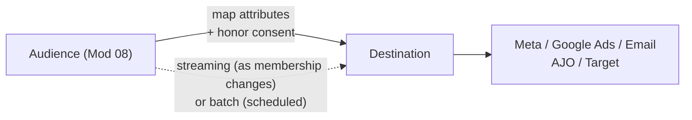

# Module 09 — Destinations & Activation

> The one question: **How do audiences *leave* AEP and drive real action?**
> Spine position: **Activate** (the first step of the "action out" half).

## The mental model

After schemas, identities, profiles, merge policies, and segments, a learner reasonably asks:
"okay… the audience exists. Now what?" If that audience never reaches Google Ads, Meta, AJO, Target,
or an email platform, does it create *any* business value?

This is where AEP stops being a system that *stores* customer intelligence and becomes one that
*drives* customer action.

> **Profiles create understanding. Activation creates outcomes.**

Nobody buys a CDP because they want better schemas. They buy it for better personalization,
journeys, and marketing. Everything in Modules 02–08 was building toward one goal: **turning
customer intelligence into action.**

## The mechanics

- A **Destination** is a pre-built connector that sends data *out* of AEP:
  - **Advertising** (Meta, Google Ads, The Trade Desk) — for paid reach/suppression.
  - **Email / marketing** (ESPs, Adobe Campaign).
  - **Adobe apps** (AJO, Target) — often via profile/audience sharing on the platform.
  - **Cloud storage / custom** (S3, HTTP) — for anything bespoke.
- **Activation** = mapping an audience (and the profile attributes it's allowed to carry) to a
  destination, honoring the governance/consent labels set back in the Schema Registry (Module 04).
- Two flavors:
  - **Audience (segment) activation** — send the *whole membership* so the platform can target/
    suppress that group.
  - **Profile activation** — send individual *attributes* for personalization (e.g. first name,
    loyalty tier) so the destination can tailor the message.
- Speed mirrors segmentation: **streaming activation** pushes membership changes as they happen;
  **batch activation** sends on a schedule.

## The one number that always surprises people

> **Audience counts rarely match across platforms — and that's usually not a bug.**

AEP might send 10,000 profiles; Meta reports 7,800 "matched." Reasons: identity **match rates** (the
destination can only use IDs it recognizes — hashed email, device ID), **hashing** differences,
**consent** filtering, and **timing** (the audience kept changing between send and report). Teach a
learner to *expect* the gap and to reason about *why*, not to panic.

## Grounded in Luma

In the simulator, activation shows up two ways:
- **To AJO:** the four segments (`ActiveCoffeeBuyers`, `ChurnRisk`, …) are "activated" into AJO where
  they become **journey entry conditions** — that's audience activation to an Adobe app (Module 10).
- **To analytics/export:** the CJA tab's "Export ProductView / CTA / Conversion CSVs" is a simple
  batch destination — data leaving AEP for downstream use. The "next steps" panel literally says:
  export → upload to a real AEP sandbox → run real segments → publish live journeys.

Profile activation is visible in offer personalization: Aaron's `machinetype = Keurig` and name ride
along so the message can be tailored — that's *attributes* activating, not just membership.

## Grounded in Retail

A real convenience & fuel retailer's activation layer does something the Luma single-app
example doesn't show: **the same audience/decisioning output fans out to two different apps for
two different channels**, not just one. AEP's Decisioning feeds:
- **AJO**, activated for **Push and In-App** — real-time, reacting the instant a person qualifies.
- **Adobe Campaign Classic**, activated for **Email and batch offer management** — but not via a
  live API call in this direction. AJO writes a segment-audience file to Azure Data Lake SFTP
  (`ajo-batchoffers-propositions`) before 5:00 PM daily; Adobe Campaign Classic reads it starting
  at 6:00 PM and exports results back on its own file (`acc-ajo-offers-metadata`).

So "activation" here isn't one flowchart arrow to one destination — it's two genuinely different
mechanisms (a live AJO handoff and a scheduled file exchange with a second app) running side by
side for the same underlying audience, each honoring the channel that app owns. A learner who only
pictures "AEP → destination → done" would miss that the *timing contract* between two Adobe apps
can itself be a nightly SFTP file, not an API call.

## Common mistakes / misconceptions

- **Building beautiful audiences that are never activated.** No destination = no outcome.
- **Panicking at count mismatches.** Expected; diagnose match rate / consent / timing instead.
- **Ignoring consent/governance on activation.** The labels from Module 04 must be honored *here* —
  sending a field to a destination it wasn't consented for is a real compliance failure.
- **Confusing audience vs. profile activation.** Sending membership when you needed attributes (or
  vice-versa) breaks personalization.

## Check yourself

1. Complete: "Profiles create ___; activation creates ___."
2. Difference between audience activation and profile activation — one example of each.
3. AEP sent 10,000 but Meta matched 7,800. Give three legitimate reasons that isn't a bug.
4. Where were the consent/governance labels defined that activation must now honor? (Trace it back.)

## Where next

→ **Module 10 — AJO: Journeys & Offers.** Activation into AJO is where audiences become
*orchestrated* real-time journeys and personalized offers.
