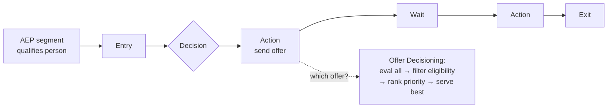
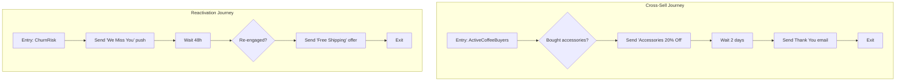

# Module 10 — AJO: Journeys & Offers

> The one question: **How are personalized *journeys and offers* orchestrated in real time?**
> Spine position: **Orchestrate** (a connected app reading the profile).

## The mental model

Everything so far built the *understanding* (unified profile + audiences). **Adobe Journey Optimizer
(AJO)** is where that understanding becomes *choreography*: the right message/offer, to the right
person, at the right moment, across channels — automatically.

The reframe:

> **A journey isn't a campaign you blast. It's a flow that *reads* the unified profile and *reacts*
> to behavior in real time.** AJO doesn't guess who to talk to — AEP already told it.

Two AJO capabilities to teach:
1. **Journeys** — multi-step flows a person moves through.
2. **Offer Decisioning** — picking the single best offer for a person at a moment.

## The mechanics

**A journey is a graph of nodes:**
- **Entry** — a condition or audience that puts a person *in* (e.g. "enters `ActiveCoffeeBuyers`").
- **Decision / condition** — a branch ("has purchased accessories?").
- **Action** — do something (send email/push, present an offer, call an API).
- **Wait** — pause (2 days, 48 hours) before the next step.
- **Exit** — leave the journey.

Because entry conditions read AEP segments (Module 08) evaluated on the real-time profile
(Module 06), a person can enter *the instant* their behavior qualifies them — that's the "real-time"
in the name.

**Offer Decisioning** is a separate engine: when a person hits a journey node that serves an offer,
the engine evaluates *all* active offers against their profile, filters by eligibility rules, ranks
by **priority**, and serves the single best eligible one — personalized with profile attributes
(Module 09's profile activation).

## Grounded in Luma

The simulator's AJO tab is a working example. **Two active journeys:**

- **Cross-Sell Journey:** Entry `ActiveCoffeeBuyers` → Decision "Has accessories purchased?" →
  Action "Send Accessories 20% Off offer" → Wait 2 days → Action "Send Thank You email" → Exit.
- **Reactivation Journey:** Entry `ChurnRisk` → Action "Send 'We Miss You' push" → Wait 48h →
  Decision "User re-engaged?" → Action "Send Free Shipping offer" → Exit.

**Offer Decisioning** with three offers:

| Offer | Priority / Channel | Eligibility rule |
|-------|--------------------|------------------|
| OFF-001 Lavazza Pro Upgrade | High / Email | `machinetype = Lavazza` |
| OFF-002 We Miss You 15% Off | Medium / Push | `engagementScore < 50` |
| OFF-003 Accessories Bundle | High / Email | `lastPurchase = Coffee Machine` |

Trace Aaron Stone (`machinetype = Keurig`, `engagementScore = 44%`): he's **not** eligible for
OFF-001 (needs Lavazza), but he **is** eligible for OFF-002 (44% < 50). If he just bought a coffee
machine he'd also match OFF-003; with two eligible High/Medium offers the engine serves the
higher-priority eligible one. This is exactly what "evaluate all, filter, rank, serve best" means.

Use the **"Simulate Entry"** and **"Fire … "** buttons to watch a profile enter a journey live —
the cleanest way to *show* that entry is driven by real-time qualification, not a manual send.

## Grounded in Retail

A real convenience & fuel retailer's AJO runs with two details a beginner wouldn't guess from the
generic model:

**1. Channels are narrower than "AJO sends everything."** This estate's AJO only sends **Push,
In-App, and Direct Message** — email is deliberately *not* an AJO channel here. Email lives on
Adobe Campaign Classic instead (Module 09), and the two apps run side by side rather than one
replacing the other. A journey step reading "send offer" in this architecture never means "send
email" — that instinct would be wrong here specifically.

**2. A journey can bypass its own batch cycle for a single high-value moment.** The normal offer
flow is the nightly SFTP exchange with Adobe Campaign Classic (Module 09). But when a journey needs
to serve **one specific 1:1 offer right now** — not tomorrow's batch — it instead calls
`POST /v1/offers/{loyaltyId}` directly against Adobe Campaign Classic in real time, skipping the
file exchange entirely for that one offer. This is the same "real-time vs. batch" tension from
Module 02, resurfacing *inside* the orchestration layer itself: even a mostly-batch integration can
carve out a real-time escape hatch for the moments that need it.

**3. Eligibility isn't always evaluated with data already inside the profile.** Before this
estate's mobile-checkout offers activate for a loyalty member, a live call checks whether that
member's CRM contact has an active **feature entitlement** for the mobile-checkout program —
a separate lookup against an external service, not a rule over attributes already sitting in the
AEP profile. Worth teaching as a real pattern: "eligibility rule" in Offer Decisioning doesn't
have to mean "profile attribute comparison" — it can mean "call out and ask," and a real journey
has to account for that call's latency and failure modes.

## Common mistakes / misconceptions

- **Treating AJO like an email blaster.** Its power is reacting to the profile/segment in real time,
  not sending one-off broadcasts.
- **Building journeys on shaky foundations.** If the segment is wrong (bad merge policy, collapsed
  identity graph), the journey faithfully targets the *wrong* people. AJO can't fix upstream errors.
- **Confusing a segment with a journey.** The segment decides *who qualifies*; the journey decides
  *what happens to them*. Offer Decisioning decides *which offer* within that.
- **Ignoring priority/eligibility interplay.** An eligible-but-low-priority offer loses to an
  eligible higher-priority one; a high-priority offer the person isn't eligible for is skipped.

## Check yourself

1. Name the five node types in a journey and what each does.
2. What's the difference between a segment, a journey, and Offer Decisioning?
3. Walk the Offer Decisioning logic for Aaron Stone across OFF-001/002/003. Which does he get, and
   why?
4. A journey is targeting the wrong customers. Why might the fix be *upstream* of AJO entirely?

## Where next

→ **Module 11 — CJA: Analytics & Attribution.** We've orchestrated experiences. Now: how do we
*measure* whether any of it worked — funnel, ROI, journey performance?
