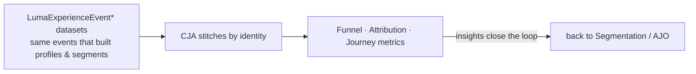
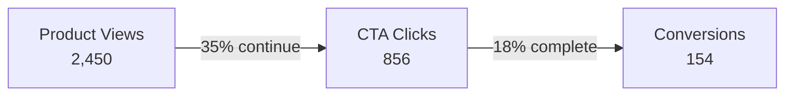

# Module 11 — CJA: Analytics & Attribution

> The one question: **How do we *measure* the whole thing — funnel, ROI, journey performance?**
> Spine position: **Analyze** (the final step; it measures everything before it).

## The mental model

Orchestration without measurement is guessing. **Customer Journey Analytics (CJA)** connects the
AEP datasets to produce unified reports: conversion funnels, revenue attribution, and journey
performance — all on the *same identity* used everywhere else in the platform.

The reframe that ties the whole course together:

> **Your analytics are only as trustworthy as the identity and schema decisions beneath them.**

If identity stitching merged the wrong people (Module 05) or a merge policy picked the wrong value
(Module 07), CJA will confidently report *wrong* numbers. Measurement is the mirror that reflects
every upstream decision — good and bad.

**CJA vs. Adobe Analytics:** Adobe Analytics is the older, web-centric behavioral analytics product.
CJA is the AEP-native evolution that can blend online + offline + cross-channel events on the shared
RTCP identity — so a single funnel can span web, app, and in-store.

## The mechanics

- CJA reads AEP **datasets** (the same `LumaExperienceEvent*` data that fed profiles and
  segments) and stitches events by identity into complete journeys.
- Core report types a beginner should know:
  - **Conversion funnel** — staged progression and drop-off (views → clicks → purchases).
  - **Attribution** — assigning revenue credit to the offers/journeys/touchpoints that drove it.
  - **Journey performance** — entries, messages sent, completion rate, time-to-conversion.
- Because it's the same data spine, one event (Aaron's `productView`) is *both* a profile signal
  (Module 06) *and* a funnel data point (here) — no separate tracking, no reconciliation.

## Grounded in Luma

The simulator's CJA tab shows the real reports:

**Conversion funnel:**

Interpretation it surfaces: an 18% view-to-purchase rate suggests room for abandoned-cart
retargeting — which loops straight back to the `AbandonedBrowsers` segment (Module 08) and the
Reactivation journey (Module 10).

**Offer attribution:**

| Offer | Dispatched | Redeemed | Revenue | Redemption % |
|-------|-----------|----------|---------|--------------|
| OFF-001 Lavazza Pro Upgrade | 245 | 67 | ₹3,01,500 | 27.3% |
| OFF-002 We Miss You 15% Off | 189 | 34 | ₹1,53,000 | 18.0% |
| OFF-003 Accessories Bundle | 312 | 89 | ₹4,45,000 | 28.5% |

Insight: OFF-003 has the best redemption (28.5%) and revenue → increase its dispatch frequency. That
decision flows back into AJO (Module 10). **This is the loop:** analyze → adjust segments/journeys →
measure again.

**Journey performance:** Cross-Sell 42% completion / 2.5 days, Reactivation 28% / 4.2 days, Premium
Upgrade 51% / 1.8 days — lets you compare orchestration effectiveness.

## Common mistakes / misconceptions

- **Trusting the numbers without trusting the foundation.** Clean-looking dashboards on a collapsed
  identity graph are *confidently wrong*. Always ask whether identity/merge decisions are sound.
- **Confusing CJA with Adobe Analytics.** CJA is AEP-native and cross-channel; AA is the older web
  tool. On this platform, CJA is the one that shares the profile identity.
- **Treating analytics as the end.** It's the *start* of the next loop — insights should feed back
  into segments and journeys, not just sit on a dashboard.
- **Ignoring attribution windows/models.** "Revenue attributed" depends on the attribution rules;
  two models can credit the same sale differently.

## Check yourself

1. Why can a CJA dashboard be "confidently wrong," and where does the error actually originate?
2. What's the difference between CJA and Adobe Analytics on this platform?
3. From the Luma funnel (2,450 → 856 → 154), what action would you recommend, and which
   segment/journey does it feed back into?
4. Attribution shows OFF-003 as the winner. Trace the full spine backward: what earlier decisions had
   to be correct for that number to be trustworthy?

## Where next — you've completed the spine

You've now walked **Ingest → Model → Identity → Profile → Segment → Activate → Orchestrate →
Analyze** end to end. The capstone exercise: take one event (Aaron's `productView` on Lavazza Pro)
and narrate its entire life across all 11 modules and all three simulator tabs. If a learner can do
that unaided, they understand how the Adobe ecosystem actually works. Use `/simulate aep` to
rehearse it, or `/quiz aep` to test the whole spine.
