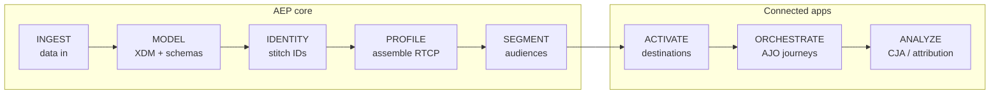

# Adobe Experience Platform Masterclass — Learning Skill

## Purpose

Take someone who is **completely new** to the Adobe Experience Cloud ecosystem and teach them,
from zero, how Adobe Experience Platform (AEP) and its connected applications — Real-Time CDP
(RTCDP), Adobe Journey Optimizer (AJO), Customer Journey Analytics (CJA), Adobe Analytics, and
Adobe Target — actually work together to turn scattered customer data into real-time, personalized
experiences.

This is a **teaching** skill, not a reference dump. It is built to be used interactively: the
learner asks to learn a topic, and the skill explains it the way an implementation team actually
experiences it — the mental models, the "aha" moments, the mistakes people make, and how the pieces
connect — then checks understanding before moving on.

The content is grounded in two things so it never stays abstract:

1. **A concrete running example** — the "Luma" coffee-retail scenario from the companion
   **AEP training simulator**, following one customer (Aaron Stone, `CUST-1101`) from an anonymous
   web visit all the way to a redeemed offer and a revenue-attribution report.
2. **The end-to-end data flow** — every concept is placed on the single spine that runs through the
   whole platform: **Ingest → Model → Identity → Profile → Segment → Activate → Orchestrate →
   Analyze.**

## When to use

- Someone says "I'm new to AEP / AJO / CJA / the Adobe ecosystem, teach me" or asks how any part
  of it works (schemas, identity, profiles, segments, journeys, activation, analytics).
- A learner wants a structured path through the platform rather than scattered answers.
- Someone wants a term explained simply (what is XDM? what's an identity graph? what's a merge
  policy?) — see [glossary.md](glossary.md).
- Someone wants to trace what happens to a piece of data as it moves through the platform, or walk
  the training simulator step by step — see [simulator-walkthrough.md](simulator-walkthrough.md).
- A learner wants to be quizzed / self-check their understanding of a module.

## When NOT to use

- Hands-on Adobe **Commerce** (Magento) engineering — that's the `retail-glossary` /
  commerce skills, not this. (This skill *does* cover how Commerce data flows *into* AEP, but not
  Magento internals.)
- Production incident debugging on a real AEP instance — this teaches the concepts and mental
  models; it is not a substitute for Adobe's official product docs for a specific API version.

## How to teach (the operating rules)

When this skill is active, behave like a patient instructor, not a search engine:

1. **Meet the learner where they are.** Assume no prior Adobe knowledge unless they show it. Define
   every acronym the first time it appears in a session. Never answer a beginner with a wall of
   jargon.
2. **One mental model at a time.** Lead with the analogy / mental model, *then* the mechanics, *then*
   the grounding example. Each module file below follows that order — mirror it.
3. **Always connect back to the spine.** After explaining a piece, say where it sits in
   Ingest → Model → Identity → Profile → Segment → Activate → Orchestrate → Analyze, and what breaks
   downstream if it's done wrong. This is the single most important habit — most AEP problems are
   upstream problems that only *appear* downstream.
4. **Ground it in Luma/Aaron Stone.** Use the running example from
   [simulator-walkthrough.md](simulator-walkthrough.md) so concepts stay concrete.
5. **Check understanding before advancing.** End a teaching turn with 1–3 self-check questions (each
   module ends with a "Check yourself" list you can draw from), and offer the next module.
6. **Be honest about depth.** These modules are a faithful beginner-to-intermediate foundation. When
   a learner reaches a genuinely advanced/at-scale topic (namespace governance across brands, B2B
   relationship modeling, identity-graph optimization, specific API versions), say so and point them
   to Adobe's official documentation rather than inventing specifics.
7. **Teach visually — use Mermaid diagrams.** Every module and resource file has ready-made
   Mermaid code-fence diagrams (flows, identity graphs, journey flowcharts, funnels). When explaining a
   concept, reproduce the relevant Mermaid diagram so the learner gets a picture, not just prose —
   these render in the IDE and on GitHub. If a learner asks for a diagram of something not already
   drawn, generate a fresh Mermaid diagram on the spot (flowchart/graph). Keep node labels short and
   quote any label containing special characters, e.g. `A["Ingest (data in)"]`.

## The learning path (pedagogical order)

Teach in this order for a from-zero learner. This is *not* the episode publish order — it's the
order in which each concept depends on the previous one. See [learning-path.md](learning-path.md)
for the full curriculum, prerequisites, and time estimates.

**The spine (every concept sits somewhere on this line):**

> Golden rule: problems *appear* on the right (broken journeys, wrong reports) but are *caused* on
> the left (schema, identity, merge decisions). Trace downstream symptoms back up the spine.

| # | Module | The one question it answers | File |
|---|--------|-----------------------------|------|
| 1 | Ecosystem Overview | Why does AEP exist, and how do the Experience Cloud apps connect? | [01-ecosystem-overview.md](01-ecosystem-overview.md) |
| 2 | Data Ingestion | How does data actually *get into* AEP? | [02-data-ingestion.md](02-data-ingestion.md) |
| 3 | XDM & Schemas | How is customer data *modeled* so everything downstream understands it? | [03-xdm-schemas.md](03-xdm-schemas.md) |
| 4 | Schema Registry | Where do schemas and their rules actually *live* and get enforced? | [04-schema-registry.md](04-schema-registry.md) |
| 5 | Identity Service | How does AEP know all these different IDs are the *same person*? | [05-identity-service.md](05-identity-service.md) |
| 6 | Real-Time Customer Profile | How are all the fragments *assembled* into one live customer view? | [06-rtcp-profile.md](06-rtcp-profile.md) |
| 7 | Merge Policies | When two systems *disagree* about a customer, which data wins? | [07-merge-policies.md](07-merge-policies.md) |
| 8 | Segmentation | How does AEP turn profiles into *audiences* that update themselves? | [08-segmentation.md](08-segmentation.md) |
| 9 | Destinations & Activation | How do audiences *leave* AEP and drive real action? | [09-destinations-activation.md](09-destinations-activation.md) |
| 10 | AJO — Journeys & Offers | How are personalized *journeys and offers* orchestrated in real time? | [10-ajo-journeys.md](10-ajo-journeys.md) |
| 11 | CJA — Analytics & Attribution | How do we *measure* the whole thing — funnel, ROI, journey performance? | [11-cja-analytics.md](11-cja-analytics.md) |

## Companion commands

These slash commands are the intended way for a learner to drive this skill. There are two families:

**Verbs** (cross-cutting — work for any product via arguments):

- **`/learn aep [topic]`** — start or continue the masterclass; teaches a module in depth (or picks
  up where the learner left off if no topic given).
- **`/define aep [term]`** — a quick, plain-English definition of one term or acronym, with where
  it sits on the spine. Backed by [glossary.md](glossary.md).
- **`/simulate aep [scenario]`** — trace a piece of data through the platform, or walk the training
  simulator (AEP → AJO → CJA tabs). Backed by [simulator-walkthrough.md](simulator-walkthrough.md).
- **`/quiz aep [topic]`** — quiz the learner on a module and grade the answers.

**Product launchers** (discoverability entry points for people who think in product terms — each
routes into the right module(s) and sets teaching scope):

- **`/learn aep [topic]`** — the AEP foundation & full learning path (Ingest → Segment, Modules 02–08);
  the main on-ramp from zero.
- **`/learn ajo [subtopic]`** — Adobe Journey Optimizer: journeys & offer decisioning (Module 10).
- **`/learn cja [subtopic]`** — Customer Journey Analytics: funnels, attribution, journey metrics (Module 11).
- **`/learn rtcdp [subtopic]`** — Real-Time CDP: the audiences & activation application on AEP (Modules
  01 + 08 + 09).

Note the `aep-*` prefix on the verbs is deliberate: AEP is the *foundation* the other apps are built
on, so it names the whole family. The product launchers cover the connected apps by name.

## Relationship to the official GDC Commerce enablement path

This skill is an *aid* to — not a replacement for — the official **GDC Commerce Team DX Enablement**
learning path (AEP Foundations → Profile → AJO Segmentation, on Adobe Experience League). That
curated path lives at `program/` (see its `LEARNING-PLAN.md`), and each of its 13
topic READMEs cross-links to the matching module here. Rough mapping:

- Foundation → Schema = Module 03 · Identity = Module 05 · Dataset/Ingestion = Module 02 ·
  Profiles = Module 06 · Platform Overview = Modules 01 + 10 · Sandboxes = env/governance (Module 04, loosely)
- Profile → Profiles & Audiences = Modules 06 + 08 · Create a Test Profile = Modules 06 + 10
- AJO Segmentation → Segments Overview / Segment Builder / Streaming / Batch = Module 08

When a learner is working through that official path, use the matching module here for the
plain-English explanation, Mermaid diagram, and quiz — but always defer to the official Experience
League tutorial as the source of truth for product specifics and UI steps.

## Additional resources

- [learning-path.md](learning-path.md) — full curriculum, prerequisites, time estimates, and the
  "spine" diagram in text form
- [glossary.md](glossary.md) — every acronym and term used across the ecosystem, in plain English
- [simulator-walkthrough.md](simulator-walkthrough.md) — the Luma / Aaron Stone running example
  and a tab-by-tab walk of the training simulator
- Module files `01` through `11` — one concept each, in pedagogical order (table above)
