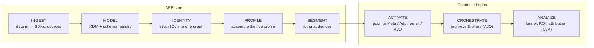
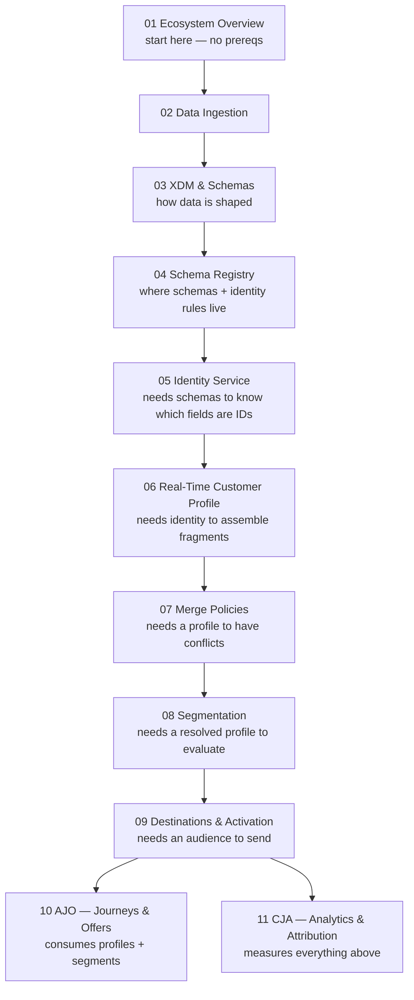

# The Learning Path

This is the curriculum for the masterclass. Teach in this order — each module assumes the previous
ones. Total foundation is roughly **6–9 hours** of guided learning if a learner does the check
questions and the simulator walkthrough alongside.

## The spine (memorize this)

Everything in the Adobe Experience Platform ecosystem sits on one line. If a learner remembers
nothing else, they should remember this:

- The **left half (Ingest → Segment)** is Adobe Experience Platform / Real-Time CDP itself.
- The **right half (Activate → Analyze)** is where the *connected applications* take over: **AJO**
  for orchestration, **CJA / Adobe Analytics** for measurement, **Target** for on-site
  personalization, and external **Destinations** (Meta, Google Ads, email) for reach.
- **The golden rule:** problems almost always *appear* on the right but are *caused* on the left.
  Broken personalization, wrong audience counts, journeys that never trigger — trace them back to a
  schema, identity, or merge-policy decision made much earlier.

## Module dependency map

## Per-module summary

| # | Module | Prereqs | The "aha" it delivers |
|---|--------|---------|-----------------------|
| 1 | Ecosystem Overview | none | AEP is not another tool — it's the *foundation layer* the other apps are built on. |
| 2 | Data Ingestion | 1 | Batch vs. streaming isn't a preference — it decides whether real-time is even possible. |
| 3 | XDM & Schemas | 1–2 | A schema isn't "just fields." Profile = *state*, ExperienceEvent = *history*. |
| 4 | Schema Registry | 3 | The UI is the surface; the Registry is where XDM is actually *enforced*. |
| 5 | Identity Service | 3–4 | AEP doesn't identify *people* — it connects *identifiers* into a graph. |
| 6 | Real-Time Customer Profile | 5 | RTCP isn't a customer table — it's a real-time *assembly engine*. |
| 7 | Merge Policies | 6 | A customer profile isn't objective truth — it's *constructed* truth you configure. |
| 8 | Segmentation | 6–7 | An audience isn't a list — it's a *continuously evaluated condition*. |
| 9 | Destinations & Activation | 8 | Profiles create understanding; activation creates *outcomes*. |
| 10 | AJO — Journeys & Offers | 6, 8 | Journeys *read* the unified profile and *react* to behavior in real time. |
| 11 | CJA — Analytics & Attribution | all | Measurement is only as trustworthy as the identity + schema decisions beneath it. |

## How to run a session

1. Ask the learner where they are (new? picking up? stuck on one concept?).
2. Teach **one** module. Follow its internal order: mental model → mechanics → Luma grounding →
   common mistakes.
3. Tie it back to the spine and name what breaks downstream if it's done wrong.
4. Ask that module's "Check yourself" questions. Only advance when they can answer.
5. Offer the simulator walkthrough for that stage so the concept becomes tangible.

## A note on episode order vs. this order

The original 9-episode series was published in the order the author *learned* the topics, which put
Identity (Ep 9) near the end and Data Ingestion as a "next episode." This curriculum reorders them
into **dependency order** so a from-zero learner never meets a concept before its prerequisites.
Episode → module mapping:

- Ep 1–2 → Module 01 (Ecosystem)
- Ep 3 → Module 03 (XDM)
- Ep 4 → Module 04 (Schema Registry)
- Ep 5 → Module 06 (RTCP)
- Ep 6 → Module 07 (Merge Policies)
- Ep 7 → Module 08 (Segmentation)
- Ep 8 → Module 09 (Destinations & Activation)
- Ep 9 → Module 05 (Identity — moved *earlier* because Profile depends on it)
- Ep 10 (previewed) → Module 02 (Data Ingestion — moved *earlier* for the same reason)
- Simulator AJO tab → Module 10; Simulator CJA tab → Module 11
