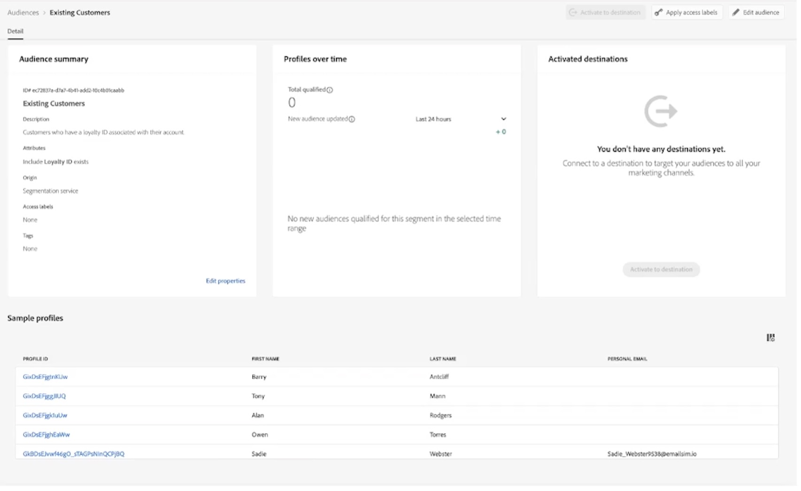

# Identity resolution & audience management

Sub-topic of the [Real-time customer insights & engagement](Real-Time%20Insights.md) pillar — the third bullet: "Go beyond the basic segment and speak to the individual."

## My takeaway

AJO also does identity resolution and continuously keeps profiles updated to move customers in and out of segments in real time.

## The screen — Audience Detail

**Breadcrumb:** `Audiences > Existing Customers` — a single audience/segment definition called "Existing Customers."

**Audience summary (left card):**
- **ID#** — internal unique identifier for this audience.
- **Description** — "Customers who have a loyalty ID associated with their account" — plain-English definition of who qualifies.
- **Attributes** — "Include Loyalty ID exists" — the actual rule: anyone whose profile has a Loyalty ID field populated is a member. Built directly on profile attributes, tying back to the unified Real-Time Customer Profile.
- **Origin: Segmentation service** — the engine that evaluates this rule, working off the profile.
- **Access labels / Tags: None** — governance metadata (currently unset).
- **Edit properties** — link to modify the definition.

**Profiles over time (middle card):** "Total qualified: 0" and "New audience updated: Last 24 hours, +0" — this is *live* qualification tracking: as profiles get updated (e.g. someone adds a loyalty ID), they flow into this count in near real time. Currently: "No new audiences qualified for this segment in the selected time range."

**Activated destinations (right card):** "You don't have any destinations yet" — this audience isn't yet connected/exported anywhere (email platform, ad platform, etc.). "Activate to destination" (grayed out) is how you'd push the audience out once it has members and a destination.

**Sample profiles (bottom table):** individual people (Profile ID, First Name, Last Name, Personal Email) who satisfy the rule — clicking a Profile ID routes to that person's Profile Detail screen. This is the "speak to the individual" part: you're not stuck at an aggregate count, you can drill down to the actual people.

## Takeaway

Identity-resolved profiles are continuously evaluated against a rule (Loyalty ID exists), moving in/out of the audience live — exactly "identity resolution and audience management... move customers in and out of segments" from the video — and it links straight down to individual profiles rather than stopping at a static count.
