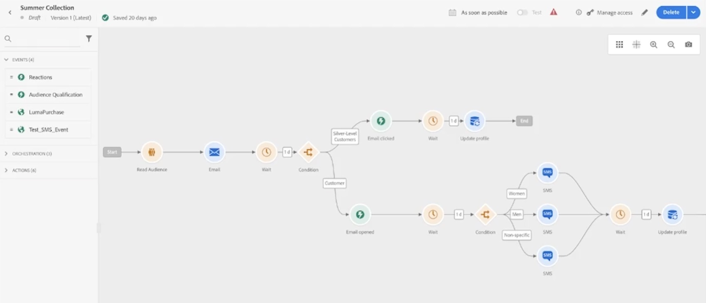

# Modern omnichannel orchestration (Journey Canvas)

Second value driver from [README notes](README.md#notes): "A single canvas on which to harmonize and optimize the customer journey for 1:1 customer engagement and marketing outreach."

## My takeaway

AJO offers modern omnichannel orchestration through a Journey Canvas that lets you orchestrate multi-layered customer engagement — audience-based outbound marketing programs as well as real-time 1:1 interactions — across channels from a single canvas. You can also leverage use-case templates and wizards to easily create and deploy new customer journeys.

## Layman example first

Imagine a "choose your own adventure" book, but for a marketing campaign:
- Everyone starts on page 1 (get an email).
- A week later, the book asks: "Did you open it? Did you click something inside?"
- Depending on your answer, you're sent down a different path — some people get another email, some get a text message, some get nothing more.
- The book also asks "are you a man, a woman, or unspecified?" partway through, and hands you a differently-worded text message accordingly.

That's exactly what the Journey Canvas below is doing, except the "reader" is a real customer and the "pages" are actual emails/texts sent by AJO.

## The screen — Journey Canvas

**Journey:** "Summer Collection" — Draft, Version 1 (Latest), saved 20 days ago. Top bar also shows a schedule ("As soon as possible"), a **Test** toggle, a validation warning icon, "Manage access," edit, and Delete — the controls an admin/marketer would use to configure and publish this journey.

**Left panel — the same building blocks seen in [Real Time Signals](Real%20Time%20Signals.md):** Events (4) — Reactions, Audience Qualification, LumaPurchase, Test_SMS_Event; Orchestration (3); Actions (6) — collapsed here, but this journey draws from several of them.

**The canvas flow, step by step:**

1. **Start → Read Audience** — the journey begins by pulling in a defined list of customers (an audience/segment, like the "Existing Customers" one from the previous screen).
2. **→ Email** — everyone in that audience gets sent an email.
3. **→ Wait (1 day)** — AJO pauses a day to give people a chance to react.
4. **→ Condition** — the journey splits people into two groups based on who they are:
   - **Silver-Level Customers** (top branch)
   - **Customer** (bottom branch, i.e. everyone else)

**Top branch — Silver-Level Customers:**
5. **→ Email clicked** — checks whether this VIP-tier customer clicked a link in the email.
6. **→ Wait (1 day) → Update profile → End** — after another short wait, their profile is updated (e.g. "clicked summer collection email") and the journey ends for them.

**Bottom branch — regular Customers:**
5. **→ Email opened** — checks whether they simply opened the email (a lower bar than clicking).
6. **→ Wait (1 day) → Condition** — splits again, this time by gender attribute: **Women / Men / Non-specific**.
7. **→ SMS** — each of the three groups gets its own tailored SMS message (three separate SMS nodes, one per group).
8. **→ Wait (1 day) → Update profile** — all three paths converge back together, wait, then update the profile (the canvas continues further to the right, cut off in this screenshot).

## Why this matters (tying back to the pillar)

- **Omnichannel** — one canvas, two channels (email *and* SMS), no need to build separate campaigns per channel.
- **Multi-layered engagement** — combines an audience-based batch entry point ("Read Audience") with real-time, individual-level branching (did *this specific person* click/open, and what segment are *they* in).
- **1:1 personalization** — the Women/Men/Non-specific split means the SMS content itself can be tailored per person, not one-size-fits-all.
- **Closes the loop** — every branch ends in "Update profile," feeding back into the Real-Time Customer Profile so future journeys/segments immediately reflect what just happened (see [Real Time Customer Profile](Real%20Time%20Customer%20Profile.md)).
