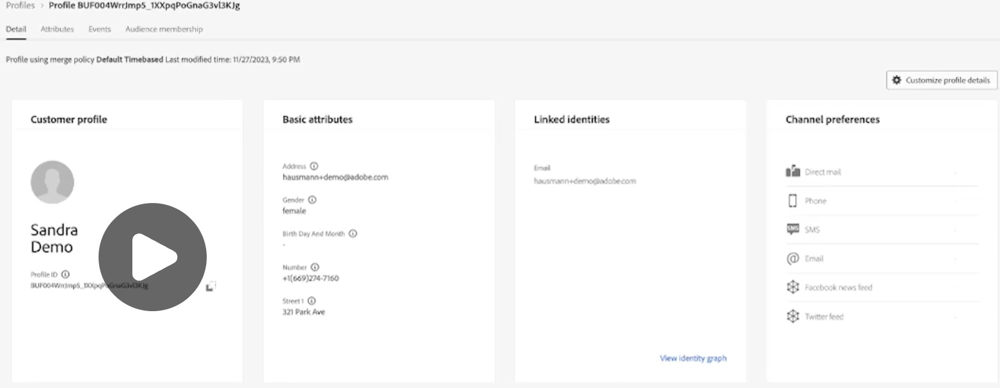

# Real-time customer profile

Sub-topic of the [Real-time customer insights & engagement](Real-Time%20Insights.md) pillar — the first bolded bullet: "Integrate all your data (web, CRM, offline) into a unified profile."

## My takeaway

AJO operates on the Real-Time Customer Profile: it integrates all customer data — web, CRM, and offline — into one unified, 360-degree view.

## The screen — Profile Detail

**Breadcrumb:** `Profiles > Profile BUF004WrrJmp5_1XXpqPoGnaG3vl3KJg` — the internal Profile ID AJO assigned this person.

**Tabs:** Detail (shown), Attributes, Events, Audience membership.

**Merge policy:** "Profile using merge policy **Default Timebased**, Last modified time: 11/27/2023, 9:50 PM." When the same person shows up from multiple sources (e.g. email from the website, loyalty number from POS), AJO needs a rulebook for merging those into one profile — a **merge policy** (Timebased = newest data wins). This is the literal mechanism behind "integrate all your data into a unified profile."

## The four cards

1. **Customer profile** — human-readable summary: name ("Sandra Demo") + Profile ID.
2. **Basic attributes** — demographic/contact fields pulled together from whatever source(s) fed them in: address, gender, birthday, phone number, street.
3. **Linked identities** — the **identity resolution** piece: AJO recognizes one physical person via more than one "key" (here, an email). "View identity graph" shows that web of connected identifiers visually.
4. **Channel preferences** — where/how this customer opted in to be reached (direct mail, phone, SMS, email, Facebook, Twitter) — feeds directly into omnichannel orchestration (e.g. don't SMS someone who only opted into email).

## Takeaway

One Profile ID, data stitched together from multiple sources, merged via a policy, with identity resolution linking the different "faces" of the same customer — this is the unified 360° view described in the video.
