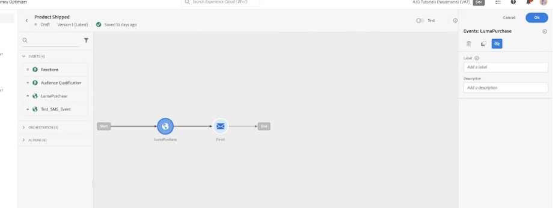

# Real-time signals

Sub-topic of the [Real-time customer insights & engagement](Real-Time%20Insights.md) pillar — the second bullet: "Listen to external signals from data sources, across the customer journey, to learn and anticipate next-best-action."

## My takeaway

AJO doesn't just react on a schedule — it listens for real-time external signals (like a purchase event) from data sources, and immediately decides the next-best-action inside a customer's journey.

## The screen — Journey Canvas

**Journey:** "Product Shipped" — Draft, Version 1 (Latest), saved 13 days ago, with a **Test** toggle top-right to try it before publishing.

**Left panel — the journey's building blocks:**
- **Events (4)** — Reactions, Audience Qualification, **LumaPurchase**, Test_SMS_Event. These are the "signals" the journey can listen for.
- **Orchestration (3)** — branching/wait-type steps (collapsed here).
- **Actions (6)** — send email/SMS/push and similar outbound actions (collapsed here).

**The canvas flow:** `Start → LumaPurchase (event) → Email (action) → End`

- **LumaPurchase node** (globe icon) — this is the external signal itself: a real-time purchase event coming in from a data source (the "Luma" demo storefront). The journey is listening for this signal as it happens, not on a batch delay.
- **Right panel** — configuration for the selected "LumaPurchase" event node: a Label, a Description, and delete/duplicate/edit icons.
- **Email node** (envelope icon) — the next-best-action: the moment the purchase signal fires, the journey immediately triggers an email.

## Takeaway

This is real-time signals in action: an external event (a purchase) is heard live, and the journey reacts instantly with the next-best-action (an email) — exactly the mechanism described in the video, as opposed to a static, scheduled campaign.
