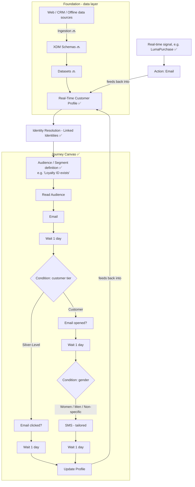

# AJO End-to-End User Flow (Living Document)

This is a running map tying together everything learned so far into one flow — from raw data to a live, personalized customer journey. It will be updated as later topics in the [learning plan](../../LEARNING-PLAN.md) are completed, so the picture stays accurate to what's actually been covered.

**Legend:** ✅ covered in detail · 🔜 upcoming topic (placeholder node, not yet documented)

## Flow diagram

## Plain-language walkthrough (matches the diagram)

1. **Data comes in** from Web, CRM, and Offline sources — the raw material (Ingestion, upcoming).
2. That data gets modeled into **Schemas** (upcoming) and stored as **Datasets** (upcoming).
3. It all resolves into one **Real-Time Customer Profile** — see [Real Time Customer Profile](Real%20Time%20Customer%20Profile.md).
4. **Identity resolution** links multiple identifiers (email, loyalty ID, cookie, etc.) to that one profile — same file, "Linked identities" card.
5. Profiles are grouped into **Audiences/Segments** using rules like "Loyalty ID exists" — see [Identity Resolution and Audience Management](Identity%20Resolution%20and%20Audience%20Management.md).
6. A **Journey Canvas** reads that audience and orchestrates a multi-step, multi-channel campaign (email → wait → branch by tier → branch by gender → SMS) — see [Journey Canvas](Journey%20Canvas.md).
7. Separately, a **real-time signal** (like a purchase event) can trigger an action directly, without waiting for a scheduled audience read — see [Real Time Signals](Real%20Time%20Signals.md).
8. Every action taken (click, open, purchase) **updates the profile**, closing the loop back to step 3 — this feedback loop is what makes the whole system "real-time" rather than a one-shot batch campaign.

## Progress tracker

| Track | Topic | Status | Reflected in diagram as |
|---|---|---|---|
| Foundation | Platform Overview | ✅ Done | whole diagram (overview level) |
| Foundation | Schema | 🔜 Not started | node B |
| Foundation | Identity | 🔜 Not started (only touched via Linked Identities) | node E |
| Foundation | Dataset | 🔜 Not started | node C |
| Foundation | Ingestion | 🔜 Not started | edge A→B |
| Foundation | Profiles | 🔜 Not started (only touched via RTCP screen) | node D |
| Foundation | Sandboxes and Access | 🔜 Not started | not yet on diagram |
| Profile | Profiles and Audiences | 🔜 Not started (only touched via Audience screen) | node F |
| Profile | Create a Test Profile | 🔜 Not started | not yet on diagram |
| AJO Segmentation | Segments Overview | 🔜 Not started | node F |
| AJO Segmentation | Segment Builder | 🔜 Not started | node F |
| AJO Segmentation | Streaming Audience | 🔜 Not started | node S (real-time signal path) |
| AJO Segmentation | Batch Audience | 🔜 Not started | node G (Read Audience path) |

## How to keep this updated

Each time a new week's topic is documented, come back here and: (1) flip its 🔜 to ✅ in the diagram and tracker, (2) expand that node with real detail/screenshot links instead of a placeholder, (3) add any new nodes the topic introduces that aren't on the diagram yet.
