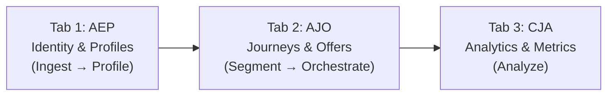
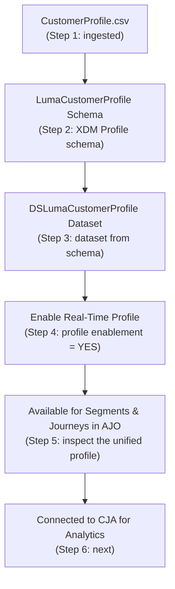

# The Luma Running Example & Simulator Walkthrough

This is the concrete, end-to-end story every module ties back to. Use it to make abstract concepts
tangible: instead of "a profile has identities," say "Aaron Stone's profile links `CUST-1101`,
`user1@infinate360.in`, and ECID `1CT4D7SZGKTI`."

The companion **AEP training simulator** models a coffee/retail brand ("Luma") and has three
tabs that map exactly to the back half of the spine:



> **Live simulator:** http://aepsimualtor.infiante360techacademy.com/ — a hands-on companion built by
> the community author. Use it to *see* each concept after teaching it.

---

## The hero customer: Aaron Stone (`CUST-1101`)

The unified Real-Time Customer Profile the simulator loads:

| Field | Value | Notes |
|-------|-------|-------|
| Customer ID (primary identity) | `CUST-1101` | The key everything links to |
| Full name | Aaron Stone | |
| Email (secondary identity) | `user1@infinate360.in` | Used for cross-channel orchestration |
| Loyalty status | Silver | Drives segmentation |
| Loyalty points | 5821 | |
| Engagement score | 44% | Used for churn prediction & retargeting |
| City / State | Portland, OR | |
| Coffee machine type | Keurig | Feeds offer decisioning rules |
| ECID | `1CT4D7SZGKTI` | Anonymous device/cookie identity |

**Identity graph:** three nodes — `customerid (CUST-1101)` ↔ `email (user1@…)` ↔ `ECID
(1CT4D7SZGKTI)` — each a different namespace, merged into one profile. This is *identity stitching*
made visible (Module 05).

**Event history (ExperienceEvents, last 6 months):**

| Date | Event type | Dataset | Details |
|------|-----------|---------|---------|
| 2025-11-01 08:12 | productView | `LumaExperienceEventProductView` | Viewed "Lavazza Pro" |
| 2025-11-01 08:14 | ctaClick | `LumaExperienceEventCTAClick` | Clicked "Add to Cart" |
| 2025-11-02 14:30 | conversion | `LumaExperienceEventConversion` | Purchased — ₹45,000 |

**A single ExperienceEvent, in XDM (what actually gets sent to AEP):**

```json
{
  "eventType": "productView",
  "eventId": "2nea67hw6",
  "timestamp": "2026-08-08T04:23:27.122Z",
  "customerId": "CUST-1101",
  "email": "user1@infinate360.in",
  "dataset": "LumaExperienceEventProductView",
  "details": "Lavazza Pro",
  "source": "Training Simulator",
  "schemaRef": "https://ns.adobe.com/xdm/context/experienceevent"
}
```

Point out to a learner: this one JSON object carries **identity** (`customerId`, `email`), **what
happened** (`eventType`, `details`), and **where it belongs** (`dataset`, `schemaRef`). That single
payload is what feeds journey triggering, segmentation, *and* analytics — same data, three uses.

---

## Tab 1 — AEP: Identity & Profiles (Ingest → Profile)

The 6-step data-lineage flow the simulator shows (the "Data Lineage & Ingestion Flow" panel):



Teaching sequence for this tab:
1. **Step 1 – Ingestion:** the CSV is uploaded → **Module 02 (Data Ingestion)**.
2. **Step 2 – Schema:** an XDM Individual Profile schema is created → **Modules 03–04**.
3. **Step 3 – Dataset:** a dataset conforming to that schema → **Module 03**.
4. **Step 4 – Profile enablement:** flip the profile toggle ON → **Module 06**. (If OFF, the data
   exists but never appears in the profile — a classic beginner mistake.)
5. **Identity graph + XDM Schema Mapping panel:** which fields are identities, which dataset they
   come from → **Module 05**. (`customerid` = primary; `email`, `ECID` = secondary.)
6. **Step 5 – Inspect the profile:** the unified Aaron Stone view above → **Module 06**.

---

## Tab 2 — AJO: Journeys & Offers (Segment → Orchestrate)

**Pre-built audience segments** (each is a *continuously evaluated rule*, Module 08 — not a list):

| Segment | Rule | Members | Journey it triggers |
|---------|------|---------|---------------------|
| ActiveCoffeeBuyers | `eventType = conversion AND productCategory = "Coffee Machine" AND status = active` | 12 | Cross-Sell Journey |
| ChurnRisk | `eventType = ctaClick AND conversionFlag = FALSE AND daysSinceLastConversion > 90` | 5 | Reactivation Journey |
| HighValueLoyalists | `loyaltypoints >= 1000 AND membershipstatus = active` | 8 | Premium Upgrade Journey |
| AbandonedBrowsers | `eventType = productView AND NOT conversion within 24h` | 3 | Abandonment Recovery |

**Active journeys** (Module 10 — entry → decision → action → wait → exit):

- **Cross-Sell Journey:** Entry `ActiveCoffeeBuyers` → Decision "Has accessories purchased?" →
  Action "Send Accessories 20% Off offer" → Wait 2 days → Action "Send Thank You email" → Exit.
- **Reactivation Journey:** Entry `ChurnRisk` → Action "Send 'We Miss You' push" → Wait 48h →
  Decision "User re-engaged?" → Action "Send Free Shipping offer" → Exit.

**Offer Decisioning Engine** (Module 10) — when a customer hits a journey node, the engine evaluates
all active offers against their profile and serves the **single highest-priority eligible** one:

| Offer | Name | Priority / Channel | Eligibility rule |
|-------|------|--------------------|------------------|
| OFF-001 | Lavazza Pro Upgrade | High / Email | `machinetype = Lavazza` |
| OFF-002 | We Miss You 15% Off | Medium / Push | `engagementScore < 50` |
| OFF-003 | Accessories Bundle | High / Email | `lastPurchase = Coffee Machine` |

**Simulate Customer Events** — the "Fire ProductView / Fire CTA Click / Fire Conversion" buttons
write an ExperienceEvent to the **dataLayer**, which flows into AEP and re-triggers segment
evaluation, journey entry, and offer decisioning. This is the best way to *show* streaming
segmentation (Module 08) live.

---

## Tab 3 — CJA: Analytics & Metrics (Analyze)

**Real-time metrics dashboard:** Total Events, Unique Customers, Conversion Rate — all computed
across the `LumaExperienceEvent*` datasets on the shared identity.

**Conversion funnel** (Module 11):

```
  Stage 1: Product Views   2,450
        ↓ 35% continue
  Stage 2: CTA Clicks        856
        ↓ 18% complete purchase
  Stage 3: Conversions       154
```
Interpretation the simulator gives: 2,450 views → 856 CTA clicks (35%) → 154 purchases (18%),
suggesting room for abandoned-cart retargeting.

**Offer performance & attribution:**

| Offer | Dispatched | Redeemed | Revenue attributed | Redemption % |
|-------|-----------|----------|--------------------|--------------|
| OFF-001 Lavazza Pro Upgrade | 245 | 67 | ₹3,01,500 | 27.3% |
| OFF-002 We Miss You 15% Off | 189 | 34 | ₹1,53,000 | 18.0% |
| OFF-003 Accessories Bundle | 312 | 89 | ₹4,45,000 | 28.5% |

Insight the simulator surfaces: OFF-003 has the highest redemption (28.5%) and revenue — recommend
increasing its dispatch frequency.

**Journey performance:**

| Journey | Entry events | Messages sent | Completion rate | Avg. time to conversion |
|---------|-------------|---------------|-----------------|------------------------|
| Cross-Sell | 456 | 1,234 | 42% | 2.5 days |
| Reactivation | 198 | 654 | 28% | 4.2 days |
| Premium Upgrade | 89 | 267 | 51% | 1.8 days |

**Export & next steps:** export ProductView / CTA / Conversion CSVs → upload to a real AEP sandbox →
run real segments → publish live journeys. This closes the loop back to Tab 1.

---

## How to use this in a lesson

- After teaching a concept, say "let's find it in the simulator" and point to the exact panel above.
- For the spine, walk one event (Aaron's `productView`) left to right: it's *ingested* (Tab 1),
  *modeled* as XDM, *resolved* to his identity graph, *assembled* into his profile, *qualifies* him
  for `AbandonedBrowsers` if no conversion follows (Tab 2), *activates* the Abandonment Recovery
  journey, and finally *shows up* in the Stage-1 funnel count (Tab 3).
- Use `/simulate aep [scenario]` to trace a custom scenario through these three tabs.
