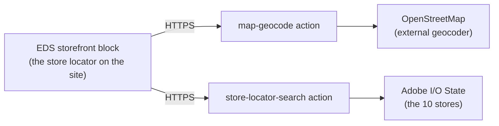

# Module 1 — What is App Builder?

> The one question: **What is App Builder, and why does it exist?**
> Spine position: this is the *whole spine* — trigger → action → response.

## The mental model

> **App Builder lets you run your own small Node.js programs ("actions") on Adobe's cloud, sitting
> *next to* Adobe Commerce / Experience Cloud rather than *inside* it.**

Analogy: imagine Adobe Commerce is a big appliance you bought. The old way to add a feature was to
open it up and rewire the motherboard (custom PHP inside Commerce core) — powerful, but risky and
hard to upgrade. App Builder is the **wall socket next to the appliance**: you plug in your own
device (an action), and it talks to the appliance through standard ports (APIs, webhooks, events).
The appliance stays untouched and upgradeable; your device does whatever custom thing you need.

The formal name for this is **out-of-process extensibility**:
- **In-process** = your code runs *inside* Commerce (PHP modules). Tightly coupled, upgrade-risky.
- **Out-of-process** = your code runs *outside* Commerce, on App Builder. Loosely coupled, independent.

## Why it exists

Adobe is moving Commerce toward a SaaS model (ACCS — Adobe Commerce as a Cloud Service), where you
**can't** freely edit the core code anymore. So the extension point moves outside:

| Business need | Old way (in-process) | App Builder way (out-of-process) |
|---|---|---|
| Custom business logic | PHP module in Commerce | A **runtime action** (Node.js) |
| Call several systems at once | Custom PHP integration | **API Mesh** (unified GraphQL) |
| React to "order placed" | PHP observer/plugin | **Adobe I/O Events** → action |
| Custom admin screen | PHP admin controller | **Admin UI SDK** app |

This kit focuses on the first row — **runtime actions** — because that's the core of App Builder and
what our store-locator build used.

## The grounding example

Our store locator needed two bits of custom logic:
1. Turn a typed address ("Austin, TX") into map coordinates — **`map-geocode`** action.
2. Given coordinates, find the nearest stores — **`store-locator-search`** action.

Neither belongs inside Commerce core. Both became **App Builder actions** — small Node.js functions
deployed to Adobe's cloud, callable over HTTPS. The Commerce storefront (an EDS block) just calls
their URLs. Commerce itself was never modified.

## Common first-time confusions

- **"Is App Builder a website host?"** No. It hosts *serverless functions* (actions) and optionally a
  small React admin UI — not general web pages. For customer-facing pages you use EDS or a storefront.
- **"Do I need Adobe Commerce to use it?"** No. Actions are just Node.js on Adobe's runtime; ours
  called OpenStreetMap and a key-value store, no Commerce involved. App Builder *shines* with Adobe
  products but doesn't require them.
- **"Is this the same as AWS Lambda?"** Conceptually yes — serverless functions. App Builder is
  Adobe's managed version (Adobe I/O Runtime, built on Apache OpenWhisk), pre-wired to Adobe identity,
  events, and services.

## Check yourself

1. In one sentence, what does "out-of-process extensibility" mean?
2. Why can't you just add custom PHP to Adobe Commerce as a Cloud Service (ACCS)?
3. In the store-locator build, name the two actions and what each one does.
4. True or false: App Builder hosts your customer-facing web pages.

Next: **Module 2 — Architecture: Runtime, Actions & State** (what actually runs your code).
