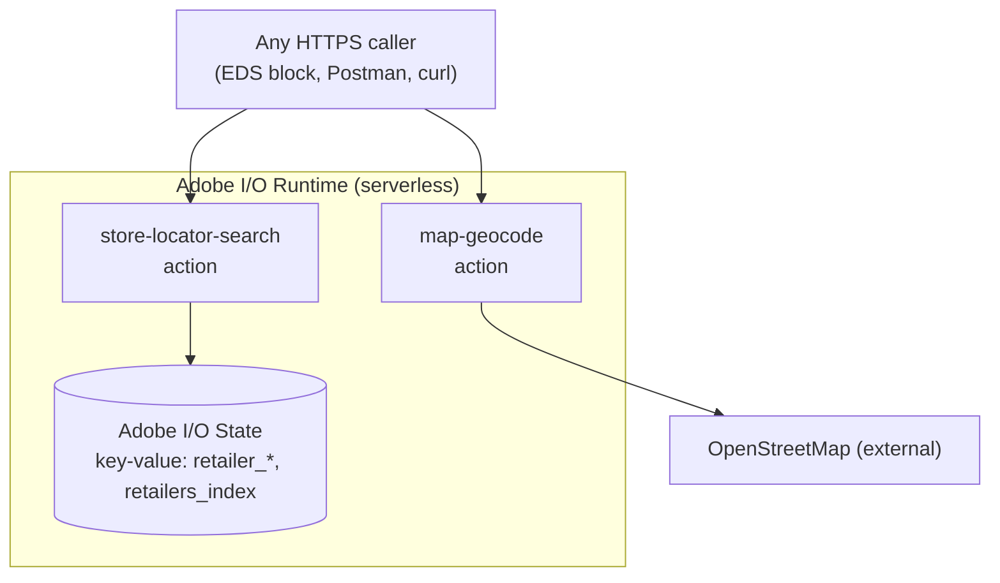

# Module 2 — Architecture: Runtime, Actions & State

> The one question: **What actually runs your code, and where does data live?**
> Spine position: **Action** (the runtime) + **Data** (State).

## The mental model

Three things make up an App Builder app:

> **1. Actions** = your Node.js functions. **2. The Runtime** = Adobe's cloud that runs them on
> demand. **3. State** = a simple built-in key-value store for data your actions need to remember.

## 1. Actions — your code

An action is one Node.js file that exports a `main` function. It receives `params` (inputs) and
returns an object with a `statusCode`, `headers`, and `body`. That's the entire contract.

```js
exports.main = async function main(params) {
  // params = the inputs (query string, JSON body, env-configured inputs)
  return { statusCode: 200, headers: { 'Content-Type': 'application/json' }, body: { hello: params.name } };
};
```

A **web action** is an action exposed over HTTPS at a URL — that's what a browser or storefront can
call. Our `map-geocode` and `store-locator-search` are web actions.

## 2. The Runtime — where actions run

**Adobe I/O Runtime** is Adobe's serverless platform (built on Apache OpenWhisk). You don't manage
servers. When someone hits an action's URL, the runtime spins up your code, runs it, returns the
result, and spins down. You pay only for what runs.

Every action gets a URL shaped like this:
```
https://<namespace>.adobeioruntime.net/api/v1/web/<package>/<action>
```
For our build:
```
https://123456-myproject-integration.adobeioruntime.net/api/v1/web/retailer-storelocator/map-geocode
        └────────────── namespace ──────────────┘                        └──── package ────┘ └─ action ─┘
```
- **namespace** = `<orgId>-<project>-<workspace>` — your deployment target (Module 3).
- **package** = a group of related actions (ours: `retailer-storelocator`).
- **action** = the specific function.

## 3. State — the built-in data store

**Adobe I/O State** (`@adobe/aio-lib-state`) is a simple **key-value store** built into App Builder.
No database to provision. You `put(key, value)`, `get(key)`, `delete(key)`, `list()`.

Our store-locator used it as the store database:
```
retailer_<id>     -> JSON of one store (name, address, lat/lng, hours…)
retailers_index   -> JSON array of all store ids
```
`store-locator-search` reads the index, loads each store, filters by distance, sorts nearest-first.

Key facts about State (learned the practical way):
- **Key-value only** — no SQL-style queries. You filter/sort in your action code.
- **Max TTL is 365 days** — records expire unless re-written. (For permanent data at scale you'd move
  to a real DB; for a POC with hundreds of records, State is perfect and zero-setup.)
- **Per-workspace** — State in your `Integration` workspace is separate from any other workspace's.
  That's why, after deploying to a fresh workspace, search returned nothing until we **seeded** data
  into *that* workspace's State.

## How it all fits — the spine



## The manifest: `app.config.yaml`

One file lists every action, its file, runtime, inputs, and whether it's a web action. **If an action
isn't in `app.config.yaml`, it does not deploy** — a real first-time trap (a `bulk-update-hours`
action existed as code in our repo but wasn't registered, so it never went live).

```yaml
application:
  runtimeManifest:
    packages:
      retailer-storelocator:
        actions:
          map-geocode:
            function: actions/map/geocode/index.js
            web: 'yes'
            runtime: nodejs:20
            inputs:
              LOG_LEVEL: debug
              MAP_PROVIDER: $MAP_PROVIDER          # env value injected at deploy
            annotations:
              require-adobe-auth: false            # public (no Adobe login needed to call it)
              final: true
```

## Common first-time confusions

- **"Where's the database?"** State *is* the built-in store for simple needs. Reach for a real DB
  only when you outgrow key-value.
- **"Why does `$MAP_PROVIDER` matter?"** Values in `inputs:` come from your `.env` at deploy time. If
  you read `params.MAP_PROVIDER` in code but never map it in `inputs:`, the env value never reaches
  the action — a subtle trap.
- **"Is `require-adobe-auth: false` safe?"** For read/search it's fine (public). For *write* actions
  (create/update/delete) you'd want `true` so only authenticated callers can change data.

## Check yourself

1. What are the three parts of an App Builder app?
2. Decode this namespace: `123456-myproject-integration`.
3. Why did search return zero stores right after deploying to a fresh workspace?
4. An action's code exists in the repo but never appears when deployed. What's the most likely cause?

Next: **Module 3 — Setup & Deploy** (nothing → a live action URL).
