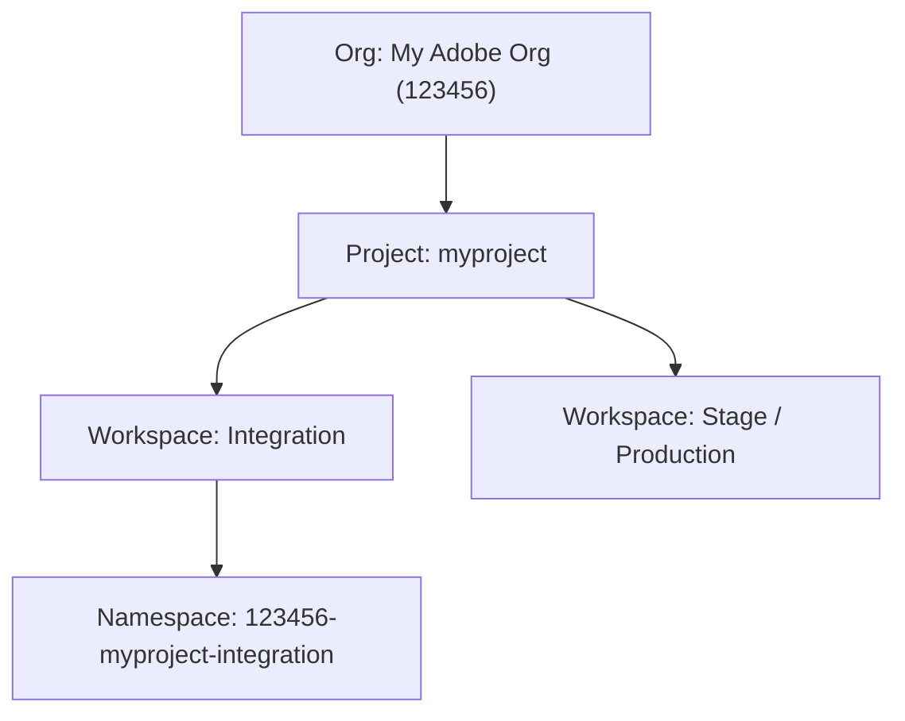
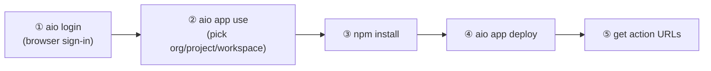

# Module 3 — Setup & Deploy (aio CLI + Console)

> The one question: **How do you go from nothing to a live action URL?**
> Spine position: this is how the **Action** gets onto the **Runtime**.

## The mental model

> **Two things: the `aio` CLI on your machine, and an App Builder *workspace* in the Adobe Developer
> Console to deploy into. `aio` links your local code to that workspace, then uploads it.**

## Prerequisites — tick these first

| # | Prerequisite | Check / install |
|---|---|---|
| 1 | Node.js 18+ (we used 20) | `node -v` |
| 2 | The aio CLI | `npm install -g @adobe/aio-cli` → `aio --version` |
| 3 | Access to an Adobe org with an **App Builder project/workspace** | revealed by `aio console org list` |

Prerequisite 3 is the real gate. App Builder deploys into a **workspace** inside a **project** inside
an **org** in the Adobe Developer Console. If you don't have one, you either create a project
(`developer.adobe.com/console` → Create project → App Builder) or get added to an existing one.

> **In our build:** the learner's only org was *My Adobe Org* (org `123456`), which
> already had a personal App Builder project `myproject` with an `Integration` workspace —
> so no new project was needed. Reusing an existing workspace is the fastest path for a POC.

## The Developer Console model (org → project → workspace)



Each **workspace** = one deployment target = one **namespace** = its own State, its own action URLs.
That's why data seeded in one workspace isn't visible in another.

## The steps (the real sequence)



**① Log in (interactive — opens a browser):**
```bash
aio login
```
> Gotcha: this needs a browser. Running it in a non-interactive shell just times out. The command
> prints an **access token** on success — treat that as a secret; don't paste it anywhere.

**② Link your local app to a workspace:**
```bash
aio app use            # interactive: pick Org → Project → Workspace
# or non-interactively, use your global default config:
aio app use -g --no-input
```
This writes `.aio` and `.env` into the app folder — the local link to your workspace (namespace +
auth). Both are gitignored (they're per-developer, and `.env` holds credentials).

**③ Install dependencies:**
```bash
npm install
```

**④ Deploy:**
```bash
aio app deploy
```
It builds and uploads every action listed in `app.config.yaml`, then prints their URLs:
```
✔ Deployed 7 action(s) for 'application'
  -> https://123456-myproject-integration.adobeioruntime.net/api/v1/web/retailer-storelocator/map-geocode
  -> …/store-locator-search
Successful deployment 🏄
```

**⑤ Confirm / inspect anytime:**
```bash
aio app info         # shows your namespace and config
```

## First-time gotchas (all real)

- **`aio login` "hangs":** it's waiting for the browser. Run it interactively in your own terminal.
- **No workspace shows in `aio app use`:** you're not on an App Builder project — create one or ask
  an admin to add you. (Check `aio console org list` / `aio console project list` to see access.)
- **`aio app deploy` needs `.env`:** if `.aio`/`.env` aren't written yet, run `aio app use` first.
- **Env inputs:** if `app.config.yaml` references `$MAP_PROVIDER`, add `MAP_PROVIDER=osm` to `.env`
  (or the value resolves empty — usually fine if your code has a default).
- **Deploying to a *shared* workspace** (e.g. a team's) overwrites its actions — coordinate first.
  For a POC, deploy to your own personal workspace and there's zero blast radius.

## Deploy target vs. source control — an important distinction

`aio app deploy` uploads to Adobe I/O Runtime using **your workspace credentials** — it has **nothing
to do with GitHub push access.** In our build, the developer couldn't push to the shared team GitHub
repo, but could still deploy the actions to their own workspace and get working URLs. Deploy target
(a cloud workspace) and code contribution (a git repo) are separate concerns.

## Check yourself

1. What three-level hierarchy in the Developer Console defines a deployment target?
2. What do `.aio` and `.env` hold, and why are they gitignored?
3. Why can you deploy actions even without push access to the team's GitHub repo?
4. `aio app deploy` fails saying it has no credentials/namespace. What step did you skip?

Next: **Module 4 — Building Actions & Using State** (writing the code itself).
