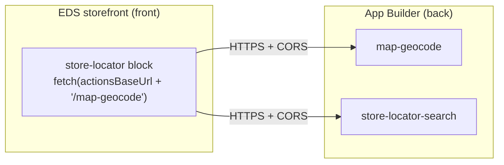
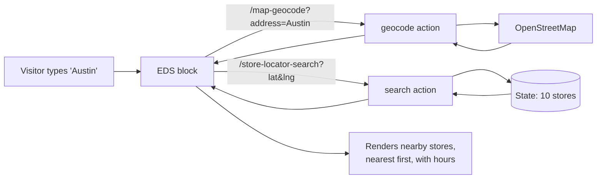

# Module 5 — Connecting Actions to a Storefront (the bridge to EDS)

> The one question: **How does an EDS block call your action — and what's the CORS gotcha everyone
> hits?**
> Spine position: **Consumer** (the storefront) ← **Response** (your action).

## The mental model

> **The storefront and the backend are two separate apps connected by one thing: a URL. The EDS block
> `fetch()`es your action's URL. The only setup is telling the block that URL, and making sure the
> browser is allowed to call it (CORS).**



## Step 1 — tell the block where the backend is

The block reads a global config object set once in the storefront's `scripts/scripts.js`:

```js
window.storeLocatorConfig = {
  actionsBaseUrl: 'https://123456-myproject-integration.adobeioruntime.net/api/v1/web/retailer-storelocator',
};
```

The block then builds URLs from it:
```js
const base = window.storeLocatorConfig.actionsBaseUrl;
const res = await fetch(`${base}/map-geocode?address=${encodeURIComponent(address)}`);
```

> First-time trap: if the config isn't set, the block falls back to a placeholder like
> `https://<namespace>.../map-geocode`, and the browser errors with **"Failed to parse URL"** —
> because `<namespace>` is literally in the string. That error = "the config didn't reach the page."

## Step 2 — the CORS gotcha (the big one)

When the block first called the action from the browser, it failed with:

```
Access to fetch ... blocked by CORS policy: The 'Access-Control-Allow-Origin' header
contains multiple values '*,*', but only one is allowed.
```

**Why:** Adobe I/O Runtime **automatically** adds CORS headers (`Access-Control-Allow-Origin: *`,
methods, headers) to web actions. Our action code *also* set `Access-Control-Allow-Origin: *`. Two
sources → `*,*` → browsers reject duplicates.

**The fix:** don't set CORS headers in your action — let the runtime provide them. Only set
`Content-Type`:

```js
// response-web.js — CORS-safe: runtime already injects Access-Control-* for web actions.
function ok(body, statusCode = 200) {
  return { statusCode, headers: { 'Content-Type': 'application/json' }, body };
}
```

Verify from the terminal:
```bash
curl -s -D - -o /dev/null ".../map-geocode?address=Austin" | grep -i access-control-allow-origin
# before: access-control-allow-origin: *,*     (browser rejects)
# after:  access-control-allow-origin: *        (works)
```

> Why it hid until now: `curl` and Node's `fetch` (in the seed script) **don't enforce CORS**, so the
> bug is invisible until a real **browser** calls the action. The storefront block was the first
> browser caller — that's when it surfaced.

## Step 3 — deploy both sides

- **Backend:** `aio app deploy` (actions to I/O Runtime).
- **Frontend:** commit the `scripts.js` config, push to the storefront repo's `main`; **Code Sync**
  deploys it to `.aem.page` (preview) and `.aem.live` (published). Code changes propagate to both
  automatically; content pages need a separate Publish.
- Expect a short **CDN propagation lag** after merge — the new `scripts.js` takes a minute to appear
  on all edge nodes; a hard refresh (Cmd+Shift+R) helps.

## The full end-to-end (what "done" looks like)



Real result: searching "Chicago" on the live page returned **Chicago Loop, 1.02 km away**, straight
from the deployed actions and seeded State. That's the whole spine working: browser → action →
data → response → rendered.

## Check yourself

1. What single piece of information connects the storefront block to the backend?
2. You see "Failed to parse URL from https://\<namespace\>...". What does that tell you?
3. Explain the `*,*` CORS error and its fix in one or two sentences.
4. Why did the CORS bug not show up when testing with curl or the seed script?

That completes the masterclass. Loop back to [SKILL.md](SKILL.md) for the module map, or run
`/simulate appbuilder` to walk the whole build step by step.
