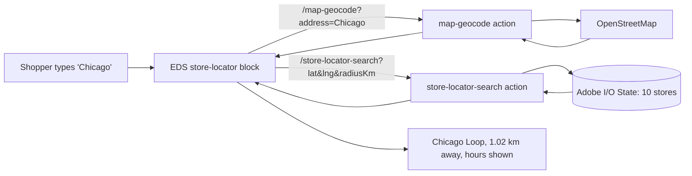

# Simulator Walkthrough — the real store-locator build, end to end

This is the running example the whole masterclass is grounded in — a **real first build**, with the
exact commands, URLs, and every gotcha hit along the way. Use it with `/simulate appbuilder` to walk
a learner through "nothing → a working backend called by a live storefront."

## The goal

A store locator: a shopper types a city, sees nearby stores. Two backend actions make that possible:
- **`map-geocode`** — address → latitude/longitude (via OpenStreetMap).
- **`store-locator-search`** — lat/lng → nearby stores, nearest first (from Adobe I/O State).

Both deployed to Adobe I/O Runtime and called by an Edge Delivery Services (EDS) storefront block.

## The end-to-end picture



## The build, step by step

### 1. Get the code onto your machine
Clone the App Builder repo (it already had the retailer CRUD actions from an earlier epic). Add the
two new actions (`actions/map/geocode/index.js`, `actions/store-locator/search/index.js`) plus a
distance helper, and **register them in `app.config.yaml`** — the step that makes them deployable.

### 2. Log in and pick a workspace
```bash
aio login                 # opens a browser; prints an access token (keep it secret)
aio console org list      # what orgs can I reach? → "My Adobe Org (123456)"
aio app use               # pick Org → Project (myproject) → Workspace (Integration)
```
This wrote `.aio` + `.env`, linking the app to namespace `123456-myproject-integration`.

> **Gotcha #1 — access gate.** `aio app use` only offers projects you belong to. Here an existing
> personal project (`myproject`) was reused — no need to create a new one. If nothing
> shows, you need to create a project or be added to one.

### 3. Configure the geocoding provider
`.env` got `MAP_PROVIDER=osm` (free OpenStreetMap, the default). `app.config.yaml` maps it into the
action via `inputs: { MAP_PROVIDER: $MAP_PROVIDER }`.

> **Gotcha #2 — node-fetch.** The reference geocode action imported `node-fetch`. On `nodejs:20`
> there's a global `fetch`, so that import was dropped rather than adding a dependency.

### 4. Deploy
```bash
npm install
aio app deploy
```
Output listed the live URLs, including:
```
…/retailer-storelocator/map-geocode
…/retailer-storelocator/store-locator-search
Successful deployment 🏄
```

### 5. Seed data (State is empty in a fresh workspace)
```bash
BASE='https://123456-myproject-integration.adobeioruntime.net/api/v1/web/retailer-storelocator' \
  node test-payloads/seed.js
# → seeded 10 retailers across US cities; retailers-list confirmed "stored: 10 retailers"
```

> **Gotcha #3 — empty results.** Right after deploy, search returned nothing. Not a bug: State is
> **per-workspace**, and this workspace had no stores until seeded.

### 6. Verify the backend with curl
```bash
curl ".../map-geocode?address=Austin,TX"
# → { "lat": 30.27, "lng": -97.74, "formattedAddress": "Austin, ...", "provider": "osm" }

curl ".../store-locator-search?lat=30.27&lng=-97.74&radiusKm=5000&maxResults=5"
# → Austin Downtown 0.64 km, then Denver, Atlanta, Chicago, Miami (nearest first)
```
Backend confirmed working before touching the frontend.

### 7. Wire the storefront block
In the EDS storefront's `scripts/scripts.js`:
```js
window.storeLocatorConfig = {
  actionsBaseUrl: 'https://123456-myproject-integration.adobeioruntime.net/api/v1/web/retailer-storelocator',
};
```
Commit, push to `main`; Code Sync deploys it.

> **Gotcha #4 — "Failed to parse URL from https://\<namespace\>...".** Before the config was live,
> the block used its placeholder URL (literal `<namespace>`). That error just means "the config
> hasn't reached the page yet" — wait for Code Sync + hard-refresh.

### 8. The CORS bug (the big lesson)
The browser call failed:
```
Access-Control-Allow-Origin header contains multiple values '*,*', but only one is allowed.
```
Adobe I/O Runtime auto-adds CORS to web actions; the action code added it too → `*,*`. Fix: stop
setting CORS in the action. To avoid changing shared code, the two new actions used a CORS-safe
`response-web.js` (Content-Type only). Redeploy → header became a single `*` → browser calls worked.

> **Gotcha #5 — why it hid.** curl and the Node seed script don't enforce CORS. The bug only appeared
> when a **browser** (the storefront) called the action.

### 9. It works, live
Searching "Chicago" on the live storefront returned **Chicago Loop, 233 S Wacker Drive, 1.02 km
away**, with real hours — straight from the deployed actions and seeded State.

## The five gotchas, as a checklist

1. **Register actions in `app.config.yaml`** or they never deploy.
2. **Access gate:** `aio app use` needs a project/workspace you belong to.
3. **State is per-workspace** — seed data into the workspace you deployed to.
4. **Placeholder URL error** = the storefront config hasn't propagated yet.
5. **CORS `*,*`** = don't set CORS headers yourself; the runtime already does. Only browsers expose it.

## Deploy target vs. GitHub — remember

`aio app deploy` goes to your **workspace** using workspace credentials — independent of GitHub push
access. You can deploy actions to your own workspace even if you can't push to the team's repo.
