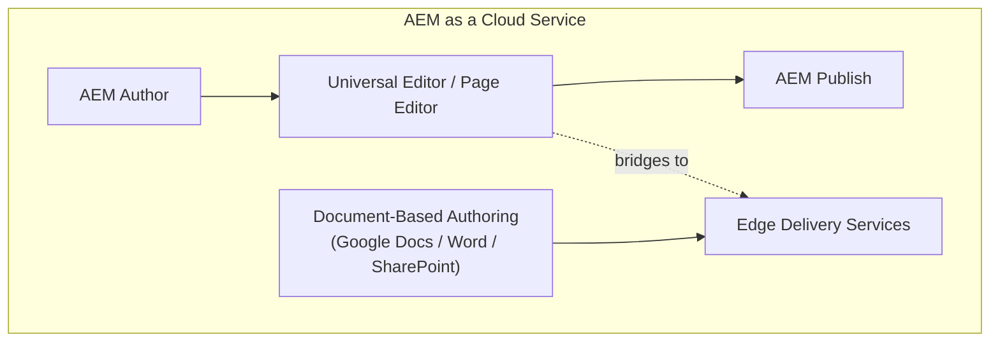

# Module 1 — What Is EDS?

> The one question: **What is EDS, and where does it sit inside Adobe's stack?**
> Pipeline position: none yet — this is the map before the journey.

## The mental model

Think of Edge Delivery Services as swapping the *engine* of a website, not the whole car. A
traditional site's engine is: database + templates + a build step + a deploy pipeline. EDS's engine
is: **a document (a Google Doc, a Word file, or a doc edited in DA.live) gets turned straight into
HTML at the edge — no build required.**

> **EDS is not a new Adobe product. It's a module *inside* AEM as a Cloud Service.**

That single sentence resolves most of the confusion people have walking in.

## The mechanics

- **EDS = Edge Delivery Services**, formerly known as **AEM Franklin** or **Helix** — same
  technology, renamed over time. It's also called **"document-based authoring."** All four names
  refer to the same thing; expect to see all of them in Adobe docs.
- It is **not a standalone Adobe product** the way Commerce, Target, or Analytics are. It's an
  individual module/functionality — you could call it a CMS — *within* **AEM as a Cloud Service
  (AEMaaCS)**.
- Classic AEMaaCS runs on two tiers: **Author** (create) → **Publish** (serve). EDS adds a separate
  delivery path fed by **Document-Based Authoring** (Google Docs, Sheets, Word, Excel, SharePoint)
  instead of — or alongside — AEM Author.
- You can **build, run, and author an entire site with EDS without ever touching AEM Author.**
  AEM Author integration is *optional*, bridged through the **Universal Editor / Page Editor** —
  mainly relevant for VIP/premium-support customers migrating an *existing* AEM site into EDS.
- The stated outcome, straight from the program's own slides: **improved conversion, reduced cost,
  and extreme "content velocity"** (a real Adobe Analytics metric — the rate content actually ships).
- Why AEM's existing strength still matters: EDS isn't replacing AEM's authoring value — AEM is
  already a well-established, streamlined product for building and authoring sites. EDS replaces
  the **delivery and build side**, not the idea of structured authoring itself.

> The dashed line matters: AEM Author → EDS is a *bridge*, not a requirement. Document-based
> authoring can feed EDS entirely on its own.

## Grounded in the enablement program

During the real Aug 2026 session, dozens of engineers — each under their own personal GitHub
account — forked `adobe/aem-boilerplate` into a personal `eds-enablement` repo and had it **live
within about 10 minutes**, with zero backend, zero build pipeline, and zero AEM Author instance
involved anywhere.
That's the whole point of Module 1's claim made concrete: EDS stood entirely on its own for every
one of them. This same repo is the running example for every module in this skill — see
[simulator-walkthrough.md](simulator-walkthrough.md).

## Common mistakes / misconceptions

These are the exact questions the program itself flagged as commonly asked, with the real answers:

- **"Is EDS a new feature or module for AEM?"** → It *is* a module within AEMaaCS, but it works
  completely standalone — it doesn't "add a feature" to an existing AEM site, it's a whole
  alternative delivery path.
- **"Is EDS a new product from Adobe Experience Cloud?"** → No. Unlike Commerce, Target, or
  Analytics, it is not sold or positioned as a standalone product.
- **Assuming AEM Author is required.** It's optional, and only relevant for migrating existing AEM
  sites via the Universal Editor.
- **Assuming "document-based authoring" means something exotic.** It means exactly what it sounds
  like: editing a Google Doc or Word file *is* editing the website.

## Check yourself

1. What are the other three names EDS goes by, and why does that matter when reading Adobe docs?
2. True or false: EDS is a standalone Adobe product like Commerce or Target. Justify your answer.
3. Can you author and publish a site with EDS without ever opening AEM Author? What's the one
   optional bridge that connects the two?

## Where next

→ **Module 2 — Architecture & Content Hub.** Now that you know *what* EDS is, the next question is
*how* a document actually becomes a live page.
