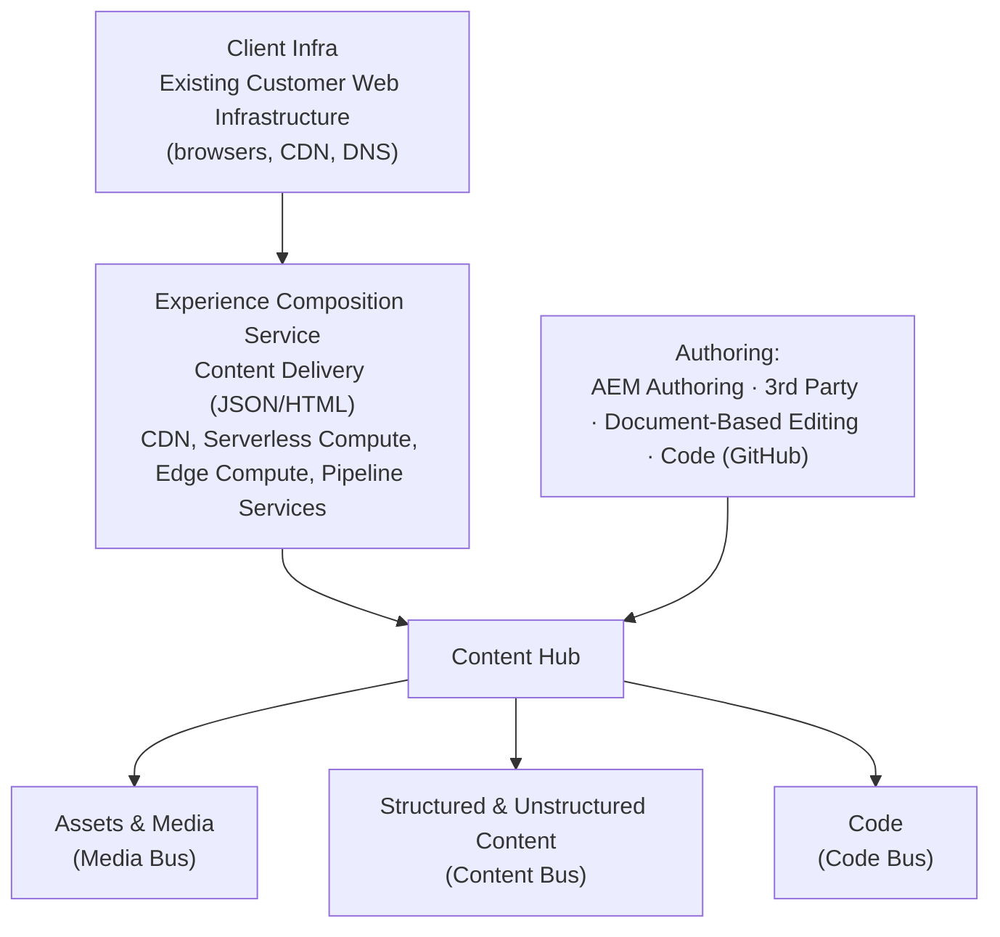
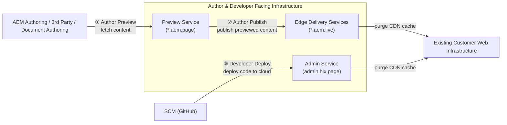
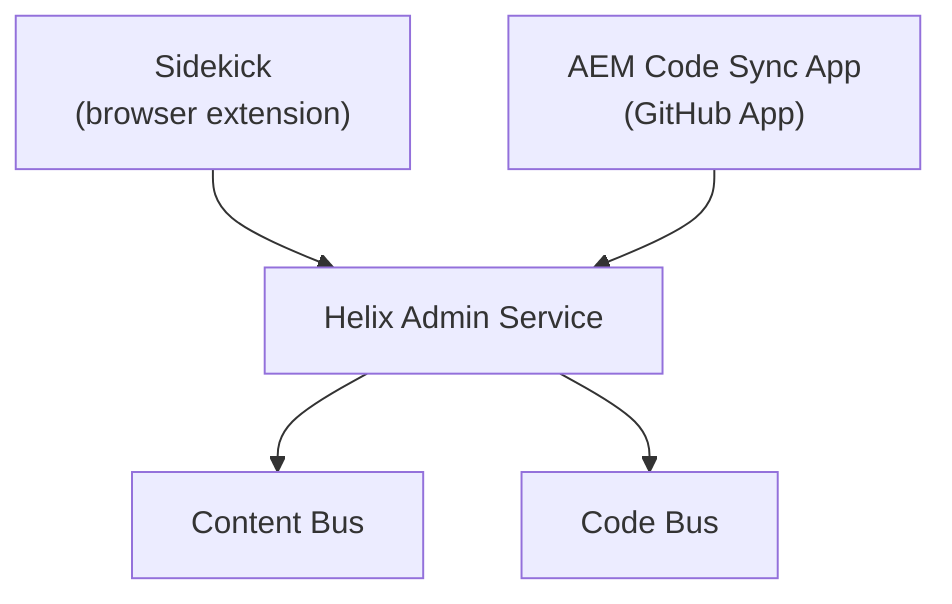

# Module 2 — Architecture & Content Hub

> The one question: **How does a document actually become a live, cached web page?**
> Pipeline position: **Content Hub → Pipeline → Preview → Publish → Live/Edge.**

## The mental model

EDS is a pipeline: a document goes in one end, a fully-rendered, edge-cached web page comes out the
other, and **nothing in between needs to be "built."** Everything in this module is really just
answering: what are the stops along that pipeline, and who feeds each one?

## The mechanics

**Serverless microservice architecture.** EDS is built as composable, single-purpose microservices
that communicate over HTTPS, each living in its own Git repository. The one-line summary the program
uses: **docs + code → edge → visitors.**

**The full stack, top to bottom:**

**The three buses**, explained plainly:
- **Content bus** — the actual words and structure of the page.
- **Media bus** — images, video, other assets.
- **Code bus** — the JS/CSS/block code. Always sourced from **GitHub** — there is no backend code
  in EDS, full stop.

**The three operations** that move things through the pipeline:

1. **Author Preview** — fetches content from AEM Authoring, 3rd party, or Document Authoring into
   the **Preview Service** (`*.aem.page`), which stores content in the cloud.
2. **Author Publish** — takes previewed content live, pushing it to **Edge Delivery Services**
   (`*.aem.live`) and purging the CDN cache.
3. **Developer Deploy** — pushes code from source control (GitHub) to the cloud, and also purges
   the CDN cache.

**Edge CDN has three layers:**
- **Customer/BYO CDN** — the client's own CDN, optional, sits on top.
- **Outer CDN** (EDS itself, `*.aem.live`) — serves *live* content, cached.
- **Inner CDN** (Preview Service, `*.aem.page`) — serves *preview-only* content, **not** cached.

In practice you get two levels of caching: customer CDN + outer CDN.

**Pipeline services ("Pipe").** These transform documents into "hyper-media"/HTML ready for
rendering. The main pipeline is **`helix-pipeline-service`**, using the **`helix-html-pipeline`**
framework — it renders HTML and can also render filtered JSON directly. It pulls code/config from
the **code bus** and content from the **content bus**.

**Core terminology (memorize these four — they recur everywhere):**

| Term | Plain-English meaning |
|------|------------------------|
| **Edge** | Delivery through the CDN/edge computing platform |
| **Pipe** | Pipeline services that transform documents into HTML — *not* a CI/CD pipeline |
| **Author** | Content creation, in Google Docs, Word, or DA.live |
| **Dev** | Frontend code & config, always kept in GitHub — no backend code in EDS |

## Grounded in the enablement program

Trace the real `eds-enablement` repo through this architecture: an author edits the `index` doc in
DA.live (content bus) → `helix-pipeline-service` transforms it → it appears at
`main--eds-enablement--<owner>.aem.page` (inner CDN, uncached, preview-only) → publishing
promotes it to `main--eds-enablement--<owner>.aem.live` (outer CDN, cached, purged on publish).
Meanwhile, a developer's CSS change goes GitHub → **AEM Code Sync** (Module 4) → the same pipeline
picks up new code-bus content → both preview and live pick it up, with no separate deploy step.

## Deeper still — the Helix Admin Service (confirmed, Session 2)

Session 2 named the piece that Module 2's diagrams above imply but don't label: the **Helix Admin
Service**. Sidekick (browser extension) and the **AEM Code Sync** GitHub App are both just
*triggers* — neither does the real work itself. Both call into the Helix Admin Service, which is
what actually converts documents, syncs code, and manages publish state, routing into the content
bus and code bus.

**From document to Markdown:** the content bus doesn't store your Word doc or Google Doc as-is —
two adapters convert it first: a **Word-to-Markdown adapter** and a **Google-Docs-to-Markdown**
adapter. (Spreadsheets are the exception — they become **JSON**, not Markdown.) That's what actually
lands in the content bus.

**What "Publish" really does:** the content bus is organized as one folder per customer, split into
a **Preview partition** (serves `*.aem.page`, non-cached) and a **Live partition** (serves
`*.aem.live`, cached). Publishing is **not** a rebuild or regeneration step — it's a literal *copy*
of your content from the Preview partition to the Live partition. This is why publishing is fast and
why nothing "compiles."

**Why your URL has that exact shape:** `main--<repo>--<owner>.aem.page` is built directly from three
things — **Owner** (your GitHub username/org), **Repo**, and **Branch**. Any mismatch in any of the
three (a typo, wrong account) breaks the URL silently with no helpful error — confirmed directly by
a real incident from this program's own Session 1 hands-on demos.

**Resilience — two implementation stacks, not one:** EDS actually runs on a dual-stack setup for
failover:

| | Default stack | Backup stack |
|---|---|---|
| Storage (Content Hub) | AWS S3 | Cloudflare R2 |
| Compute | AWS Lambda | Cloudflare Worker |
| Routing/Delivery (CDN) | Fastly | Cloudflare CDN |

If a major CDN provider has an outage, sites automatically fail over to the second stack and stay
up. This is infrastructure-level resilience, not something a project team configures per site.

## Common mistakes / misconceptions

- **Thinking "Pipe" means a CI/CD build pipeline.** It doesn't — it's a *rendering* pipeline
  (document → HTML), not a deploy pipeline. There is no build step to configure.
- **Confusing Preview (`.aem.page`) with Live (`.aem.live`).** Preview is not cached and not
  production; forgetting to hard-reload after a change is the #1 "it didn't work" false alarm.
- **Assuming code can live anywhere but GitHub.** "Dev" in the glossary always means
  GitHub-hosted frontend code/config — there is no backend code in EDS.

## Check yourself

1. Name the three buses inside the Content Hub and what each one carries.
2. Walk through the three operations (Author Preview, Author Publish, Developer Deploy) — what
   triggers each, and what does each one purge?
3. Why are there two CDN tiers (inner and outer), and why is only one of them cached?
4. A developer's CSS change never shows up on the live site. Which bus does that change live in,
   and what's the most likely missing step? (Hint: see Module 4.)

## Where next

→ **Module 3 — Why EDS (& the Alternatives).** Now that you know how it works, the next question is
why a team would choose this architecture over the alternatives.
