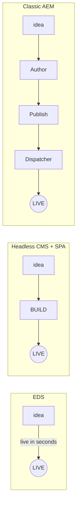

# Module 3 — Why EDS (& the Alternatives)

> The one question: **Why would a team choose EDS over headless CMS+SPA or traditional AEM?**
> Pipeline position: none directly — this is the "why," not a pipeline stage.

## The mental model

> **EDS's pitch: delete two things most web teams take for granted — the build step, and the CMS
> UI — and still end up faster.**

Everything in this module is really one comparison, viewed from different angles: authoring
experience, build effort, performance out of the box, and hosting.

## The mechanics

**No build-heavy frameworks.** EDS strips away dependencies on complex backends and introduces a
**block-based development model** driven by vanilla JavaScript and CSS — no preprocessors, no JSON
build artifacts.

**Faster deployment.** GitHub integration means you manage and deploy code directly from the
repository, with no external dependencies.

**Web performance, by default:**
- Sub-second page loads.
- Minimal JS bundle, no heavy client framework.
- Edge caching **built in, not bolted on** — this is architectural, not a config you turn on
  (Module 2's CDN layers).
- Designed around **Core Web Vitals** from the ground up.

**Business impact, stated as the program's own headline claim:**
- **Consistently 100 Lighthouse scores** — and the program is explicit that this is the **baseline
  expectation, not a stretch goal.**
- Faster time-to-market for content teams.
- Lower hosting/infra overhead.
- SEO benefits that fall out of speed and Core Web Vitals.

**The three-way comparison:**

| | **EDS** | **Headless CMS + SPA** | **Traditional AEM (AMS)** |
|---|---|---|---|
| Authoring | Docs / SharePoint | CMS UI / forms | AEM author instance |
| Build | None for content | Client build pipeline | Full CI/CD deploy cycle |
| Performance out-of-box | Excellent (100 Lighthouse) | Depends on framework/JS | Needs tuning / Dispatcher |
| Hosting | Managed edge/CDN | Self-managed / 3rd-party CDN | Dedicated AEM infra |

**"One idea → three ways to go live":**

## Grounded in the enablement program

The same `eds-enablement` demo from Module 1 makes this concrete: participants had a live site on a
**free personal GitHub account, in about 10 minutes, with zero infrastructure cost.** The equivalent
Headless CMS+SPA path would need a build pipeline and hosting setup first; the equivalent Classic
AEM path would need Author → Publish → Dispatcher tuning before anything real users could see it.

**Why this specific team is doing this program at all** (from the live discussion): EDS was
introduced specifically to fix **performance bottlenecks and tight coupling in Adobe Commerce** —
enabling faster content updates and decoupled front-end development, platform-agnostic authoring,
and integration with a variety of backends. The Lighthouse-100 default isn't magic — it comes from
**three-phase rendering**: **eager, lazy, and delayed** loading, applied per block. EDS can run
**standalone or hybrid** with AEM — some pages on EDS, some on classic AEM in the same site — and
Adobe's own recommendation is that **new** AEM projects should start with EDS.

## Common mistakes / misconceptions

- **Assuming EDS's speed is something you configure or tune.** It isn't — caching and the
  three-phase loading model are architectural defaults, not settings you turn on.
- **Treating Headless CMS+SPA and EDS as the same category.** One needs a client build pipeline;
  EDS explicitly doesn't.
- **Assuming EDS replaces AEM everywhere.** Hybrid deployment — some pages EDS, some classic AEM —
  is supported and common; it's not all-or-nothing.

## Check yourself

1. Fill in the three-way comparison table from memory: Authoring, Build, Performance, Hosting for
   EDS vs. Headless CMS+SPA vs. Traditional AEM.
2. Why is "100 Lighthouse score" described as a baseline expectation rather than a stretch goal?
3. What three loading phases give EDS its default performance, and why does phasing matter?
4. Can a single site run some pages on EDS and others on classic AEM? What does Adobe recommend for
   brand-new projects?

## Where next

→ **Module 4 — Hands-On Setup & Code Sync.** Time to stop comparing and actually build one — from
zero to a live EDS site.
