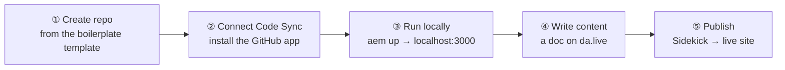
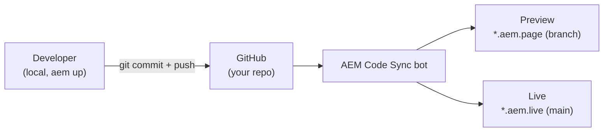

# Module 4 — Hands-On Setup & Code Sync

> The one question: **How do you go from nothing to a live EDS site in under 10 minutes?**
> Pipeline position: **Dev (GitHub) → Code Sync → Preview/Live.**

## The mental model

> **There are exactly two moving parts to get from "nothing" to "a live EDS site": a GitHub repo,
> and the AEM Code Sync app connected to it. Everything else is default.**

This module is deliberately hands-on — the "grounding example" *is* the exercise. Do the steps
yourself; that's how the real session taught it.

## The mechanics

**Prerequisites checklist — tick all six before starting:**

| # | Prerequisite | Check |
|---|---|---|
| 1 | GitHub account, signed in, able to create repos | — |
| 2 | Node.js 18+ | `node -v` |
| 3 | Git | `git --version` |
| 4 | Chrome + Sidekick extension, installed & pinned | — |
| 5 | Code editor (VS Code recommended) | — |
| 6 | AEM CLI | `npm i -g @adobe/aem-cli` |

Optional: Google Drive / SharePoint access — only needed if mounting doc-based content from there
instead of DA.live. Full guide: `aem.live/developer/tutorial`. Sidekick: `aem.live/docs/sidekick`.

**The 5-step demo flow** (about 10 minutes, completely free, on a personal GitHub account):



**Demo — create the repo & connect Code Sync, step by step:**

1. Open `github.com/adobe/aem-boilerplate` → **"Use this template"** → **"Create a new repository."**
2. Name it (e.g. `my-eds-site`), owner = your account, visibility **Public**.
3. Install the Code Sync app: `github.com/apps/aem-code-sync/installations/new`.
4. Choose **"Only select repositories"** → pick your new repo → **Save**.
5. Verify the site is already live at `https://main--<repo>--<owner>.aem.page`.

> **Most common mistake: skipping step 3.** If you skip installing Code Sync, the `.aem.page` URL
> returns a 404 forever — Code Sync is literally what connects GitHub to the edge. There is no
> other way the content bus gets fed from a repo you just created.

**Local development, once the repo is live:**

```bash
npm install -g @adobe/aem-cli   # if not already installed
git clone https://github.com/<owner>/<repo>
cd <repo>
aem up                          # opens http://localhost:3000/ with live reload
```

A good place to start making changes: the `blocks` folder, where most of the styling and block code
lives. Edit a `.css` or `.js` file there and see the change immediately in the browser.

**Shipping the change — "How Code Ships":**



Once you're ready, `git add`, `commit`, and `push` your code to both preview
(`https://<branch>--<repo>--<owner>.aem.page/`) and production
(`https://<branch>--<repo>--<owner>.aem.live/`) — **that's it, you made it.** Pushing a commit means
the Code Sync bot picks it up, the branch preview updates in seconds, and merging to `main` goes
live.

> **The punchline the whole module builds to: NO build pipeline.** This is what removes the classic
> deploy bottleneck (compare Module 3's Traditional AEM row: Author → Publish → Dispatcher).

## Anatomy of a project (confirmed, Session 2)

Once your repo exists, here's what's actually in it and why — all of it buildless, served straight
from GitHub. (Source: `aem.live/developer/anatomy-of-a-project`.)

| File/folder | Role |
|---|---|
| `head.html` | Injected into every page's `<head>` — one place to control markup with no build step. Only edit it for base-URL remapping or legacy-browser support; **no inline scripts/martech here** (it's a performance hit). |
| `404.html` | Custom error page at the repo root — gives visitors an on-brand experience instead of a blank default. Author and commit it like a normal page. |
| `.hlxignore` | A `.gitignore`-style file (same syntax) that keeps private/irrelevant files — tests, build artifacts — out of delivery. |
| `robots.txt` | Standard robots-exclusion file, but it **only takes effect on the real production domain** — `.aem.page`/`.aem.live` always force disallow-all regardless of what this file says. |
| `/scripts` | `scripts.js`, `aem.js` — the lazy-phase trigger logic. |
| `/styles` | `styles.css` (LCP-critical — loaded eager) and `lazy-styles.css`. |
| `/blocks` | One subfolder per block: `blockname/blockname.css` + `blockname.js`. |
| `/icons` | SVGs, referenced in content as `:iconname:`. |

**The block naming rule (memorize this — it's a real, silent-failure debugging trap):** folder name
= CSS class = CSS filename = JS filename, all identical. **A mismatched table header in the source
doc is why a block silently fails to render** — no error, it just doesn't apply.

## Grounded in the enablement program

This module *is* the real demo, retold: dozens of engineers ran exactly these five steps live,
each forking `adobe/aem-boilerplate` into their own `eds-enablement` repo. The friction that
actually came up is worth knowing before you hit it yourself:

- **Node version mismatches** — the CLI needs Node 18+; check with `node -v` before anything else.
- **Template-repo owner/visibility confusion** — when creating from the boilerplate template,
  picking the wrong owner (an org vs. your personal account) is an easy first mistake.
- **Code Sync permission scope** — some org setups don't default to "all repositories"; you must
  explicitly choose **"Only select repositories"** and pick the new repo, or the install silently
  doesn't cover it.
- **Repo ownership transfers** — several participants had to transfer a repo between accounts/orgs
  to resolve access, which is a normal (if slightly alarming-looking) GitHub flow, not a sign
  something's broken.
- **2FA / sudo-mode confirmation** — confirming a GitHub App install sometimes requires a fresh
  sudo-mode verification code; this is standard GitHub security, not an EDS-specific issue.

**Shipping via a PR — step by step (the recommended real-world path, not just direct push).**
Pushing straight to `main` works, but real teams open a branch + PR instead, because a PR gets you
a reviewable before/after comparison plus an automated performance check. Real example, from a
learner's own repo: a PR titled "Update eds-custom-block.js":

1. Create a branch (not `main`) and commit your change there — e.g. `<your-username>-patch-1`.
2. Push the branch and open a PR into `main`. **Every branch automatically gets its own live URLs**,
   scoped by branch name, using the exact same pattern as `main` — just swap in the branch name:
   `<branch>--<repo>--<owner>.aem.page` (preview) and `<branch>--<repo>--<owner>.aem.live` (yes,
   even a live/production-style URL per branch, not only for `main`).
3. **Fill in the PR description template** most real repos enforce for EDS work: the GitHub issue
   the PR is for (`Fix #<n>`), and **before/after test URLs** — before = `main`'s live URL, after =
   your own branch's live URL. A reviewer compares the two directly, no local checkout needed.
4. The **`aem-code-sync` bot comments on the PR immediately**, in two parts:
   - First: *"I will run some actions to deploy your branch and validate page speed,"* with three
     tickable checkboxes — **Re-run all PSI checks**, **Re-run failed PSI checks**, **Re-sync
     branch** — the bot treats these as commands when checked, not just status text.
   - Second, once it finishes: a scores table, one row for 📱 mobile and one for 🖥️ desktop, each
     with Performance/Accessibility/SEO/Best-Practices scores, SI/FCP/LCP/TBT/CLS audit metrics, and
     a link to the full Google PageSpeed Insights (PSI) report.
5. **Two independent checks can show up on the same PR — don't confuse them.** A repo's own generic
   `Build / build` GitHub Action can fail for reasons that have nothing to do with EDS (lint, test
   config, etc.), while the bot's own `aem-psi-check` reports the real Lighthouse score (e.g. `100`)
   completely independently. One failing doesn't mean the other — or the actual deploy — is broken.
6. **Wait for the PSI comment before merging** — merging first means shipping to Live without ever
   seeing its performance/accessibility impact, the concrete version of the boilerplate's own "Peak
   performance" pitch. Merge once PSI is healthy and GitHub reports no conflicts with the base
   branch.

## Real incident: "Code Sync is installed, but the site has zero styling"

A genuinely confusing failure mode, worth knowing before you hit it: Code Sync can be **correctly
installed** on your repo and you can still get a page with no CSS, no JS, and no console errors at
all — blocks render as plain, unstyled `<div>`s, using the browser's bare default fonts.

**Why it happens:** installing the Code Sync app does **not** retroactively sync commits that
already exist. It only reacts to the *next* `git push`. If your repo's last commit happened before
you installed the app (or you installed it and haven't pushed since), the code bus has simply never
been asked to fetch `head.html`, `scripts.js`, `styles.css`, or any block file — even though they're
sitting right there on GitHub. Since `head.html`'s `<script>`/`<link>` tags never get injected into
the page, the browser never even *tries* to request those files — there's nothing to 404, which is
why it's silent.

**How to diagnose it — the Helix Admin API:**

```bash
curl https://admin.hlx.page/status/<owner>/<repo>/<branch>
```

Check the `code` field. `"status": 200` means the code bus is healthy; `"status": 400` (or a plain
`404` when you fetch one specific file, e.g. `.../code/<owner>/<repo>/<branch>/head.html`) confirms
the code bus has nothing. The tell is that `preview`/`live` (which read from the *content* bus,
i.e. da.live) are usually perfectly healthy at the same time — content and code are separate buses,
and only one of them is broken.

**The fix, two ways:**
1. **Normal way:** commit anything and push. The Code Sync app's webhook fires on the push and
   syncs the code bus automatically going forward.
2. **Force it immediately, without a new push:**
   ```bash
   curl -X POST https://admin.hlx.page/code/<owner>/<repo>/<branch>/*
   ```
   This tells Helix "go fetch whatever is currently on GitHub's `<branch>` right now" — a one-time
   manual pull of whatever's already committed. It does **not** push anything, and it can't pull in
   files that only exist on your laptop and were never committed — only code that has actually
   reached GitHub can ever reach the code bus, either by push-trigger or by this manual pull.

**Push vs. sync — the distinction that actually matters:** *push* = your commits going **to**
GitHub (a git action you control). *Sync* = the code bus **fetching from** GitHub (a Helix action,
normally auto-triggered by a push, forceable via the admin API above). Local dev (`aem up`) adds a
third wrinkle: it always serves **your local files** for anything under `/blocks`, `/scripts`,
`/styles` regardless of git or sync status — so a brand-new, never-committed block can render
perfectly on `localhost:3000` while being completely invisible on the real `.aem.page`/`.aem.live`
site, because those only ever see what's reached the code bus.

## Common mistakes / misconceptions

- **Skipping Code Sync install and assuming the boilerplate "just works."** It won't — see the
  404 warning above.
- **Assuming installing Code Sync retroactively syncs old commits.** It only reacts to the *next*
  push — see the real incident above for the diagnosis and fix.
- **Editing files outside `blocks/` and expecting to see styling change.** Start in `blocks/` —
  that's where most of the styling and block code actually lives.
- **Forgetting this needs no build step at all.** There's no `npm run build` in this flow — pushing
  to GitHub *is* the deploy.
- **A block silently doesn't render, no error anywhere.** Check the naming rule first: folder name,
  CSS class, CSS filename, and JS filename must all match exactly — a mismatched table header in
  the source doc is the usual cause. (Confirmed live: a doc referencing two blocks whose
  `/blocks/<name>/` folders didn't exist yet produced real `404`s and `failed to load module`/
  `failed to load block` console errors for those two blocks specifically, while a third block on
  the same page loaded fine — same page, isolated per-block failure.)

## Check yourself

1. What are the two things you truly need before you have a live EDS site, per the mental model?
2. You just forked the boilerplate and your `.aem.page` URL 404s. What's the single most likely
   missing step?
3. Walk the five demo steps from memory, in order.
4. What command starts local development, and what port does it open?
5. Why is "no build pipeline" the single biggest claim of this module, and how does it map back to
   Module 3's comparison table?
6. Code Sync is installed, your repo has code in it, but the live page shows zero styling and no
   console errors. What single Admin API check confirms the diagnosis, and what are the two ways to
   fix it?
7. Why can a brand-new block render on `localhost:3000` but be invisible on `.aem.page`, even though
   Code Sync is installed and working?

## Where next

→ **Module 5 — DA.live Authoring & Publishing.** Your site is live and your code ships — now, how
does an actual author change the *content*?
