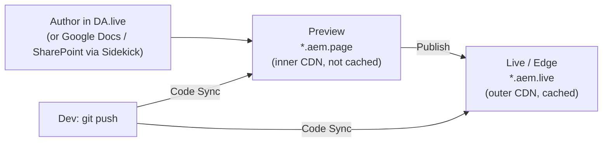

# Module 5 — DA.live Authoring & Publishing

> The one question: **How does an author change content, and how does code ship with no build step?**
> Pipeline position: **Author (DA.live) → Preview (`.aem.page`) → Publish → Live/Edge (`.aem.live`).**

## The mental model

> **Authoring in EDS looks and feels like editing a Word document — because for most content, it
> literally is one — and "publishing" is really just telling the edge cache to catch up with what's
> already sitting on the inner preview tier.**

## The mechanics

**After Code Sync install**, Adobe's configurator bot (`tools.aem.live/bot/setup`) confirms two
things and hands you three links:

- ✅ Content source set to `https://content.da.live/<owner>/<repo>` (Document Authoring / DA)
- ✅ AEM Code Sync started for your GitHub repository

| What | Link |
|---|---|
| Create your content | `https://da.live/#/<owner>/<repo>` |
| Preview your site | `https://main--<repo>--<owner>.aem.page/` |
| Live site | `https://main--<repo>--<owner>.aem.live/` |

**`da.live` (Document Authoring)** is the browser-based doc editor. Browsing a repo
(`da.live/#/<owner>/<repo>`) shows **one doc per page/fragment** — the boilerplate ships with
`footer`, `index`, and `nav`, mirroring the site's actual page/fragment structure. Opening a doc
(`da.live/edit#/<owner>/<repo>/index`) gives a Word-like block editor: text, link, list, image,
table, and layout tools in the left rail, with a publish/send arrow top-right.

> The boilerplate's default `index` content is, deliberately, the onboarding doc itself: *"Congrats,
> you are ready to go! Your forked repo is set up as an AEM Project and you are ready to start
> developing,"* with a link to `aem.live/tutorial`. The out-of-the-box page **is** the tutorial.

**Preview vs. Publish/Live are genuinely separate steps:**

A **hard reload** is often needed to actually see an update — this is caching doing its job, not a
bug. If a change "isn't showing up," check whether it was published (not just previewed) and whether
the browser cached the old page.

**Sidekick's actual job.** The Sidekick browser extension is required *specifically* when the
authoring source is **not** DA.live — i.e. Google Docs, Word, or SharePoint. It automates
preview/publish/unpublish/delete for those sources. DA.live has this built into its own UI (the
send/publish arrow), so Sidekick is for the *other* authoring paths, not a DA.live requirement.

**The practice loop (confirmed, Session 2):** edit content directly in DA.live or your doc →
preview with Sidekick → publish → unpublish a page → re-publish it. Three gotchas called out
explicitly on the session's own slide:
- **Cache-related false negatives** — hard-reload before assuming something's broken (same point as
  above, worth repeating because it's the single most common false alarm).
- **Preview vs. live confusion** — double-check the URL (`.aem.page` vs `.aem.live`) before deciding
  a change "didn't work."
- **GitHub account/org mismatches** — called out as "the biggest snag last time" in the session;
  matches the account/repo-name mix-up that breaks the `main--<repo>--<owner>` URL pattern (Module 4).

**Prerequisites for a hands-on authoring session (confirmed, Session 2):** a GitHub account +
access to DA.live (or your Google Drive/SharePoint doc); Sidekick installed, only if using Google
Docs/SharePoint; local dev via `aem up` + the AEM CLI. **Document-based authoring never actually
requires local dev** — that's only for previewing code changes in your own editor, not for editing
content.

**`da.live/start`** is a project-scaffolding screen for a brand-new project, four steps:

1. Go to `da.live/start`.
2. Paste your **AEM codebase** GitHub URL (e.g. `github.com/<owner>/<repo>`) — this is the repo
   Code Sync is already watching.
3. Choose demo content — **None** (no sample content), **AEM Block Collection** (sample content +
   block library — **recommended**, since ready-made blocks let a team start authoring immediately
   with no custom dev work — fits fast, consistent onboarding), or **Author Kit** (sample content +
   library, for more flexible authoring).
4. Click **"Make something wonderful."**

> Trivia (confirmed, Session 2): `da.live` began life internally as **"Dark Alley"** (Project Dark
> Alley) — now officially **Adobe Document Authoring (DA) for Edge Delivery Services**. Same
> product, renamed before general use.

**`fstab.yaml`** is what actually connects a repo to its DA.live content source — a
UNIX-`fstab`-style file defining the **content mountpoint**, always read from `main`. It's generated
**automatically** the moment you scaffold a project at `da.live/start`, pointing your repo at the
new DA.live project. Two nuances worth knowing:
- With **Helix 5**, `fstab.yaml` is optional — content sources can instead be set via the
  **Configuration Service API** for a **repoless setup**, meaning the same code repo can be reused
  across multiple sites.
- **Only one mountpoint per `fstab.yaml`.** Extra content sources need a Configuration Service
  overlay (BYOM — Bring Your Own Mount).

**Troubleshooting broken images (confirmed, Session 2):** a common early mistake is missing/broken
images on a freshly scaffolded page — this traces back to block selection during setup. Picking
**AEM Block Collection** (rather than None) and following the `da.live/start` steps in order avoids
it; it's a setup-sequencing issue, not a DA.live bug.

**Block library integration.** Predefined blocks from the boilerplate repo can be added into a
DA.live project for drag-and-drop block usage in authoring, with code syncing between DA.live and
the underlying GitHub codebase via Code Sync (Module 4).

**Collaboration.** Repo owners can add additional developers/collaborators and assign permissions,
supporting multi-author, multi-dev workflows on the same project.

## Page & bulk metadata, placeholders (confirmed, Session 2)

**Metadata is invisible to visitors** but critical for AI agents (GEO — Generative Engine
Optimization), search engines (SEO), and social embeds.

**Page-level metadata block:** add a table at the end of the document.
- First row: just the word **"Metadata"** — tells AEM everything below is page metadata.
- Then one row per property: left column = property name (`title`, `description`, `image`, ...),
  right column = value.
- Preview and publish it exactly like any other content change.
- To remove a property, leave its value cell empty.

**Bulk/global metadata:** apply metadata to many pages at once via a sheet named **`metadata`**
(`metadata.xlsx` on SharePoint) in the site root.
- Columns: a **URL pattern** (wildcards supported, e.g. `/docs/**`) + one column per property
  (`template`, `theme`, `robots`, ...).
- Evaluated **top-to-bottom** — site-wide `**` rules must come *before* more specific ones.
- Use `""` (empty string) as a value to explicitly remove a property from matching pages.
- **Precedence: page-level metadata block always wins over the bulk metadata sheet.**
- You must preview + publish the sheet itself for changes to take effect — it's a real doc/sheet
  like any other, not a settings panel.

**Placeholders** centralize repeated strings/variables instead of hard-coding them — especially
valuable for multilingual sites.
- A spreadsheet named **`placeholders`** (`placeholders.xlsx` on SharePoint), in the root or a
  per-locale folder.
- Columns: **Key** (the identifier used in code) and **Text** (the literal string shown).
- Preview via Sidekick and have stakeholders check the `.page` (preview) site before publishing to
  production.

## Forms & Commerce Drop-ins (intro only, confirmed Session 2)

Two topics introduced at slide level, not yet hands-on:

- **Forms with EDS:** a spreadsheet defines the form's fields — EDS generates a **JSON definition**
  from it. Previewing that spreadsheet creates a URL; a **Form block** on the page renders it. When
  integrated with AEM (the Universal Editor flow — Module 3), the same forms switch to AEM's
  **Adaptive Form** block/editor instead. The same spreadsheet-to-API mechanism generalizes beyond
  forms — any spreadsheet can back nav, data tables, or feature comparisons.
- **Commerce Drop-ins:** Adobe Commerce ships pre-built, Commerce-specific blocks called
  **drop-ins** — cart, product listing, checkout, and more. Same idea as AEM's out-of-box
  components, purpose-built for Commerce storefronts running on EDS. This is the concrete,
  technical path to EDS + **ACCS** (Adobe Commerce as a Cloud Service) pairing. Reference:
  `github.com/adobe-commerce`.

## Grounded in the enablement program

During the live session, one participant edited their own `index` doc in DA.live, adding a short
personal introduction line beneath the boilerplate's congrats text, then previewed and published it
to their own `main--eds-enablement--<owner>.aem.live`. Multiple other engineers ran the identical
fork-and-edit pattern independently under their own accounts — proof the workflow is designed to be
repeated 1:1 by every learner, not a one-off stage demo.

## Common mistakes / misconceptions

- **Forgetting Preview ≠ Live.** Publishing is a separate, deliberate step — previewing alone never
  reaches real visitors.
- **Not hard-reloading and assuming a change "didn't work."** Caching is architectural (Module 2);
  a stale browser cache is the most common false alarm.
- **Reaching for Sidekick when authoring in DA.live.** Unnecessary — DA.live has native
  publish/preview built in. Sidekick matters for Google Docs/SharePoint-sourced projects instead.

## A note on depth

This module started from **Session 1** and now includes confirmed pieces of **Session 2** (the
`da.live/start` flow, `fstab.yaml`, the broken-image troubleshooting note, the Sidekick
author/preview/publish/unpublish practice loop, and the forms/Commerce drop-ins intro above) as
they're captured. Still not yet covered: multi-file batch operations and EDS-vs-AEM-Sites
coexistence — later parts of Session 2's agenda that haven't landed here yet. Custom block
creation and the PR/CI (Lighthouse bot) workflow are covered in
[Module 4](04-hands-on-setup-and-code-sync.md) instead, since they're really a code-shipping
concern.

## Check yourself

1. What two things does the Code Sync setup bot confirm, and what three links does it then give you?
2. Why does the boilerplate's default `index` page double as its own tutorial?
3. When exactly is Sidekick required, and when is it unnecessary?
4. You published a change but the live site still shows the old content. What's the first thing to
   try before assuming something's broken?

## Where next

You've completed all five modules from Session 1. For the live, real program's own pacing and
tracking, switch to `/enablement eds` — it walks the same material against the actual 5-week
roadmap in [program/LEARNING-PLAN.md](program/LEARNING-PLAN.md), and will pick up Sessions
2-5 as they're captured.
