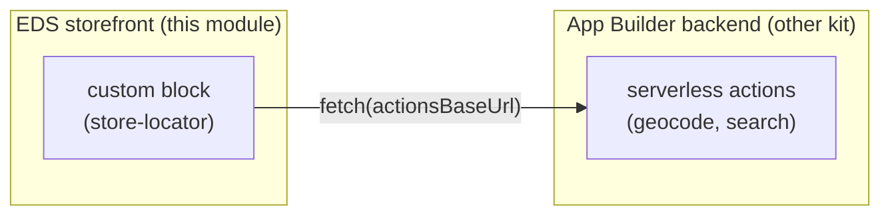

# Module 6 — Real-World Build: A Commerce Storefront + Custom Block

> The one question: **What actually happens when you build a real EDS *Commerce* storefront and add a
> custom block wired to a backend — beyond the plain boilerplate demo?**
> Pipeline position: the whole pipeline, applied for real — Dev → Code Sync → Content (DA) →
> Preview/Live — plus the bridge to an App Builder backend.

## Why this module exists

Modules 1-5 teach EDS with the **plain** `adobe/aem-boilerplate` and a personal `eds-enablement`
site. This module is **field notes from a real first build**: a fresh **Commerce** storefront
(`hlxsites/aem-boilerplate-commerce`) with a custom **store-locator block** that calls an Adobe App
Builder backend. It captures the gotchas the plain demo never surfaces — every one of these was hit
live, first time.

> Honesty note: this is our own real build, not a captured session of the internal program. It's
> included because it's concrete and repeatable, and it connects EDS to its backend companion (see
> the App Builder Enablement Kit).

## The two-repo mental model

A real commerce storefront is **two separate apps** connected by one URL:



The block only knows the backend by a URL it reads from `window.storeLocatorConfig.actionsBaseUrl`.
Nothing else is shared.

## The setup, step by step — with the real gotchas

### 1. Create the repo — Commerce boilerplate is a *template*, and it moved
- Use **`github.com/hlxsites/aem-boilerplate-commerce`** (not `adobe/...` — the canonical repo moved
  to `hlxsites/`).
- Click **"Use this template" → Create a new repository** (it's a template, **not** a fork). The
  button is **hidden if you're not signed in**.

### 2. Code Sync — and the Enterprise-account wall
- Install **AEM Code Sync** (`github.com/apps/aem-code-sync`) scoped to the repo. Without it, the
  `.aem.page` URL 404s forever.
- **Gotcha (Adobe EMU accounts):** an Adobe **Enterprise Managed User** GitHub account (e.g.
  `firstname_adobe`) often **can't install third-party GitHub apps** on its own repos, and doesn't
  appear as an install target. Fix: host the storefront on a **regular personal github.com account**
  (which can install Code Sync freely), or in an **org** where an admin installs it.
- **Underscore in the owner name:** EDS builds URLs as `<branch>--<repo>--<owner>.aem.page`. An owner
  with an underscore (like an EMU username) makes an unusual hostname — it happened to resolve, but a
  clean owner (org or normal handle) avoids the worry entirely.

### 3. Clone locally — HTTPS vs SSH, and multiple keys
- **Gotcha:** if `git push` prompts for **"Username for https://github.com"**, your remote is HTTPS —
  and GitHub no longer accepts passwords there. Switch to SSH:
  ```bash
  git remote set-url origin git@github.com:<owner>/<repo>.git
  ```
- **Gotcha (two GitHub accounts on one machine):** if you have keys for both an EMU and a personal
  account, `git` may offer the wrong one and get denied. Pin the right key per repo:
  ```bash
  git config core.sshCommand "ssh -i ~/.ssh/id_ed25519 -o IdentitiesOnly=yes"
  ```
  (Find which key maps to which account with `ssh -T -i ~/.ssh/<key> git@github.com`.)

### 4. `config.json` — the Commerce boilerplate needs it or it shows a config error
- The Commerce boilerplate renders a **"Configuration Error"** until a `config.json` (Commerce
  backend endpoints) exists at the repo root.
- For a POC with no real backend, copy the shipped **`demo-config.json` → `config.json`** (Adobe's
  demo store) — commit it, and the error clears with demo product data.
- **Key point:** your *custom content block* (store-locator) doesn't need this — it's a plain content
  block, independent of Commerce data. The demo config just stops the storefront's own pages erroring.

### 5. `fstab.yaml` / Site Creator — the real cause of a 404 home page
- **Gotcha:** even with Code Sync + `config.json`, the site 404s if there's **no `fstab.yaml`** —
  that's the file mounting your **content source** (DA.live). No mount → no content → 404.
- Fix: run the **Site Creator** tool
  (`da.live/app/adobe-commerce/storefront-tools/tools/site-creator/site-creator`) → **"Use existing
  repository"** → it commits `fstab.yaml` and populates DA with starter content. Home page then
  renders.

### 6. Authoring in DA.live — it's "Add block", not "table"
- **Gotcha:** to add a block in DA.live there's **no "insert table" option**. Blocks *are* tables,
  inserted via the contextual **"Add block"** button in the editor toolbar (it becomes "Edit table"
  once your cursor is inside one).
- Put the block **name** (e.g. `Store Locator`) in the top/header row. That's the whole trigger for a
  block that builds its own UI.

### 7. Preview vs Publish, `.aem.page` vs `.aem.live`, and CDN lag
- **Content:** Preview → `.aem.page`; Publish → `.aem.live`. Two deliberate steps.
- **Code** (blocks, `scripts.js`): deployed by Code Sync to **both** `.aem.page` and `.aem.live`
  automatically on push to `main` — code doesn't need a separate content publish.
- **Gotcha:** after merging a code change, expect a **CDN propagation lag** — edge nodes serve mixed
  old/new copies for ~a minute. A hard refresh (Cmd+Shift+R) helps; don't assume it failed.

### 8. Wire the block to its backend
- Set the backend URL once in `scripts/scripts.js`:
  ```js
  window.storeLocatorConfig = { actionsBaseUrl: 'https://<namespace>.adobeioruntime.net/api/v1/web/<package>' };
  ```
- **Gotcha:** if this isn't set/deployed, the block uses a placeholder and the browser throws
  **"Failed to parse URL from https://\<namespace\>..."** — that literally means the config hasn't
  reached the page yet.
- **CORS gotcha lives on the *backend* side** (see the App Builder kit): the runtime auto-adds CORS,
  so the action must **not** also add it, or the browser sees `*,*` and rejects the call.

## The gotcha checklist (print this)

1. Commerce boilerplate is a **template** at **`hlxsites/`** — "Use this template", signed in.
2. **EMU GitHub accounts can't install Code Sync** — use a personal account or an org.
3. HTTPS remote → password prompt → **switch remote to SSH**; pin the right key with `core.sshCommand`.
4. Commerce boilerplate needs **`config.json`** (copy `demo-config.json`) or it shows a config error.
5. **No `fstab.yaml` = 404** — run **Site Creator** to mount DA content.
6. In DA.live it's **"Add block"**, not "insert table".
7. Code deploys to both `.aem.page`/`.aem.live` via Code Sync; **content** needs Preview/Publish;
   allow for **CDN propagation lag**.
8. Block↔backend is one **`window` config URL**; the placeholder-URL error = config not live yet.

## Check yourself

1. Why does a fresh Commerce storefront 404 even after Code Sync and `config.json` are in place?
2. Why might an Adobe EMU GitHub account be unable to install AEM Code Sync?
3. In DA.live, how do you actually insert a block, and where does the block name go?
4. A code change is merged but the live page still shows the old behaviour. What's the likely reason,
   and what do you do?
5. The block errors with "Failed to parse URL from https://\<namespace\>...". What's missing?

Companion: the backend those actions live in is taught in the **App Builder Enablement Kit** — this
module is the storefront half of that same store-locator build.
