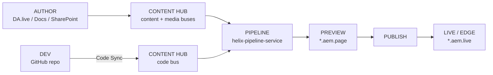

# EDS Learning Path

## The pipeline (every concept sits somewhere on this line)

> Golden rule: if a page looks wrong or a change "isn't showing up," trace *backward* along this
> line — content bus? code bus? was it published, not just previewed? was the browser cache stale?
> Almost every symptom maps to a specific stop on this pipeline.

## Order and time estimates

| # | Module | Depends on | Rough time | File |
|---|--------|-----------|-----------|------|
| 1 | What is EDS? | Nothing — start here | 15 min | [01-what-is-eds.md](01-what-is-eds.md) |
| 2 | Architecture & Content Hub | Module 1 | 25 min | [02-architecture-and-content-hub.md](02-architecture-and-content-hub.md) |
| 3 | Why EDS (& the Alternatives) | Module 2 | 15 min | [03-why-eds-and-alternatives.md](03-why-eds-and-alternatives.md) |
| 4 | Hands-On Setup & Code Sync | Modules 1-3 | 30-45 min (hands-on) | [04-hands-on-setup-and-code-sync.md](04-hands-on-setup-and-code-sync.md) |
| 5 | DA.live Authoring & Publishing | Module 4 | 25 min | [05-da-live-authoring-and-publishing.md](05-da-live-authoring-and-publishing.md) |

Total: roughly 2-2.5 hours including the hands-on module, matching what the real Session 1 covered
in one sitting.

## Prerequisites

None beyond curiosity for Modules 1-3. Module 4 needs the six items on its own checklist (GitHub
account, Node 18+, Git, Chrome + Sidekick, a code editor, the AEM CLI).

## Honesty about scope

This learning path currently covers **Session 1 only** (2026-08-12) of the real 5-week EDS
Enablement Program. The program's own roadmap (see
[program/LEARNING-PLAN.md](program/LEARNING-PLAN.md)) continues with:

- **Week 2** — DA & Sidekick deep-dive, live authoring practice → will extend Module 5
- **Week 3** — customizing code: project structure, `scripts.js`/`styles.css` → new module
- **Week 4** — adding/updating blocks & CSS, building a block end-to-end → new module
- **Week 5** — Q&A, recap, mini practical showcase, readiness for independent work → will close out
  this learning path

This file will be updated as each later session is captured. Until then, don't expect (or invent)
content on block development or code customization beyond what Modules 1-5 already state.
