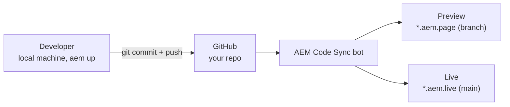

# The Running Example — `eds-enablement`

Every module in this skill grounds its concepts in the same concrete scenario: the live hands-on
demo dozens of engineers ran during the real Session 1 of the EDS Enablement Program (2026-08-12).
There's no separate simulator app for EDS the way AEP has one — the *real* GitHub/DA.live workflow
**is** the simulator, and it's free to run yourself.

## The scenario

Each participant:

1. Forked `github.com/adobe/aem-boilerplate` using **"Use this template"** into their own repo,
   typically named `eds-enablement` or `eds-enablement-2026`, under their **own personal GitHub
   account**.
2. Installed the **AEM Code Sync** GitHub App on that repo, scoped to "Only select repositories."
3. Confirmed the site was live at:
   - Preview: `https://main--eds-enablement--<owner>.aem.page/`
   - Live: `https://main--eds-enablement--<owner>.aem.live/`
4. Cloned the repo locally, ran `aem up`, and edited files in the `blocks` folder with live reload
   at `http://localhost:3000/`.
5. Opened `https://da.live/#/<owner>/eds-enablement`, edited the `index` doc, and published it.

The fact that this exact sequence was independently reproducible by every single participant, on
their own free GitHub account, in about 10 minutes, *is itself* the strongest teaching tool in the
whole program — it's proof, not just a claim, of Module 3's "why EDS" pitch.

## The "Code Journey" — how a change actually ships

Narration: a developer pushes a commit → the Code Sync bot picks it up → the branch preview updates
within seconds → merging to `main` goes live. **No build pipeline anywhere in this diagram** — that
absence is the entire point (Module 4).

## The "Congrats" page — a deliberate teaching device

The boilerplate's default `index` content reads:

> *"Congrats, you are ready to go! Your forked repo is set up as an AEM Project and you are ready to
> start developing. See the full tutorial here: `https://www.aem.live/tutorial`"*

Point this out explicitly when teaching Module 5: **the first page every learner ever edits is
already the onboarding doc itself.** One participant added a short line introducing themselves
directly beneath this text, previewed it, and published it, which is the smallest possible complete
round-trip through the entire pipeline (Author → Preview → Publish → Live).

## Use this for teaching

When a learner asks "can you show me how X works," prefer walking this exact sequence over an
abstract description:

- **Positioning (Module 1):** "Notice nothing here touched an AEM Author instance."
- **Architecture (Module 2):** "The `index` edit lives in the content bus; the CSS edit in `blocks/`
  lives in the code bus — different buses, same pipeline."
- **Why EDS (Module 3):** "This whole thing took 10 minutes on a free account — that's the pitch,
  demonstrated, not asserted."
- **Setup (Module 4):** "If step 2 (Code Sync) is skipped, step 3's preview URL 404s — that's the
  #1 real mistake people hit live."
- **Authoring (Module 5):** "Publishing is a separate click from previewing — hard-reload if you
  don't see it."
