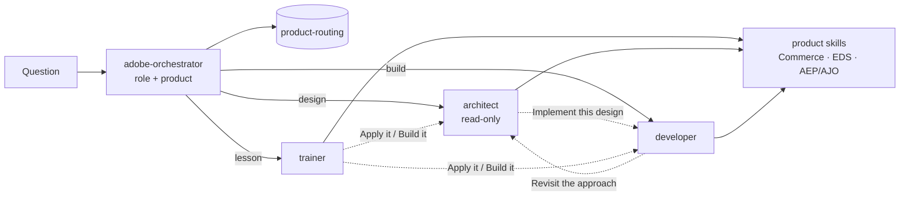

# Adobe Readiness Agents

GitHub Copilot agents that get an Adobe delivery team project-ready across products: a **Trainer**,
an **Architect** and a **Developer**, grounded in versioned product skills. This repository brings
the product knowledge together in one GitHub Copilot workspace.

For the complete implementation, architecture, installation, Copilot usage, maintenance, and
guardrail details, see the [technical guide](TECHNICAL-GUIDE.md).

## Technical overview

This is a collection of Markdown configuration and knowledge files, not a running Adobe service.
There is no application server or build step. VS Code and GitHub Copilot read the files when you
open the workspace or install them into another workspace.

- **Agents** define each role, its allowed tools, and handoffs to other roles.
- **Prompts** provide the slash commands that select a role and task.
- **Skills** contain product knowledge; the routing skill selects the relevant files.
- **Learning plans** record your progress locally, rather than changing the shared curriculum.

For a deeper explanation, read the guide's [architecture](TECHNICAL-GUIDE.md#2-architecture-and-execution-flow),
[installation](TECHNICAL-GUIDE.md#6-installation-and-discovery-in-copilot), and
[troubleshooting](TECHNICAL-GUIDE.md#10-verification-and-troubleshooting) sections.

## New here? Start here

**1. Set up**

- Install VS Code and sign in with a GitHub account that has Copilot access.
- Clone and open the repo:
  ```bash
  git clone https://github.com/gaurav127606/adobe-readiness-agents.git
  code adobe-readiness-agents
  ```
- Open Chat (**⌃⌘I** on Mac, **Ctrl+Alt+I** on Windows) and switch the mode to **Agent**.

**2. Type `/start-here`.** It shows the products, asks your goal, recommends where to begin, and
starts you on step one.

**3. Follow the loop, one topic per sitting**

| Step | Example |
|---|---|
| Learn | `/learn eds architecture` |
| Try it | `/simulate eds walk the setup demo` |
| Check yourself | `/quiz eds architecture` |
| Mark it done, get the next topic | `/enablement eds` |

**4. Suggested starting point by goal**

| Your goal | Start with |
|---|---|
| Adobe web or storefront work | `/enablement eds` — 5 weeks |
| Customer data, audiences, journeys | `/enablement aep` — 3 tracks |
| Extending Adobe Commerce without touching core | `/learn accs` for the big picture, then `/enablement appbuilder` — 5 hands-on modules |
| Commerce ⇄ ERP/WMS integrations | `/define` the terms in the ERP/WMS and retail acronym tables, then `/architect how should we sync inventory from a WMS into Adobe Commerce` |

**5. Apply it.** Bring a real question to `/architect` (design) or `/develop` (build). If you're
stuck, pick the **adobe-orchestrator** agent and ask anything.

Your progress is saved in each product's `program/LEARNING-PLAN.md`, in your own clone. Keep it
local or on a personal branch; don't push it to `main`.

## What's inside

| Agent | Role | Tools |
|---|---|---|
| `adobe-orchestrator` | Detects role and product, then delegates | read, agent |
| `trainer` | Teach, define, quiz, simulate, run the enablement program | read, search, edit (progress only) |
| `architect` | Requirements → options → trade-offs → recommendation | read, search (**cannot edit**) |
| `developer` | Concrete code, config, setup and debugging | read, search, edit |

| Product | Skill | Source repo |
|---|---|---|
| Commerce ⇄ ERP/WMS/3PL | `erp-wms-glossary` + `commerce-architect-playbook` / `commerce-developer-playbook` | `commerce-domain-skills`, `erp-wms-glossary` |
| Retail commerce | `retail-glossary` | `retail-glossary` |
| Edge Delivery Services | `eds-enablement-masterclass` (6 modules + 5-week `program/`) | [eds-enablement-training-kit](https://github.com/gaurav127606/eds-enablement-training-kit) |
| AEP / RTCDP / AJO / CJA | `adobe-experience-masterclass` (11 modules + 3-track `program/`) | [adobe-aep-ajo-training-kit](https://github.com/gaurav127606/adobe-aep-ajo-training-kit) |
| App Builder | `appbuilder-enablement-masterclass` (5 modules + `program/`) | `appbuilder-enablement-training-kit` |
| Commerce Cloud extensibility (ACCS, API Mesh, Events, Admin UI SDK) | `adobe-commerce-cloud-masterclass` (9 modules, no `program/`) | `adobe-commerce-cloud-masterclass` |

`product-routing` is the single table that maps products to skills, and each role to the files it
loads.

## Shared commands across products

**3 role agents and 8 prompts cover every product**. Use a product name after a command, such as
`/learn eds` or `/learn aep`. Adding a product does not require another set of agents or prompts.

## How it works



## Layout

```
adobe-readiness-agents/
├── install.sh                    # user-level or per-repo install
├── README.md                     # quick start and project overview
├── TECHNICAL-GUIDE.md             # architecture, implementation and troubleshooting
├── templates/product-skill/      # starting point for a new product
└── .github/
    ├── agents/                   # adobe-orchestrator, trainer, architect, developer
    ├── prompts/                  # start-here, learn, define, quiz, simulate, enablement, architect, develop
    └── skills/                   # product-routing, 2 commerce playbooks, 2 glossaries, 4 masterclasses
```

  Maintainers may also have `scripts/`, `tests/`, `test/`, and `eval/` locally. These folders and
  the workflow that invokes the local tools are Git-ignored and are not included in fresh clones.
  The root `install.sh` remains shared because it is needed for installation.

## Setup

**Prerequisites:** VS Code with GitHub Copilot Chat, signed in, with chat in **Agent** mode.

**A — Try it right away (best for a demo)**

```bash
code ~/projects/adobe-readiness-agents
```

Open Chat, open the agent picker, and choose **adobe-orchestrator**.

**B — Add it to a project repo (shared with the team)**

```bash
./install.sh workspace ~/projects/<your-repo>    # never overwrites existing files
cd ~/projects/<your-repo> && git add .github && git commit -m "Add Adobe readiness agents"
```

**C — Personal, in every workspace**

```bash
./install.sh user     # symlinks agents/prompts into VS Code's user folder, skills into ~/.copilot/skills
```

Then run **Developer: Reload Window**. Because these are symlinks, a `git pull` updates them in place.

**Verify:** the agent picker lists the 4 agents, and typing `/` shows `/start-here`, `/learn`,
`/define`, `/quiz`, `/simulate`, `/enablement`, `/architect` and `/develop`.

## How to use it

| You want to… | Type |
|---|---|
| Get started as a newcomer | `/start-here` |
| Ask anything | Agent **adobe-orchestrator**, then a plain question |
| Learn a topic | `/learn eds code sync` · `/learn aep identity` · `/learn appbuilder deploy` · `/learn accs api mesh` |
| Look up one term | `/define aep merge policy` · `/define GRN` |
| Check yourself | `/quiz eds everything` · `/quiz aep module 5` |
| Walk a scenario | `/simulate eds walk the setup demo` · `/simulate aep abandoned cart` |
| Follow the program | `/enablement eds` · `/enablement aep` |
| Design | `/architect inventory sync from our WMS for 120 stores` |
| Build or debug | `/develop Source Item sync consumer` · `/develop my EDS block doesn't render` |

## Demo script (about 12 minutes)

0. **Clone live.** Run the two commands from *New here? Start here* in a fresh folder. In Chat, the
   agent picker lists the 4 agents and typing `/` lists the 8 prompts, with no install step.
1. **Cheap path.** `/define aep merge policy`. One glossary file, and no subagent.
2. **Trainer.** Orchestrator: *"Teach me how EDS turns a document into a live page."* Point out the
   one-line role/product choice, the pipeline diagram and the "Check yourself" questions.
3. **Quiz.** `/quiz eds code sync`. It asks one question at a time and explains why each answer matters.
4. **Architect.** Orchestrator: *"How should we sync inventory from our WMS into Adobe Commerce?
   40k SKUs, 120 stores, flash sales."* It loads the commerce playbook and returns a 15-section
   design: explicit assumptions, 2–3 real options and a Mermaid diagram.
5. **Handoff.** Click **Implement this design**. The developer writes the Source Item consumer and
   states when the storefront reflects it (indexer timing).
6. **Cross-product debugging.** `/develop my EDS store-locator block shows "Failed to parse URL from
   https://<namespace>…"`. The answer is diagnosed from the EDS real-world build module.
7. **Guardrail.** Ask the architect to write a file. It can't, because it has no edit tool.
8. **Add a product live** (next section).

**Main points for the audience:** each role on the team, across products, is written down as
versioned files. There's one routing table. The knowledge is shared across Copilot roles. A
new product takes one folder and one row.

## Why it uses fewer tokens

- **Progressive loading.** Until a skill is needed, Copilot only sees its name and description.
  Each role then loads only the files listed for it in `product-routing`, one module at a time.
- **Minimum routing.** Only the product rows the question touches are loaded.
- **Subagent isolation.** Designs and builds run in the specialist's own context. The main thread
  keeps only the answer, so later turns don't re-send skill files.
- **Shared roles.** 3 role agents cover every product, instead of N products × 3 roles.
- **Small tool sets** per role, and **no always-on instructions** (`copilot-instructions.md` /
  `applyTo: "**"`).

## Adding a product

**If it comes from a source training kit** (a repo with `skill/SKILL.md` and `training/`, like EDS, AEP and
App Builder):

The sync steps below require the optional local maintainer tools; fresh clones do not include them.

1. Add one line to `scripts/kits.conf`: skill folder, source label, default path, an env var to
   override the path, and the kit's old slash commands mapped to the Copilot ones.
2. Run `./scripts/sync-kits.sh`.
3. Add one row to `.github/skills/product-routing/SKILL.md`: trigger words, skill, and the files for
   Trainer, Architect and Developer.

**If it's written by hand:** `cp -R templates/product-skill .github/skills/<product>-masterclass`, set
`name:` to the folder name exactly, write a trigger-word `description`, add modules, a glossary and an
optional `program/`, then add the routing row.

No agent or prompt changes are needed. Run `./scripts/doctor.sh`: it fails if `name:` doesn't match
the folder, the routing row points at a missing file, or the new skill has no routing row.

## Check everything (one command)

For maintainers with the local `scripts/` and `tests/` folders:

```bash
./scripts/doctor.sh
```

Run it before a demo, a commit or a push. It needs Node 18+ (`nvm use 22` if it says otherwise) and
prints PASS/FAIL for each check:

- shell scripts parse and are executable;
- agents, prompts and skills have valid frontmatter, every referenced agent/skill/file exists, the
  architect stays read-only, every skill is routed, and relative links resolve;
- the automated tests pass;
- no private names or personal paths are in published files.

These are local checks, not a published GitHub Actions pipeline. End users do not need them to
use the agents.

## Keeping in sync with source training kits

The EDS, AEP and App Builder skills are generated from the kit repos listed in
the local `scripts/kits.conf`. Don't edit them here; edit the kit, then run (local tools required):

```bash
./scripts/sync-kits.sh
```

The kits are expected next to this repo (`../<kit>`). To point at another location, set the env var
named in `kits.conf` (`EDS_KIT`, `AEP_KIT` or `APPBUILDER_KIT`) for that run.

The script copies `skill/` and `training/` → `program/`, rewrites links and commands for this hub,
applies `scripts/.scrub-names`, cleans the frontmatter (and quotes a description YAML would misread),
and runs `check-names.sh`. It builds everything
in a temporary folder first, so if a source is missing or the check fails, nothing in the hub changes.
Each synced skill gets a `SYNC-METADATA.json` recording the kit commit it came from.

- `scripts/.scrub-names` is **local and git-ignored**, so the names never get published. Each
  maintainer keeps their own copy. The format is documented at the top of the file. It also replaces
  the App Builder build's personal namespace with an example (`123456-myproject-integration`).
- The commerce glossaries and playbooks, and `adobe-commerce-cloud-masterclass`, are curated copies,
  scrubbed by hand. Refresh them manually and run `./scripts/doctor.sh`. The Commerce Cloud copy leaves
  out the source's customer-specific illustrative scenario.
- A sync keeps every existing `LEARNING-PLAN.md` exactly as it is, and replaces the rest of
  `program/`. Keep personal notes in the learning plan, not in other program files.
- The AEP running example uses **Luma**, Adobe's own demo brand. The external training simulator
  still shows its original brand name.

## Publishing to GitHub

When local maintainer tools are available, `doctor.sh` must print `all checks passed`. The
`ln -s` line is optional: it makes every `git push` run the local checks first.
Review `git status` before committing; scripts, tests and evaluation files must remain local.

```bash
./scripts/doctor.sh
ln -s ../../scripts/doctor.sh .git/hooks/pre-push
git add README.md TECHNICAL-GUIDE.md .gitignore install.sh .github/agents .github/prompts .github/skills templates
git diff --cached --stat
git commit -m "Adobe readiness agents: trainer, architect, developer across products"
git remote add origin https://github.com/gaurav127606/adobe-readiness-agents.git
git push -u origin main
```

## Troubleshooting

| Symptom | Fix |
|---|---|
| An agent is missing from the picker | The file must end in `.agent.md`. Check the YAML frontmatter, then reload the window. |
| The orchestrator answers itself instead of delegating | Make sure your Copilot version lets custom agents run as subagents (search "subagent" in Settings). |
| A skill never loads | Its `description` is missing the words the user typed, or `name` doesn't match the folder. |
| A skill appears twice | Check for duplicate workspace and user-level skill installations; keep only one active copy. |
| `sync-kits.sh` stops with "readable scrub rules are required" | Create `scripts/.scrub-names` (see its format) before syncing. |
| `doctor.sh` says Node 18 or newer is required | Run `nvm use 22` (or install Node 18+), then rerun it. |
| `doctor.sh` fails a check | Each FAIL line is preceded by the exact file and problem. Fix it and rerun. |
