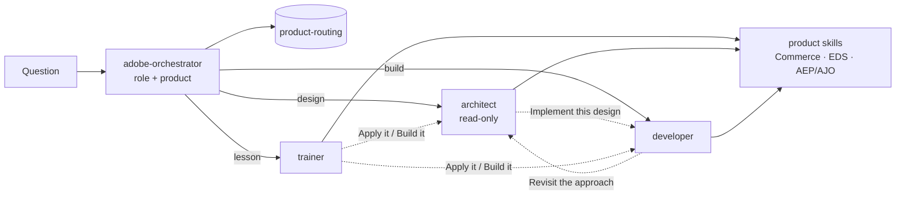

# Adobe Readiness Agents

GitHub Copilot agents that get an Adobe delivery team project-ready across products: a **Trainer**,
an **Architect** and a **Developer**, grounded in versioned product skills. The Claude versions stay
unchanged in their own repos. This repo is the Copilot edition that brings them together.

## New here? Start here

**1. Set up**

- Install VS Code and sign in with a GitHub account that has Copilot access.
- Clone and open the repo:
  ```bash
  git clone https://github.com/gaurav127606/adobe-readiness-agents.git
  code adobe-readiness-agents
  ```
- Open Chat (**⌃⌘I** on Mac, **Ctrl+Alt+I** on Windows) and switch the mode to **Agent**.

**2. Type `/start-here`.** It shows the products, asks your goal, recommends where to begin, and
starts you on step one.

**3. Follow the loop, one topic per sitting**

| Step | Example |
|---|---|
| Learn | `/learn eds architecture` |
| Try it | `/simulate eds walk the setup demo` |
| Check yourself | `/quiz eds architecture` |
| Mark it done, get the next topic | `/enablement eds` |

**4. Suggested starting point by goal**

| Your goal | Start with |
|---|---|
| Adobe web or storefront work | `/enablement eds` — 5 weeks |
| Customer data, audiences, journeys | `/enablement aep` — 3 tracks |
| Commerce ⇄ ERP/WMS integrations | `/define` the terms in the ERP/WMS and retail acronym tables, then `/architect how should we sync inventory from a WMS into Adobe Commerce` |

**5. Apply it.** Bring a real question to `/architect` (design) or `/develop` (build). If you're
stuck, pick the **adobe-orchestrator** agent and ask anything.

Your progress is saved in each product's `program/LEARNING-PLAN.md`, in your own clone. Keep it
local or on a personal branch; don't push it to `main`.

## What's inside

| Agent | Role | Tools |
|---|---|---|
| `adobe-orchestrator` | Detects role and product, then delegates | read, agent |
| `trainer` | Teach, define, quiz, simulate, run the enablement program | read, search, edit (progress only) |
| `architect` | Requirements → options → trade-offs → recommendation | read, search (**cannot edit**) |
| `developer` | Concrete code, config, setup and debugging | read, search, edit |

| Product | Skill | Source repo (Claude, unchanged) |
|---|---|---|
| Commerce ⇄ ERP/WMS/3PL | `erp-wms-glossary` + `commerce-architect-playbook` / `commerce-developer-playbook` | `commerce-domain-skills`, `erp-wms-glossary` |
| Retail commerce | `retail-glossary` | `retail-glossary` |
| Edge Delivery Services | `eds-enablement-masterclass` (6 modules + 5-week `program/`) | [eds-enablement-training-kit](https://github.com/gaurav127606/eds-enablement-training-kit) |
| AEP / RTCDP / AJO / CJA | `adobe-experience-masterclass` (11 modules + 3-track `program/`) | [adobe-aep-ajo-training-kit](https://github.com/gaurav127606/adobe-aep-ajo-training-kit) |

`product-routing` is the single table that maps products to skills, and each role to the files it
loads.

## Claude → Copilot mapping

| Claude | Copilot |
|---|---|
| `master-orchestrator` skill | `adobe-orchestrator` agent (now multi-product) |
| `architect-mode`, `developer-mode` skills | `architect`, `developer` agents (product-neutral). Commerce specifics live in the commerce playbooks. |
| `/architect`, `/develop` | `/architect`, `/develop` |
| `/eds-learn`, `/aep-learn`, `/aep`, `/ajo`, `/cja`, `/rtcdp` | `/learn eds …`, `/learn aep …`, `/learn ajo`, `/learn cja`, `/learn rtcdp` |
| `/eds-explain`, `/aep-explain` | `/define eds …`, `/define aep …` (`/explain` is a built-in Copilot command) |
| `/eds-quiz`, `/aep-quiz` | `/quiz eds …`, `/quiz aep …` |
| `/eds-simulate`, `/aep-simulate` | `/simulate eds …`, `/simulate aep …` |
| `/eds-enablement`, `/adobe-training` | `/enablement eds`, `/enablement aep` |
| `training/` folder in each kit | `program/` inside each skill |

The Claude version needed **one command set per product**. Here, **3 role agents and 8 prompts
cover every product**, and adding a product adds no agents or prompts.

## How it works



## Layout

```
adobe-readiness-agents/
├── install.sh                    # user-level or per-repo install
├── scripts/
│   ├── sync-kits.sh              # regenerate EDS + AEP skills from the Claude kits
│   ├── check-names.sh            # blocks project names / personal paths
│   └── .scrub-names              # local only, git-ignored: names to scrub
├── templates/product-skill/      # starting point for a new product
└── .github/
    ├── agents/                   # adobe-orchestrator, trainer, architect, developer
    ├── prompts/                  # start-here, learn, define, quiz, simulate, enablement, architect, develop
    └── skills/                   # product-routing, 2 commerce playbooks, 2 glossaries, 2 masterclasses
```

## Setup

**Prerequisites:** VS Code with GitHub Copilot Chat, signed in, with chat in **Agent** mode.

**A — Try it right away (best for a demo)**

```bash
code ~/projects/adobe-readiness-agents
```

Open Chat, open the agent picker, and choose **adobe-orchestrator**.

**B — Add it to a project repo (shared with the team)**

```bash
./install.sh workspace ~/projects/<your-repo>    # never overwrites existing files
cd ~/projects/<your-repo> && git add .github && git commit -m "Add Adobe readiness agents"
```

**C — Personal, in every workspace**

```bash
./install.sh user     # symlinks agents/prompts into VS Code's user folder, skills into ~/.copilot/skills
```

Then run **Developer: Reload Window**. Because these are symlinks, a `git pull` updates them in place.

**Verify:** the agent picker lists the 4 agents, and typing `/` shows `/start-here`, `/learn`,
`/define`, `/quiz`, `/simulate`, `/enablement`, `/architect` and `/develop`.

## How to use it

| You want to… | Type |
|---|---|
| Get started as a newcomer | `/start-here` |
| Ask anything | Agent **adobe-orchestrator**, then a plain question |
| Learn a topic | `/learn eds code sync` · `/learn aep identity` · `/learn ajo` |
| Look up one term | `/define aep merge policy` · `/define GRN` |
| Check yourself | `/quiz eds everything` · `/quiz aep module 5` |
| Walk a scenario | `/simulate eds walk the setup demo` · `/simulate aep abandoned cart` |
| Follow the program | `/enablement eds` · `/enablement aep` |
| Design | `/architect inventory sync from our WMS for 120 stores` |
| Build or debug | `/develop Source Item sync consumer` · `/develop my EDS block doesn't render` |

## Demo script (about 12 minutes)

0. **Clone live.** Run the two commands from *New here? Start here* in a fresh folder. In Chat, the
   agent picker lists the 4 agents and typing `/` lists the 8 prompts, with no install step.
1. **Cheap path.** `/define aep merge policy`. One glossary file, and no subagent.
2. **Trainer.** Orchestrator: *"Teach me how EDS turns a document into a live page."* Point out the
   one-line role/product choice, the pipeline diagram and the "Check yourself" questions.
3. **Quiz.** `/quiz eds code sync`. It asks one question at a time and explains why each answer matters.
4. **Architect.** Orchestrator: *"How should we sync inventory from our WMS into Adobe Commerce?
   40k SKUs, 120 stores, flash sales."* It loads the commerce playbook and returns a 15-section
   design: explicit assumptions, 2–3 real options and a Mermaid diagram.
5. **Handoff.** Click **Implement this design**. The developer writes the Source Item consumer and
   states when the storefront reflects it (indexer timing).
6. **Cross-product debugging.** `/develop my EDS store-locator block shows "Failed to parse URL from
   https://<namespace>…"`. The answer is diagnosed from the EDS real-world build module.
7. **Guardrail.** Ask the architect to write a file. It can't, because it has no edit tool.
8. **Add a product live** (next section).

**Main points for the audience:** each role on the team, across products, is written down as
versioned files. There's one routing table. The same knowledge runs on Claude and on Copilot. A
new product takes one folder and one row.

## Why it uses fewer tokens

- **Progressive loading.** Until a skill is needed, Copilot only sees its name and description.
  Each role then loads only the files listed for it in `product-routing`, one module at a time.
- **Minimum routing.** Only the product rows the question touches are loaded.
- **Subagent isolation.** Designs and builds run in the specialist's own context. The main thread
  keeps only the answer, so later turns don't re-send skill files.
- **Shared roles.** 3 role agents cover every product, instead of N products × 3 roles.
- **Small tool sets** per role, and **no always-on instructions** (`copilot-instructions.md` /
  `applyTo: "**"`).

## Adding a product (2 steps)

1. `cp -R templates/product-skill .github/skills/<product>-masterclass`. Set `name:` to the folder
   name exactly, write a trigger-word `description`, and add modules, a glossary and an optional
   `program/`.
2. Add one row to `.github/skills/product-routing/SKILL.md`: trigger words, skill, and the files for
   Trainer, Architect and Developer.

No agent or prompt changes are needed. Candidates already written for Claude:
`appbuilder-enablement-masterclass` and `adobe-commerce-cloud-masterclass`.

## Keeping in sync with the Claude kits

The EDS and AEP skills are generated from the kit repos. Don't edit them here; edit the kit, then
run:

```bash
./scripts/sync-kits.sh        # EDS_KIT=... AEP_KIT=... to override the ../ defaults
```

The script copies `skill/` and `training/` → `program/`, rewrites links and commands for this hub,
applies `scripts/.scrub-names`, cleans the frontmatter, and runs `check-names.sh`.

- `scripts/.scrub-names` is **local and git-ignored**, so the names never get published. Each
  maintainer keeps their own copy. The format is documented at the top of the file.
- The commerce glossaries and playbooks are curated copies, scrubbed by hand. Refresh them manually
  and run `./scripts/check-names.sh`.
- A sync overwrites `program/`, which holds learner progress. Commit progress first.
- The AEP running example uses **Luma**, Adobe's own demo brand. The external training simulator
  still shows its original brand name.

## Publishing to GitHub

```bash
./scripts/check-names.sh                                   # must print "clean"
ln -s ../../scripts/check-names.sh .git/hooks/pre-push     # optional: block any push that fails it
git add . && git commit -m "Adobe readiness agents: trainer, architect, developer across products"
git remote add origin https://github.com/gaurav127606/adobe-readiness-agents.git
git push -u origin main
```

## Troubleshooting

| Symptom | Fix |
|---|---|
| An agent is missing from the picker | The file must end in `.agent.md`. Check the YAML frontmatter, then reload the window. |
| The orchestrator answers itself instead of delegating | Make sure your Copilot version lets custom agents run as subagents (search "subagent" in Settings). |
| A skill never loads | Its `description` is missing the words the user typed, or `name` doesn't match the folder. |
| A skill appears twice | VS Code also reads `~/.claude/skills`, so linked Claude versions show up too. |
| `sync-kits.sh` warns about `.scrub-names` | Create it (see its format) before syncing, or names won't be scrubbed. |
