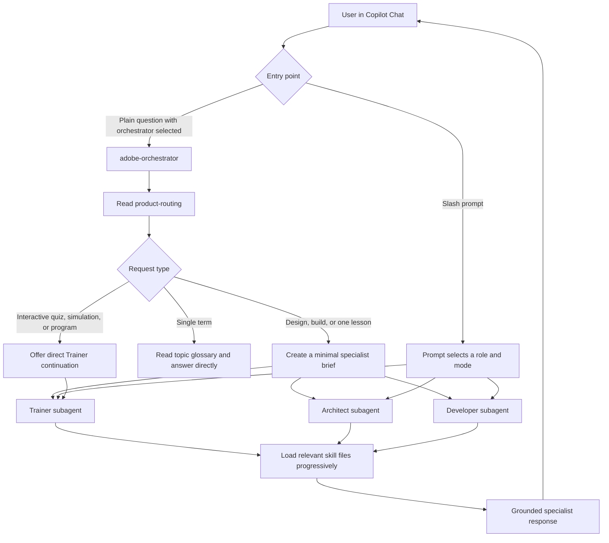
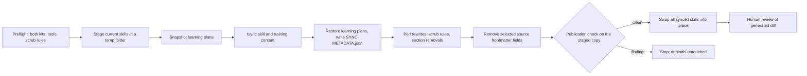

# Adobe Readiness Agents — Technical Implementation and Copilot Guide

**Implementation reviewed:** 10 October 2026  
**Audience:** developers, architects, trainers, maintainers, and technical demo reviewers.  
**Scope:** the implementation in this repository, not unrelated skills installed on a particular user's machine.

## Contents

1. [What was implemented](#1-what-was-implemented)
2. [Architecture and execution flow](#2-architecture-and-execution-flow)
3. [How the agents are implemented](#3-how-the-agents-are-implemented)
4. [How prompts are implemented](#4-how-prompts-are-implemented)
5. [How knowledge and routing are implemented](#5-how-knowledge-and-routing-are-implemented)
6. [Installation and discovery in Copilot](#6-installation-and-discovery-in-copilot)
7. [Using the system end to end](#7-using-the-system-end-to-end)
8. [Knowledge generation and maintenance](#8-knowledge-generation-and-maintenance)
9. [Guardrails and trust boundaries](#9-guardrails-and-trust-boundaries)
10. [Verification and troubleshooting](#10-verification-and-troubleshooting)
11. [Extending the implementation](#11-extending-the-implementation)
12. [Design decisions, limitations, and next steps](#12-design-decisions-limitations-and-next-steps)

## 1. What was implemented

This project is a **file-based customization layer for GitHub Copilot Chat in VS Code**. It turns a curated Adobe knowledge collection into a small virtual delivery team:

- An **orchestrator** chooses the appropriate role and product.
- A **trainer** teaches and guides practice.
- An **architect** evaluates requirements and recommends a design.
- A **developer** explains or applies an already-decided implementation.

The key design is **roles separated from products**. Roles are reusable agents; Adobe-specific knowledge lives in skills. Adding another product normally changes the knowledge and routing, not the agent roster.

### Implementation inventory

| Component | Count | Implementation |
|---|---:|---|
| Custom agents | 4 | Markdown bodies with YAML frontmatter |
| Reusable slash prompts | 8 | Prompt files selecting an agent and task mode |
| Skills | 9 | Routing, two playbooks, two glossaries, four masterclasses (EDS, Experience, App Builder, Commerce Cloud) |
| Installer | 1 | Bash; workspace copies or user-level symlinks |
| Optional local maintenance scripts | 4 | Training-kit sync, publication check, structure validator, and the `doctor.sh` runner; not included in clean clones |
| Optional local automated test suites | 2 | Node built-in test runner; synthetic fixtures only; not included in clean clones |
| Product template | 1 | Starting structure for another knowledge skill |

The shared implementation includes `install.sh` as its published installer. `scripts/`, `tests/`, and `eval/` are local-only optional maintainer tools, not pushed or included in clean clones. `.github/workflows/checks.yml` is also local-only and ignored because it depends on the local `scripts/doctor.sh`; it is not part of the shared implementation or published CI.

### Technology responsibilities

| Technology | Responsibility |
|---|---|
| VS Code + GitHub Copilot Chat | Model interaction, agent discovery, file access, edits, and subagent execution where supported |
| Markdown | Agent behavior, prompts, product facts, learning modules, and learner progress |
| YAML frontmatter | Descriptions, tool availability, prompt-agent selection, handoffs, and skill metadata |
| Bash | Published installation and optional local maintenance orchestration |
| `rsync` | Optional local synchronization of generated knowledge folders |
| Perl | Optional local rewriting of commands, paths, scrubbed strings, and skill frontmatter |
| Node.js 18+ | Optional local structure validation and automated tests; no npm dependencies |
| Git | Version control and sharing; not an application database |
| Mermaid | Architecture and teaching diagrams |

**Not implemented in this repository:** a custom model server, LangChain, LangGraph, a vector database, an embedding pipeline, a Model Context Protocol (MCP) server, Adobe API connectors, or a standalone application backend. The LLM service is supplied through Copilot. There is no model identifier pinned in these agent files.

The system grounds answers by reading relevant files. It is not a separately implemented vector-search Retrieval-Augmented Generation (RAG) service. Copilot's own retrieval and platform behavior should not be confused with code implemented here.

## 2. Architecture and execution flow



The diagram combines two entry paths. A slash prompt selects its agent directly; it does not first require the orchestrator. A specialist invoked through the orchestrator runs as a subagent. Interactive direct-agent conversations remain in the user's chat flow.

### Orchestrator algorithm

Implemented in [.github/agents/adobe-orchestrator.agent.md](.github/agents/adobe-orchestrator.agent.md):

1. **Detect role:** learning → Trainer; choosing an approach → Architect; implementing an agreed approach → Developer.
2. **Detect product:** read the routing skill and select the minimum applicable rows.
3. **Report the decision:** one short role/product statement.
4. **Choose execution path:** direct glossary lookup, specialist subagent, or interactive Trainer handoff.
5. **Return the specialist answer:** the instructions request that it be returned unchanged.
6. **Continue with updated facts:** when the user supplies answers to open questions, include those facts in the next delegation.

The subagent brief contains **role, product rows, question, known facts, and a constraint**. The constraint tells the specialist it cannot interview the user: it should state assumptions and open questions while still producing a complete answer.

The orchestrator intentionally does **not** paste skill files, previous answers, or full documents into that brief. The specialist reads its own knowledge files. Passing all relevant known facts remains important: an isolated specialist should not be assumed to know the entire parent conversation.

### Why interactive modes are handled differently

A quiz needs an answer from the learner before it can continue. An enablement session needs progress and consent. The orchestrator therefore routes quizzes, simulations, and enablement to a direct Trainer continuation instead of pretending they can finish inside a single one-shot subagent call.

## 3. How the agents are implemented

Each agent consists of:

- **Frontmatter:** description, tools, argument hint, and optional delegation/handoff metadata.
- **Markdown instructions:** role contract, context-loading sequence, behavior, grounding, prohibited behavior, and output expectations.

These are host-consumed configuration files, not Python or JavaScript agent classes. Role and product decisions are instruction-driven model behavior, not a deterministic routing function written in application code.

### Agent contracts

| Agent | Configured tools | Responsibility | Boundary |
|---|---|---|---|
| `adobe-orchestrator` | `read`, `agent` | Route requests and delegate | Delegation list names Trainer, Architect, and Developer; no edit tool |
| `trainer` | `read`, `search`, `edit` | Teach, define, quiz, simulate, track enablement | Instructed to edit only skill program progress/notes, with learner consent |
| `architect` | `read`, `search` | Requirements, alternatives, trade-offs, recommendation | No edit tool configured |
| `developer` | `read`, `search`, `edit` | Implementation, configuration, debugging | Instructed to edit only when asked to apply changes |

None of these agent configurations explicitly includes a terminal execution tool. A Developer answer may describe commands or tests; this configuration alone does not establish that the agent can run them.

### Trainer

Source: [.github/agents/trainer.agent.md](.github/agents/trainer.agent.md).

| Mode | Context loaded | Interaction |
|---|---|---|
| `learn` | Relevant module from the skill's learning path | Mental model → mechanics → example → diagram → mistakes → check questions |
| `define` | Glossary or topic file | Definition, acronym expansion, pipeline position, example, related terms |
| `quiz` | Module's check questions | One question at a time; feedback after each answer |
| `simulate` | Simulator walkthrough plus referenced module | Trace a scenario stage by stage; connect each step to downstream effects |
| `enablement` | Learning plan and selected topic README | Continue from first item not marked Done; explain primer and official link; walk self-check |

The Trainer defines unfamiliar acronyms and teaches one topic at a time. Missing knowledge must be acknowledged rather than invented. Its edit restriction covers Status and "Your notes" inside a skill's program folder and requires learner approval.

### Architect

Source: [.github/agents/architect.agent.md](.github/agents/architect.agent.md).

The Architect gathers decision-changing requirements, makes assumptions explicit, compares at least two viable options, and recommends one approach tied to the constraints. Failure behavior is mandatory. It loads a product playbook when available; otherwise it uses the general architecture output structure.

For Commerce, the [architect playbook](.github/skills/commerce-architect-playbook/SKILL.md) adds source-of-truth and freshness considerations, discovery questions, a [decision framework](.github/skills/commerce-architect-playbook/decision-framework.md), and a [15-section output format](.github/skills/commerce-architect-playbook/output-format.md).

### Developer

Source: [.github/agents/developer.agent.md](.github/agents/developer.agent.md).

The Developer assumes the approach is decided. It explains code/config placement, component interaction, data flow, errors and retries, testing, and timing/visibility. Debugging starts with a diagnostic path. It reads workspace code when the task actually concerns that code.

For Commerce, the [developer playbook](.github/skills/commerce-developer-playbook/SKILL.md) supplies inventory entities, authoritative versus cached quantities, [implementation guidance](.github/skills/commerce-developer-playbook/implementation-framework.md), and an [11-section output format](.github/skills/commerce-developer-playbook/output-format.md).

### Handoffs versus subagent delegation

Handoffs are declared in frontmatter and offered by Copilot's UI where supported:

| Origin | Offered continuation |
|---|---|
| Orchestrator | Continue with Trainer, Architect, or Developer |
| Trainer | Apply it to a real design; Build it |
| Architect | Implement this design |
| Developer | Revisit the approach |

All current handoffs use `send: false`: they are user-controlled transitions, not automatic background execution. This differs from the orchestrator's instructed specialist subagent call for a one-shot answer.

## 4. How prompts are implemented

A prompt's frontmatter selects an agent using `agent`. Its body fixes the requested mode or workflow. The argument hint guides the user's input; it is not a formal parameter schema or input validator.

| Slash prompt | Agent | Example | Source |
|---|---|---|---|
| `/start-here` | Trainer | `/start-here new to Adobe storefront work` | [start-here prompt](.github/prompts/start-here.prompt.md) |
| `/learn` | Trainer | `/learn eds architecture` | [learn prompt](.github/prompts/learn.prompt.md) |
| `/define` | Trainer | `/define aep merge policy` | [define prompt](.github/prompts/define.prompt.md) |
| `/quiz` | Trainer | `/quiz eds code sync` | [quiz prompt](.github/prompts/quiz.prompt.md) |
| `/simulate` | Trainer | `/simulate aep abandoned cart` | [simulate prompt](.github/prompts/simulate.prompt.md) |
| `/enablement` | Trainer | `/enablement eds week 2` | [enablement prompt](.github/prompts/enablement.prompt.md) |
| `/architect` | Architect | `/architect inventory sync from a WMS` | [architect prompt](.github/prompts/architect.prompt.md) |
| `/develop` | Developer | `/develop Source Item sync consumer` | [develop prompt](.github/prompts/develop.prompt.md) |

`/start-here` is an onboarding workflow, not a sixth Trainer mode. It introduces the products, asks about the user's goal, recommends a starting product, and moves into enablement where available.

**Two different lookup paths:** `/define` runs directly with Trainer. A term-only plain question asked to the orchestrator is answered by the orchestrator from a glossary without a specialist subagent.

The project deliberately uses `/define`, not `/explain`, because `/explain` conflicts with a built-in Copilot command. These are chat slash prompts, not shell CLI commands.

## 5. How knowledge and routing are implemented

The [product-routing skill](.github/skills/product-routing/SKILL.md) is the central product-to-knowledge map. It contains trigger words and role-specific resources. Agents select only the rows and files relevant to the question; a row is not an instruction to preload every listed file.

| Product family | Primary skill | Role-specific additions |
|---|---|---|
| Commerce ↔ ERP/WMS/3PL | [ERP/WMS glossary](.github/skills/erp-wms-glossary/SKILL.md) | Architect/Developer commerce playbooks; integration-point references |
| Retail commerce | [Retail glossary](.github/skills/retail-glossary/SKILL.md) | Commerce playbooks; Developer order-lifecycle reference |
| Edge Delivery Services (EDS) | [EDS masterclass](.github/skills/eds-enablement-masterclass/SKILL.md) | Six modules, glossary, simulator, five-week program |
| Adobe Experience Platform (AEP), Real-Time CDP, Adobe Journey Optimizer (AJO), Customer Journey Analytics (CJA) | [Experience masterclass](.github/skills/adobe-experience-masterclass/SKILL.md) | Eleven modules, glossary, simulator, three-track program |

### Role-specific module selection

- **EDS Architect:** architecture/content hub, alternatives, real-world storefront build.
- **EDS Developer:** setup/Code Sync, authoring/publishing, real-world storefront build.
- **Experience Architect:** schemas, identity, merge policies, segmentation, activation, journeys.
- **Experience Developer:** ingestion, schemas, schema registry, segmentation.
- **Trainer:** module selected from the learning path, or the relevant glossary/simulator/program resource.
- **Cross-product request:** select each genuinely relevant product row. For example, a storefront plus customer-data question can require both EDS and Experience knowledge.

If no row matches, the agents should state that no skill is installed for that product. A product skill available elsewhere in a user's environment is not automatically part of this repository's published routing table.

### Skill anatomy

The [product template](templates/product-skill/SKILL.md) establishes the intended pattern:

| Resource | Purpose |
|---|---|
| Skill entry point | Name, discoverable description, teaching rules, product pipeline, module map |
| Modules | Focused explanations and check questions |
| Learning path | Module ordering and guidance, where provided |
| Glossary/topic files | Cheap, focused term lookups |
| Simulator walkthrough | Scenario trace grounded in the same running example |
| Optional program | Roadmap, official references, self-checks, Status and notes |

Skill `name` should match its directory name. Descriptions should contain terms users actually ask about. Routing and playbooks use `user-invocable: false` so they are internal supporting resources rather than the main user-facing workflow.

### Context and progress

Progressive loading means the agent reads the entry point and then only needed content. This is intended to reduce context volume; the repository includes no measured token benchmark or cost guarantee.

Progress is stored as Markdown, not in a database:

- EDS learning plan: `.github/skills/eds-enablement-masterclass/program/LEARNING-PLAN.md`
- Experience learning plan: `.github/skills/adobe-experience-masterclass/program/LEARNING-PLAN.md`

Learners must keep personal progress local or on an appropriate personal branch; these paths describe learner state, not guaranteed published resources. User-level symlinks share the same source progress across workspaces; workspace copies have separate progress files.

## 6. Installation and discovery in Copilot

### Prerequisites

- VS Code with GitHub Copilot Chat access and a signed-in account.
- A version/configuration supporting custom agents, prompt files, skills, and, for orchestrator delegation, custom subagents.
- A trusted workspace where applicable; follow organizational Copilot policies.
- Bash for the published installer. Maintainers running optional local sync also need the local maintainer files, `rsync`, Perl, and standard Unix text utilities.

There is no repository dependency installation, application build, Adobe credential setup, or backend server to start.

### Option A — Open the hub itself

Clone the repository using SSH if needed, then open it in VS Code. Copilot can discover the repository's workspace customizations without copying them elsewhere.

```bash
git clone git@github.com:gaurav127606/adobe-readiness-agents.git
open -a "Visual Studio Code" adobe-readiness-agents
```

The open command above is for macOS and does not require the optional `code` command-line launcher. On another OS, use VS Code's Open Folder UI.

### Option B — Copy into a team workspace

Run from the hub checkout; replace the example target with an existing repository directory:

```bash
./install.sh workspace "$HOME/projects/team-project"
```

[install.sh](install.sh) creates the destination's three customization directories and copies agents, prompts, and skills with `cp -Rn`. Existing files are not overwritten. Review and commit the copied customizations if they should be shared with the team.

**Update behavior:** this is a snapshot, not a live connection. Re-running the installer adds missing files but does not update files already present, and does not remove obsolete files. Refresh existing copies through a deliberate reviewed update or merge; protect learner progress first.

### Option C — Install personally across workspaces

```bash
./install.sh user
```

| Platform | Agent/prompt destination | Skill destination |
|---|---|---|
| macOS | VS Code's standard user prompt directory under Library/Application Support | Hidden Copilot skill directory under the user's home directory |
| Linux | Standard Code user prompt directory under the home config directory | Hidden Copilot skill directory under the user's home directory |

The installer links each agent/prompt into the user prompt directory and each skill folder into the user skill directory. It creates missing directories, skips an existing real file/folder, and replaces an existing same-name symlink. Moving or deleting the hub can break those links.

Run **Developer: Reload Window** after installation. Edits or pulls in the hub update linked content; Copilot may still need a reload/new chat to pick up changes.

**Platform limits:** the user branch explicitly supports Darwin/macOS and Linux, not Windows. Workspace mode has no OS switch but still needs a shell and compatible Unix copy behavior; it is not a native PowerShell installer. The script targets standard VS Code paths, not a configurable Insiders/profile/XDG installation. Skill discovery can vary with VS Code version and settings; verify rather than assuming installation proves activation.

### Installation safety and removal

The script locates source content relative to its own location, so it does not depend on the caller's working directory. Workspace mode requires an existing target directory but does not verify that it is a Git repository. Neither mode runs the publication check.

There is no uninstall command. Remove only the user symlinks created by this project, or the workspace copies you intentionally installed. Do not delete unrelated customizations or learner data.

## 7. Using the system end to end

### A. Learn and track progress

1. Open Copilot Chat and run `/start-here`.
2. State your role or goal; choose the recommended product.
3. Run `/learn eds architecture` for a focused lesson.
4. Run `/simulate eds walk the setup demo` for a guided trace.
5. Run `/quiz eds code sync` and answer one question at a time.
6. Run `/enablement eds` to continue the program; approve a progress edit only when appropriate.

A simulator walkthrough is instructional. It does not establish that this repository deploys a storefront, creates an audience, or executes a real Adobe API operation.

### B. Design, then implement

Select `adobe-orchestrator` and ask:

> How should we sync inventory from our WMS into Adobe Commerce? We have 40,000 SKUs, 120 stores, and flash-sale peaks.

Expected flow:

1. Orchestrator selects Architect and Commerce ↔ WMS.
2. It briefs Architect with the question and known facts.
3. Architect reads routing, the commerce playbook, and relevant glossary/integration references.
4. Architect returns options, assumptions, risks, failure behavior, security, and a recommendation.
5. User answers open questions or chooses **Implement this design**.
6. Developer uses the agreed approach and loads implementation-specific guidance.

To force a role without orchestration, use `/architect` or `/develop` directly. Include actual constraints and agreed decisions. To request file changes, explicitly ask the Developer to apply them; an explanation or code example alone is not an edit request.

### C. Debug an existing implementation

> /develop my EDS block does not render; inspect the block and explain the diagnostic path before applying a fix.

Provide error text, relevant files, observed versus expected behavior, and any decision already made. The Developer should inspect workspace code, explain data flow, and identify what needs testing. With the current tool list, do not assume it can run a terminal test or deploy a change.

### Copilot consumption of this document

This guide is documentation, not an always-on instruction file, prompt, or skill. To use it as context, attach it to Copilot Chat through the UI and ask a focused question such as:

> Using the attached technical guide and the actual agent files, explain the routing and handoff flow for an EDS debugging request.

For a first-time user, use the installed onboarding prompt instead of loading the entire technical guide into every conversation.

## 8. Knowledge generation and maintenance

### Source ownership

| Content | Maintenance strategy |
|---|---|
| EDS masterclass | Generated from the EDS training kit's skill and training folders |
| Experience masterclass | Generated from the AEP/AJO training kit's skill and training folders |
| App Builder masterclass | Generated from the App Builder training kit's skill and training folders |
| Commerce Cloud masterclass | Curated copy of the source skill for GitHub Copilot; customer-specific scenario left out, authoring notes reworded |
| Commerce playbooks and glossaries | Curated copies; refresh manually and sanitize |
| Agents, prompts, routing, installer, template | Maintain in this hub |

The goal is to reuse the source training content in GitHub Copilot without changing the source kits. Product-specific source commands become reusable Copilot prompts. The training folder becomes the skill's program folder.

### Sync pipeline

Implemented in the optional local maintainer file `scripts/sync-kits.sh`, which is not included in clean clones:



From a maintainer's hub checkout with local `scripts/` files, source kits, and scrub rules available:

```bash
./scripts/sync-kits.sh
```

Kits are listed in local `scripts/kits.conf`, one line each: skill folder, source label, default location (a sibling checkout), the environment variable that overrides it (`EDS_KIT`, `AEP_KIT`, `APPBUILDER_KIT`), and the kit's legacy slash commands mapped to the Copilot prompts. Adding a kit-shaped product needs only a new line there plus a routing row when these optional local files are available.

**Actual transformation steps:**

1. Preflight before changing anything: required tools, a readable local scrub-rules file (sync refuses to run without it), an executable publication check, and both sources' skill entry point and training folder.
2. Create a private staging folder inside the hub (`.sync-kits.*`, ignored by Git) and copy the current generated skills into it.
3. Snapshot every existing `LEARNING-PLAN.md` under each `program/` folder, including nested ones.
4. Copy skill content with `rsync -a --delete`, excluding the program folder and macOS metadata; copy training content into `program/` with deletion enabled, excluding macOS and IDE metadata.
5. Restore the snapshotted learning plans byte-for-byte, and write `SYNC-METADATA.json` (source kit name, its Git commit or `unknown`, UTC sync time; no local paths).
6. Rewrite known relative/home training paths and legacy slash command forms, and apply non-empty `find|replacement` scrub rules literally — on every Markdown file except the preserved learning plans.
7. Apply `section:<heading>` removals from the matching line until the next level-two heading or end of file.
8. Remove selected source metadata fields from each synced skill entry point (display name, category, version, status, keyword lists, and related-skill lists), and wrap the description in quotes if it contains `: ` or ` #`, which YAML would otherwise misread.
9. Run the publication check on the staged copy. A finding stops the sync with every original untouched.
10. Move the staged skills into place. If a move fails, the previous versions are restored.

**Scrub semantics:** an empty replacement in a `find|` rule is **block-only**. The sync script does not replace or remove it; the checker reports it if it remains. Scrub rules are local and ignored by Git. Do not publish their private contents.

**Safety:** sync validates before publishing and keeps learning plans, but it still replaces everything else in the generated skills, including notes kept outside `LEARNING-PLAN.md`. A preserved plan does not pick up upstream changes to that plan; merge those by hand. Publication is a pair of renames with rollback, not a single atomic swap, so don't run two syncs at once. Inspect the diff and, with local `scripts/` and `tests/` available, run `./scripts/doctor.sh` before publishing. Do not edit generated masterclass content in the hub expecting it to survive the next sync. Optional local `tests/sync-kits.test.mjs` covers these behaviors with synthetic kits.

### Publication check

Optional local `scripts/check-names.sh` checks the customization tree, product templates, the root README, and this guide for:

- macOS-style personal absolute paths;
- selected project/feedback wiki-memory link forms;
- strings listed in local scrub rules, excluding section directives.

It prints matches and exits with failure when findings exist, and fails closed if a target can't be scanned. Without local scrub rules it warns and runs only the generic checks. It is not a general credential scanner, all-platform path detector, or PII classifier.

With the local `scripts/` files available in a maintainer checkout:

```bash
./scripts/check-names.sh
```

The optional local sync script and `doctor.sh` invoke it automatically. There is no published CI running it; scrub rules are never published. The published installer does not invoke it.

## 9. Guardrails and trust boundaries

### What is implemented versus what is guidance

| Control | Implementation | Strength/limit |
|---|---|---|
| Architect cannot edit through its configured tools | Tool list excludes edit | Host-level availability restriction; not an OS filesystem sandbox |
| Orchestrator delegates only to named roles | Agent allowlist in frontmatter | Subject to host support and configuration |
| Trainer edits progress only with consent | Markdown behavioral instruction | Not a path-level permission check |
| Developer applies edits only when requested | Markdown behavioral instruction | Not a separate approval service |
| Facts come from loaded skills/user code | Grounding instructions | No automated semantic verifier or citation test |
| Unknown product/depth acknowledged | Routing and honesty instructions | Depends on model compliance |
| Optional local publication sanitation | Local executable checker when invoked | Not included in clean clones; limited configured patterns; can be skipped without external enforcement |
| Existing workspace files preserved on installation | No-clobber copy | Prevents overwrite, not incorrect/stale customization |

### Guardrails not supplied by this repository

- Dedicated input prompt-injection detection or request-scope middleware.
- Automatic input/output secret or personal-data masking.
- Custom tool-argument schema validators and resource-level authorization.
- Transactional approvals, audit logging, or CRUD policies for enterprise APIs.
- Automated output groundedness, toxicity, or content-safety validation.
- Runtime evaluation harness, rate limiting, or production observability.

Copilot's platform safety and consent controls may add protections, but they are external to this implementation. A read/search tool can still expose readable sensitive content; read-only does not mean confidentiality is guaranteed. Treat skill content, workspace files, and future tool responses as possible injection surfaces. Tool-limited agents are not a complete enterprise security boundary.

Keep credentials and customer data out of training content, review imported material, and use least-privilege external credentials if API integration is later added. Deterministic authorization must live at the resource/tool boundary, not only in a sentence telling the model to behave safely.

## 10. Verification and troubleshooting

### Static checks

Run only from a maintainer's hub checkout with the optional local `scripts/` and `tests/` files available (needs Node 18+). These files are not included in clean clones; these checks are not an installation prerequisite:

```bash
./scripts/doctor.sh
```

Local `scripts/doctor.sh` runs every check, reports PASS/FAIL for each, and exits non-zero if any fail:

| Check | What it catches |
|---|---|
| Shell scripts | Syntax errors; scripts that lost their executable bit |
| Node version | Node older than 18, with the fix to apply |
| Local `scripts/validate.mjs` | Missing/invalid frontmatter (unquoted `: `, ` #`, tabs, duplicate keys); missing descriptions; agent/prompt files with the wrong suffix; prompts or handoffs naming an agent that doesn't exist; the architect gaining `edit`/`execute`; a skill `name` not matching its folder; descriptions over 1024 characters; a `program/` without `LEARNING-PLAN.md`; routing rows naming missing skills or files; skills no routing row mentions; broken relative Markdown links |
| Optional local automated tests | Regressions in the validator and in sync safety (`tests/`) |
| Publication check | Personal paths and local scrub names in published files |

`.github/workflows/checks.yml` is local-only and ignored because it depends on local `scripts/doctor.sh`. It is not published, does not provide CI for clean clones, and is not a shared merge gate. Maintainers with the local `scripts/` and `tests/` files can optionally run the doctor as a local pre-push hook: `ln -s ../../scripts/doctor.sh .git/hooks/pre-push`.

These checks prove the files are consistent with each other. They do not prove Copilot discovery in a given VS Code version, the model's routing choices, or factual response quality — use the acceptance checklist below for that.

### Copilot acceptance checklist

| Check | Expected result |
|---|---|
| Open agent picker | Orchestrator, Trainer, Architect, Developer available |
| Type slash and select project prompts | All eight reusable workflows available; other platform commands may also appear |
| `/define aep merge policy` | Focused glossary-based answer, not a full lesson |
| Orchestrator single lesson | Role/product statement and a specialist answer |
| Orchestrator quiz | Direct Trainer continuation offered rather than fabricated learner answers |
| Architect asked to edit | No configured edit capability; explain or hand off instead |
| Developer asked only for explanation | No workspace edit requested by the role contract |
| Enablement progress update | Learner approval requested; only program progress/notes changed |
| Unsupported product | Missing installed coverage acknowledged |
| Cross-product scenario | Only the necessary product knowledge loaded |

Inspect Copilot's tool trace and resulting file diffs where available. Do not infer compliance only from the final answer.

### Troubleshooting matrix

| Symptom | Diagnostic action |
|---|---|
| Missing agent | Check filename suffix, YAML, installation location, version support, and reload |
| Missing prompt | Check prompt metadata and selected workspace/user profile; inspect slash menu |
| Orchestrator does not delegate | Check host support/settings for custom subagents and availability of named specialist agents |
| Skill not loaded | Check name/directory agreement, description trigger terms, routing row, and discovery settings |
| Duplicate skills | Inspect workspace and user GitHub Copilot skill locations, including separately installed skills; remove only the unwanted duplicate |
| User install says skipped | A real destination file/folder already exists; compare before changing it |
| Broken user links | Restore the hub location or intentionally reinstall links from its new location |
| Workspace copy stays old | Installer intentionally does not overwrite existing files; perform a reviewed update |
| Sync source missing | For optional local maintainer sync, confirm local `scripts/` files and sibling kit checkouts or provide source environment overrides |
| Scrub warning | When using the optional local checker, prepare approved local rules before publishing; generic-only success is not comprehensive sanitation |
| Progress changed unexpectedly | Check shared symlinked storage, another learner's edits, and destructive sync; recover preserved progress |
| Answer exceeds captured coverage | Ask for the loaded source and uncertainty; consult official product documentation |

## 11. Extending the implementation

### Add another product

If the product comes from a kit with `skill/SKILL.md` and `training/` and the optional local maintainer files are available, add one line to local `scripts/kits.conf`, run the local sync, and add a routing row (steps 6–8 below). In a clean clone without those files, or for other products:

1. Use the [product template](templates/product-skill/SKILL.md) as the starting point for a new skill folder.
2. Set an exact matching skill name and a discoverable description with genuine user trigger terms.
3. Write the product pipeline, scope, running example, and focused modules.
4. Supply a glossary and simulator when those Trainer workflows are intended to work.
5. Add a learning path and program resources when lesson selection and progress tracking are required. The template alone does not supply these resources.
6. Add one routing row listing the skill and relevant files for each role.
7. Verify linked resources exist and test lookup, lesson, design, and implementation entry paths.
8. Review content before sharing; run optional local sanitation checks when the maintainer files are available.

No new agent or prompt is normally needed for a product that fits the existing role contracts. Add or change a role only when its behavior/tools genuinely differ. A new prompt is useful for a genuinely distinct workflow, not just another product name.

### Modify an existing role or prompt

- Change the relevant agent's behavior contract or prompt body, not an unrelated product module.
- Review tool changes as capability changes. Adding terminal or external-system tools changes the security boundary.
- Keep YAML parseable and descriptions specific; quote values containing YAML-sensitive punctuation.
- Preserve the distinction between one-shot delegation and interactive workflows.
- Re-test discovery and the affected handoffs after modification.

## 12. Design decisions, limitations, and next steps

### Why this implementation

| Decision | Benefit | Trade-off |
|---|---|---|
| Product-neutral roles | Reuse across product families | Role behavior must remain generic enough |
| One routing table | Auditable mapping and simple expansion | A model interprets it; it is not a compiled router |
| Progressive knowledge loading | Smaller task-relevant context | Missing/poor descriptions can lead to missed knowledge |
| Specialist subagents | Context isolation for design/build answers | Known facts must be passed explicitly; host support required |
| Direct interactive Trainer | Natural multi-turn learning | Progress is local Markdown, not a managed learning platform |
| Generated EDS/Experience copies | Reuse existing training kits | Sync replaces local edits other than learning plans and needs diff review |
| Symlinks versus workspace copies | Live personal updates versus shareable team snapshots | Shared state/broken links versus manual refreshes |

### Current limitations

This is a Copilot enablement and assistance toolkit, **not a production autonomous Adobe integration service**. It supplies no Adobe credentials, automatic deployment, runtime API authorization, durable workflow engine, or production monitoring. It does not pin the Copilot model or prove response correctness. Source knowledge is versioned in Git but may lag current product behavior; each synced skill records the kit commit it came from in `SYNC-METADATA.json`, while selected source frontmatter fields are still removed.

User-level installation is limited to standard macOS/Linux VS Code layouts. Workspace installation needs compatible Unix tooling. There is no uninstall/upgrade merge command. Keep personal learner progress out of shared commits. Optional maintainer `scripts/`, `tests/`, and `eval/` files are local-only and absent from clean clones. The ignored local workflow depends on the local doctor and supplies no published CI or shared merge enforcement.

### Recommended next steps — not already implemented

1. Add versioned acceptance scenarios for routing, grounding, unsupported coverage, and handoffs.
2. Separate shared knowledge from personal learner state, so progress lives outside the generated skills.
3. Expand secret scanning and define enforceable edit/approval policies where the host supports them.
4. Add MCP/API tools only for an explicit use case, with schema validation, resource authorization, safe credentials, and auditability.
5. Introduce a separately hosted framework only if independent orchestration, retrieval, APIs, or runtime enforcement is required.

### Technical summary for a presentation

> We implemented an Adobe readiness team as native GitHub Copilot customizations: one orchestrator and three reusable role agents, eight product-neutral chat prompts, and nine versioned knowledge skills. A central routing table selects role-specific content, and progressive file loading keeps each task focused. The published Bash installer `install.sh` installs the configuration. Optional local maintainer scripts regenerate sanitized training content from existing kits without losing learner progress, and local `doctor.sh` validates agents, prompts, skills, routing, links and publication safety when the local scripts and tests are available. These tools, `eval/`, and the dependent ignored workflow are not included in clean clones; there is no published CI. Tool availability provides limited capability boundaries; grounding and workflow rules remain model-followed instructions. The current system is a Copilot toolkit, not a standalone RAG backend or autonomous production integration.